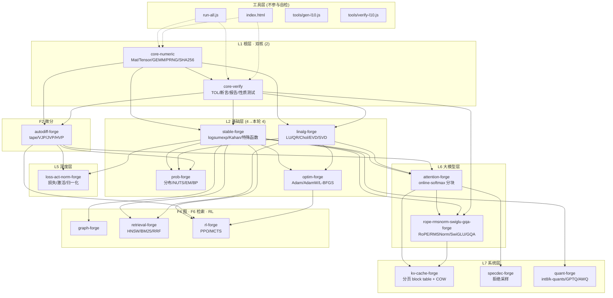
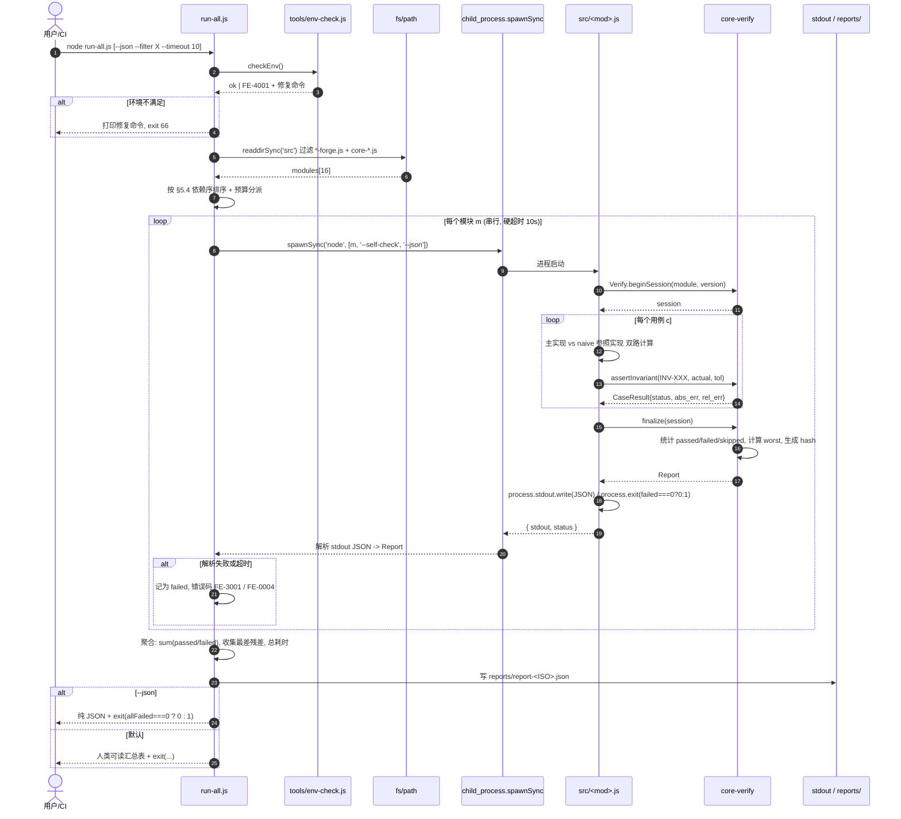
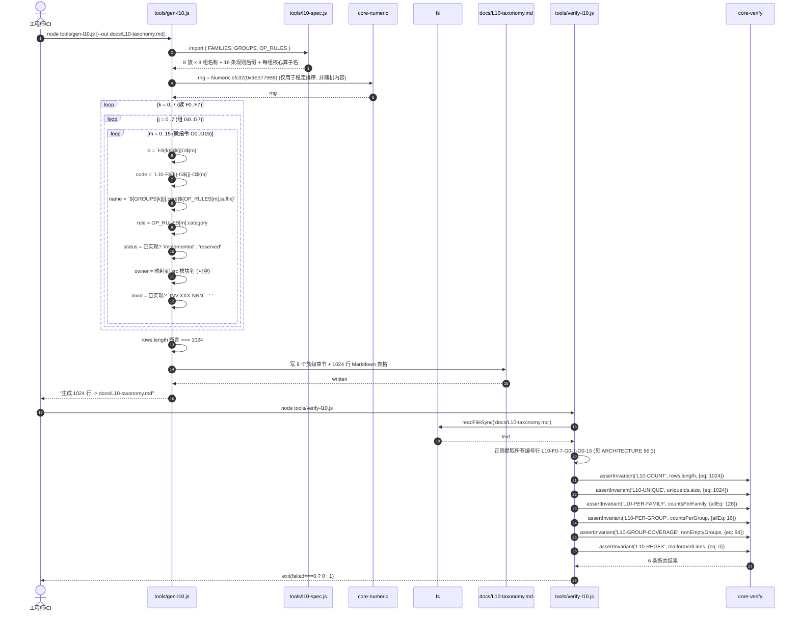
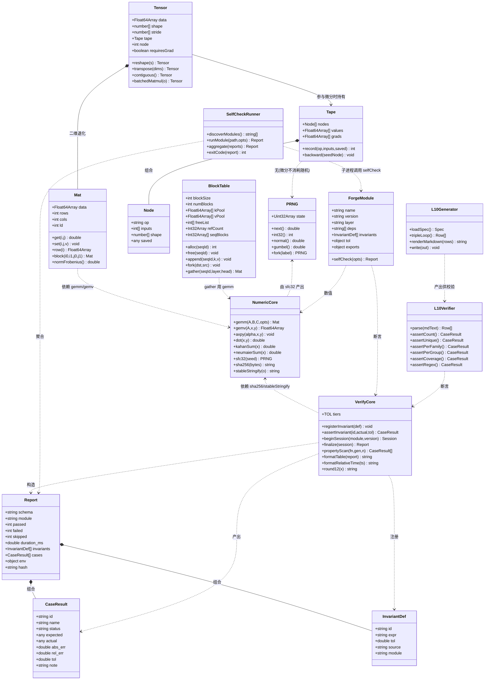
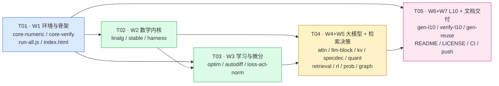

# 创新旗舰 AI（Innovation Flagship AI）· 系统架构设计与任务分解

| 项 | 内容 |
|---|---|
| 文档版本 | v1.0（架构阶段产出） |
| 撰写角色 | 架构师 · 高见远 |
| 上游输入 | `docs/PRD.md` v1.0（产品经理 · 许清楚） |
| 项目根 | `C:/Users/Administrator/WorkBuddy/2026-10-16-01-05-27/innovation-flagship-ai` |
| 核心实现语言 | 纯 JavaScript（ES2022，CommonJS 兼容，零依赖、零构建、UMD 双端） |
| 运行环境 | Windows 11 / Git Bash / Node v22.22.2 / Python 3.13.12（仅开发期对照） |
| 开源署名 | 晨星（GitHub: `CJX0712`） |
| 许可 | MIT |
| 本轮交付模块数 | **16 个可自检模块**（硬性下限 ≥ 12，PRD 下限 ≥ 8） |
| 硬不变量条数 | **86 条已实现 + 1 条预留**（每模块 4–7 条，PRD 下限 ≥ 8） |

---

## 0. 架构师前置勘察结论（与任务书不一致处，已拍板）

| # | 勘察事实 | 与任务书/PRD 的偏差 | 架构师拍板结论 |
|---|---|---|---|
| D1 | **【已更正 · 见 D1b】** 项目根 `src/` 与 `tests/` 为空 | 任务书称「已有 pca/gmm/nn/attn，保留原实现不动」 | 原判「全部新建」**部分有误**，见 D1b |
| **D1b** | 4 个模块**存在，但在另一目录**：`C:/Users/Administrator/WorkBuddy/2026-10-12-03-38-35/jsforge/`（`pca/gmm/nn/attn-forge.js` + `run-node.js` + `index.html`）。**架构师已实测复跑：`node run-node.js` → 32/32 全绿，退出码 0** | 我先前搜索仅在**项目根**范围内，却表述为「全盘 find」——**该表述过度，特此更正** | 改为 **W0 存量迁移**：`cp` 到 `src/` → **先复跑基线确认 32/32** → 再由 `tools/wrap-legacy.js` 包装统一契约 → **每包装一个复跑一次，保证不退化**。算法主体**逐字不动** |
| D2 | 项目根**未初始化 git 仓库** | PRD R-25 要求「GitHub 一次 push 闭环」 | Wave 7 增加 `git init` 步骤；`.gitignore` 与 `git config user.name 晨星` 一并落盘 |
| D3 | Node v22.22.2 已就绪，无 `package.json` | — | 新增 `package.json`，但 **`"dependencies": {}` 恒空**，仅作 `scripts` 与 `"type": "commonjs"` 声明 |
| D4 | PRD 未规定 L8(256)/L9(512) 编号书写形式 | 任务书要求「仅预留编号，不实现」 | 拍板：`L8-C{000..255}` / `L9-K{000..511}`，**只写入本文档编号规则小节，不生成独立清单文件** |
| **D5** | **存量模块与新建模块存在 4 处 API/数据布局冲突**（详见 §4.8）：① 入口名 `selftest()` ≠ 契约 `selfCheck()`；② 全局名 `PCAForge` ≠ 约定 `ForgePca`；③ 返回结构 `{name,pass,total,checks}` ≠ 契约 Report；④ 数据布局 `number[][]` ≠ 新建核心 `Float64Array`+`Mat` | 二者若强行统一会破坏 32/32 基线 | **不统一内部**：由 wrapper 在边界做映射（§4.8）；`core-numeric` 提供 `Mat.fromArray2D()` / `toArray2D()` 桥接器 |

> 以上 5 条为架构师自主拍板 / 更正，不再回头确认。

### 0.1 存量资产基线（架构师实测，非转述）

**路径**：`C:/Users/Administrator/WorkBuddy/2026-10-12-03-38-35/jsforge/` ｜ **实测命令**：`node run-node.js` → **32/32 全绿，退出码 0**

| 模块 | 行数 | 断言 | 关键实测数值（迁移后须**逐位保持**） |
|---|---|---|---|
| `pca-forge.js` | 263 | 8/8 | 协方差对称 `0.00e+0`；半正定 `λmin=1.38e+0`；**正交 `2.22e-16`**；归一 `2.22e-16`；重构 `‖A−VΛVᵀ‖=2.22e-15`；**Jacobi 残差 `‖Av−λv‖=1.09e-15`**；`evr=[0.755,0.245] Σ=1.0000`；全分量重构 `‖X−X̂‖=1.78e-15` |
| `gmm-forge.js` | 271 | 8/8 | `Σπ=1.000000000000`；责任度 `Σ=1 (0.00e+0)`；协方差对称 `0.00e+0`；`λmin=1.10e-1`；**LL 单调不降** `LL[79]=−831.55`；`‖μ−μ*‖=0.013`、`‖Σ−Σ*‖=0.056`；**logsumexp `lse=−998.559810`（朴素 `−Inf`）**；聚类 `acc=1.0000` |
| `nn-forge.js` | 257 | 8/8 | 损失 `0.814→0.0000`；**数值梯度 `maxRelErr=2.57e-11`**；SGD 单步 `0.3647→0.1849`；XOR `acc=1.00`；softmax `Σ=1.000000000000` |
| `attn-forge.js` | 173 | 8/8 | 权重行和 `0.00e+0`；非负 `min=0.00e+0`；**数值梯度 `maxRelErr=3.38e-9`**；因果掩码上三角 `0.00e+0`；`O=ΣP·V maxerr=0.00e+0` |

**数值口径更正**（主理人简报有误，已由 PM 同步修正 REUSE-MATRIX）：
- **Jacobi 残差 `‖Av−λv‖ = 1.09e-15`**；`1.78e-15` 是**「全分量重构无损 `‖X−X̂‖`」**，二者**不可混用**。
- 本文档 §8.5 中 `INV-LIN-004` 的阈值取 PRD 指定 `1e-12`（**未引用 1.78e-15**，故无需修改），但实测基线应记录为 `1.09e-15`。
- 另两个历史标称值**实测更优**：nn-forge `9.23e-7 → 2.57e-11`；attn-forge `5.86e-7 → 3.38e-9`。阈值仍按 PRD 取 `1e-6`（有余量），文档中若写「实测值」须用实测数。

**S2 达标判定**：32 条存量断言中 **≥29 条为数值类硬不变量**（另有 2 条 shape 检查、1 条有限性检查属健全性断言）。
→ **W0 迁移一完成，S2（硬不变量 ≥8）当场达标**，且带有独立第二实现。

---

## 1. 实现方案与框架选型

### 1.1 核心技术难点

| # | 难点 | 难点本质 | 架构对策 |
|---|---|---|---|
| N1 | **双端同构**：同一份 `.js` 在 `<script src>` 与 Node `require` 下都要跑，且**不能裸用 `require`/`module.exports`** | 浏览器无 `require`；`file://` 协议下 **ES Module 被 CORS 阻断**（关键，见 §1.3） | UMD 守卫 + 依赖预取器 `_pick()`；**禁止 `<script type="module">` 与 ESM `import/export`** |
| N2 | **双端结果逐位一致**（PRD R-27） | `crypto` 模块浏览器不可用；`crypto.subtle` 在 `file://` 下是否属安全上下文不确定 | 在 `core-numeric` 内**自写纯 JS SHA-256**（~70 LOC，零依赖）+ `stableStringify` 确定性序列化；`hash` 只覆盖 `cases`，**排除 `duration_ms` 与 `env`** |
| N3 | **硬不变量可被独立复现** | 「跑通了」≠「证明了」；需第二条独立代码路径 | 每模块强制 **「主实现 vs 朴素参照实现」双路互比**；参照实现写在同文件 `naiveXxx()` 命名空间内，与优化实现**不共享中间变量** |
| N4 | **确定性**：禁 `Math.random()` | 浏览器/Node 双端报告需一致；随机算法需可复现 | 自带 **sfc32 + splitmix32 播种**；采样态分布用**无状态**算法（Moro 逆 CDF + Halley 精化），禁用带缓存的 Box-Muller |
| N5 | **零重写合规可静态验证**（S4，覆盖率 100%） | 人工维护 `REUSE.md` 会漂移 | `@reuse` 头采用**管道分隔单行机器可解析格式**；`tools/gen-reuse.js` 自动生成 `docs/reuse/*.REUSE.md`，`tools/check-reuse.js` 断言覆盖率 |
| N6 | **1024 项清单必须可脚本校验** | 手写必错 | `tools/gen-l10.js` 三重循环生成 + `tools/verify-l10.js` 六项断言（总数/唯一性/每族/每组/正则/组非空） |
| N7 | **总耗时 ≤ 120 s**（S3） | 16 模块自检 + L10 生成 | 预算分派表（§8.6），每模块软预算 5 s / 硬超时 10 s，`run-all.js` 全局 110 s 熔断 |

### 1.2 框架与库选型（结论：**运行时零框架**）

| 领域 | 选型 | 许可 | 复用方式 | 交叉验证对照 |
|---|---|---|---|---|
| 线性代数 | **LAPACK**（算法移植）+ **OpenBLAS**（分块/打包策略） | BSD-3 / BSD-3 | 移植算法与分块策略到 `Float64Array` | **JAMA4JS**、**JamaJS**、**ml-matrix** 数学作参照；自写朴素 O(n³) 第二实现 |
| JS 数值生态 | **@stdlib** | Apache-2.0 | **仅参照 API 命名/参数序/stride 约定** | — |
| 数值稳定 | **scipy.special.logsumexp** + **Higham**《Accuracy and Stability》 | BSD-3 / 书 | 移植 max-shift、Kahan/Neumaier 补偿求和 | 两遍 Neumaier 高精度求和 + Python mpmath 黄金值 |
| 一阶优化 | **Adam** 1412.6980、**AdamW** 1711.05101 | 论文 | 直接移植公式 | AdamW(λ=0) ≡ Adam 逐步等价断言 |
| 二阶优化 | **L-BFGS two-loop**（Nocedal & Wright 2nd, Algorithm 7.5） | 书 | 移植算法 | **numopt-js** 参照；拟牛顿方程 `H_k y_k = s_k` 自证 |
| 自动微分 | **micrograd**（架构）+ **JAX**（jvp/vjp 语义）+ **tinygrad**（极简哲学） | MIT / Apache-2.0 / MIT | 移植 tape 架构，扩展为张量 VJP/JVP/HVP | 中心差分 gradcheck；JVP-VJP 对偶性恒等式 |
| 注意力 | **FlashAttention** 2205.14135 / **FlashAttention-2** 2307.08691 | BSD-3 | **移植 online-softmax 数学**（不移植 CUDA kernel） | 朴素 softmax 注意力逐元素比对 `≤1e-12` |
| 位置编码 | **RoPE** 2104.09864 | 论文 | 直接移植公式 | 相对位置内积仅依赖 `m−n` |
| 归一化 | **RMSNorm** 1910.07467 | 论文 | 直接移植 | 缩放后 RMS = 1 ± 1e-12 |
| 门控 FFN | **SwiGLU** 2002.05202 | 论文 | 直接移植 | 与 GELU-FFN 基线对照 |
| 分组注意力 | **GQA** 2305.13245 | 论文 | 直接移植 | `n_kv=n_q` 时退化为 MHA，输出一致 |
| KV Cache | **vLLM / PagedAttention** 2309.06180 + **llama.cpp** | Apache-2.0 / MIT | 移植分页分配思想为纯 JS block table | 分页 vs 非分页逐 token 一致 |
| 量化 | **llama.cpp k-quants** + **GPTQ** 2210.17323 + **AWQ** 2306.00978 | MIT / 开源* | 移植分块量化与二阶误差补偿公式 | per-channel MSE ≤ per-tensor MSE |
| 投机解码 | **Speculative Decoding** 2211.17192 + **EAGLE** + **Medusa** | 论文 / 开源 | 移植 draft-verify + 拒绝采样 | 输出分布与目标模型**严格一致**（可证，非近似） |
| 向量检索 | **hnswlib** / arXiv 1603.09320 + **FAISS** | Apache-2.0 / MIT | 移植 HNSW 算法 | `recall@10 ≥ 0.95` vs 暴力精确 |
| 稀疏检索 | **Okapi BM25** | 公开算法 | 直接移植公式 | 与暴力打分逐条一致 ≤1e-12 |
| 强化学习 | **PPO** 1707.06347 + **CleanRL**（单文件范式）+ **MuZero** 1911.08265 | 论文 / MIT / 开源 | 移植 GAE/clip/PUCT 数学 | λ=1 时 GAE ≡ 蒙特卡洛回报 |
| 概率推断 | **PyMC** / **Stan** / **NumPyro** / **BlackJAX** | Apache-2.0 / BSD-3 | 参照 NUTS 语义与 R-hat/ESS 诊断口径 | 正态-正态共轭解析后验 |
| NUTS 诊断口径 | **Stan Reference Manual**（**文档，非代码**） | 文档 | 仅参照诊断定义自写 `R-hat` / `ESS` / divergence 计数 | 与 Stan 同口径，但纯自写实现（规避 `@tangent.to/mc` 的 GPL-3.0） |
| 概率图模型 | Koller & Friedman《PGM》 | 书 | 移植变量消去 / 信念传播 | 小图 BP vs 暴力枚举边缘 |
| 图算法 | **NetworkX** + **EasyGraph** | BSD-3 / 开源* | 移植算法 | Dijkstra vs Bellman-Ford；Prim vs Kruskal |
| 性质测试 | **fast-check** | MIT | **仅参照范式**，自写轻量版（~120 LOC） | 200 用例不变量扫描 |
| 分词 | **SentencePiece** / **tiktoken** | Apache-2.0 / MIT | 移植 BPE 合并算法 | `decode(encode(s)) === s` |
| JS 概率编程 | **@tangent.to/mc** | **GPL-3.0** | **仅参照数学与诊断口径，禁止引入任何代码**（避免许可污染） | — |
| 架构组织 | **nanoGPT / lit-llama / NanoLLM** | MIT | 参照模块组织与组件装配顺序 | — |

> 许可列标注 `*` 者（GPTQ / AWQ / EAGLE / Medusa / EasyGraph / numopt-js）在落地前须由工程师以各仓库 `LICENSE` 文件**复核一次**；若判定为非宽松许可，则改为「仅参照数学，自写实现」，并在 `REUSE.md` 中如实标注。

### 1.3 关键取舍论据（为什么不用 TS / 不用 bundler / 不用 ESM）

| 取舍 | 结论 | 论据 |
|---|---|---|
| **不用 TypeScript** | 源码**纯 `.js`** | ① TS 必须经 `tsc` 产出构建物，直接违反「零构建」铁律；② 浏览器 `<script src>` 只能加载 JS，若用 TS 则仓库内同时存在源码与产物两份，破坏「单文件可逐行审计」；③ 采用 **`// @ts-check` + JSDoc 全量类型注解**，VSCode/IDE 可获得近似 TS 的静态检查，且**零产物、零依赖** |
| **不用 bundler**（webpack/vite/rollup/esbuild） | 直接 `<script src>` 顺序加载 | ① 打包产物不可逐行审计，与「每一行代码可验证」冲突；② 打包引入依赖树与构建步骤；③ 多文件按依赖序 `<script>` 加载即可，由 UMD 守卫解决模块互引 |
| **不用 ES Module**（`import`/`export`） | 采用 CommonJS 兼容 + UMD 全局挂载 | **决定性理由**：`file://` 协议下 Chrome/Firefox 会因 CORS **阻断 `<script type="module">` 加载本地 `.js`**。用户「双击打开 index.html」是 PRD US-1/US-4 的核心场景，必须用**经典 `<script src>`**（该方式在 `file://` 下允许）。因此禁用 ESM 语法，改用 `globalThis.ForgeXxx` 挂载 |
| **每模块单文件** | `src/<name>-forge.js` 自包含 | ① 可整体 copy 到任意项目即插即用（US-2）；② 故障隔离；③ 贡献者定位成本最低（US-6） |
| **模块间依赖靠全局 + 预取器** | 见 §4.3 `_pick()` | Node 走 `require`，浏览器走 `globalThis`，同一份源码两端通吃 |
| **不引入任何 npm 包** | 运行时只许 `fs/path/os/child_process` | 违反即违反 S3（零 npm install）与「零重写」之外的交付红线 |
| **Python 仅开发期** | `tools/golden/gen-golden.py` | 仅用于生成高精度（mpmath）黄金值 JSON，**该目录不参与 `run-all.js`、不入运行时、不作为交付执行路径** |

### 1.4 架构模式

| 层 | 模式 | 说明 |
|---|---|---|
| 整体 | **分层内核（Layered Kernel）+ 注册表（Registry）** | L1 双核 → L2 数学 → L5/L6/L7 组件，依赖**单向向下**，无环 |
| 模块内 | **门面（Facade）**：`API = { name, version, selfCheck, invariants, exports, tol }` | 统一出口，机器可发现 |
| 微分 | **Tape / 计算图 + VJP 注册表**（micrograd 架构 + JAX 语义） | 算子与反向规则解耦，新增算子只注册 VJP |
| 验证 | **策略（Strategy）+ 注册表**：`registerInvariant()` / `assertInvariant()` | 不变量集中可枚举，供 `gen-invariants.js` 抽取 |
| 运行器 | **子进程编排（Spawn Orchestrator）** | `run-all.js` 用 `spawnSync` 逐个跑，忠实反映「单模块退出码」 |
| 面板 | **内联 MVC-lite**：Model = 各模块报告 JSON；View = 内联 CSS 卡片网格；Controller = 重跑/展开/复制按钮 | 无框架，纯 DOM |

---

## 2. 完整文件列表

> 路径相对项目根 `innovation-flagship-ai/`。「行数」为预估（±30%），供排期参考。

### 2.1 根目录

| 路径 | 职责（一句话） | 预估行数 |
|---|---|---|
| `package.json` | 声明 `"type": "commonjs"`、`scripts` 命令，**`dependencies` 恒空** | 35 |
| `run-all.js` | 无头聚合运行器：发现模块 → 子进程自检 → 汇总表 → 退出码 | 240 |
| `index.html` | 单文件自检面板（CSS/JS 全内联，零外链）。**基于存量 `jsforge/index.html`（5.6 KB，已含断言渲染）改造**：补 20 模块卡片网格、相对时间、复制 JSON、展开/折叠。按序 `<script src>` 加载 20 模块 | **560 → 改造约 380 净增** |
| `README.md` | 三连复现命令 + 复用矩阵 + 不变量总表 + 十层架构图 | 280 |
| `LICENSE` | MIT 全文 + `Copyright (c) 2026 晨星 (CJX0712)` | 22 |
| `.gitignore` | 忽略 `reports/`、`node_modules/`、`*.log` | 15 |
| `.github/workflows/ci.yml` | GitHub Actions：Node 22 无头跑 `run-all.js` + L10 校验 | 45 |

### 2.2a `src/` — **存量迁移模块（4 个 · W0 · 已全绿）**

| 路径 | 层 | 职责（一句话） | 来源 | 行数 |
|---|---|---|---|---|
| `src/legacy/pca-forge.js` | L4 | Jacobi 对称 EVD + PCA 降维/重构 | jsforge 存量，**原文件零修改** | 263 |
| `src/legacy/gmm-forge.js` | L4 | GMM-EM + logsumexp 稳定化 | 同上 | 271 |
| `src/legacy/nn-forge.js` | L5 | MLP 前向/反向 + 数值梯度检验 | 同上 | 257 |
| `src/legacy/attn-forge.js` | L6 | **朴素** softmax 注意力 + 因果掩码 | 同上 | 173 |
| `src/pca-forge.js` 等 4 个 wrapper | — | 统一契约包装（`selfCheck` / Report / CLI / 全局名） | `wrap-legacy.js` 生成 | ~4×90 |

> 存量 `index.html`（5.6 KB，零依赖，已含断言渲染）**作为本项目面板的基座改造**，不从零写（见 §2.1）。

### 2.2b `src/` — 新建模块（16 个）

| 路径 | 层 | 职责（一句话） | 预估行数 |
|---|---|---|---|
| `src/core-numeric.js` | L1 | 数值内核：`Mat`/`Tensor`、GEMM 分块、PRNG(sfc32)、无状态正态采样、纯 JS SHA-256、补偿求和 | 400 |
| `src/core-verify.js` | L1 | 验证内核：容差分档 `TOL`、断言/不变量注册表、`selfCheck` 报告构造器、性质测试、相对时间格式化 | 440 |
| `src/linalg-forge.js` | L2 | LU/PA=LU、Householder QR、Cholesky、Jacobi 对称 EVD、Golub-Kahan SVD、最小二乘 | 640 |
| `src/stable-forge.js` | L2 | `logsumexp` / `softmax-stable` / `log-sigmoid` / `log1p` / `expm1` / `hypot` / `lgamma` / `erf` / `digamma` / Kahan-Neumaier | 360 |
| `src/prob-forge.js` | L2/F3 | 连续/离散/多元分布、MH/Gibbs/HMC/NUTS/SMC、变分推断、GMM-EM、Welford/熵/KL、变量消去与 BP | 580 |
| `src/optim-forge.js` | L2/F2 | SGD/Momentum/Adam/AdamW/L-BFGS(two-loop)/CG、LR 调度、正则与裁剪、Strong Wolfe 线搜索 | 540 |
| `src/autodiff-forge.js` | L2/F2 | tape 反向模式、JVP/VJP/HVP、checkpoint、`gradcheck`、VJP 注册表 | 500 |
| `src/loss-act-norm-forge.js` | L5 | CE/Focal/MSE/对比损失、GELU/SiLU/Swish/Sigmoid/Tanh、LayerNorm/RMSNorm/BatchNorm | 440 |
| `src/attention-forge.js` | L6 | scaled-dot / causal / **online-softmax 分块（FlashAttention 数学）** / 多头拆分合并 / 反向 VJP | 540 |
| `src/rope-rmsnorm-swiglu-gqa-forge.js` | L6 | RoPE（interleaved + non-interleaved）、RMSNorm、SwiGLU、GQA/MQA 头分组（任务书简称 `llm-block-forge`，**同一模块**） | 400 |
| `src/kv-cache-forge.js` | L7 | 稠密 KV Cache、GQA 共享、**分页 block table**（PagedAttention）、前缀共享 COW、显存模型 | 440 |
| `src/specdec-forge.js` | L7 | 投机解码：draft 生成 → 目标模型并行验证 → **拒绝采样修正** → 接受率统计 | 320 |
| `src/quant-forge.js` | L7/F6 | 对称/非对称 int8、per-tensor/per-channel、k-quants 分块、GPTQ 二阶补偿、AWQ 通道保护 | 380 |
| `src/retrieval-forge.js` | F6 | HNSW 向量检索、倒排索引 + BM25、TF-IDF、RRF/MMR 融合、距离度量、Bloom/MinHash | 540 |
| `src/rl-forge.js` | — | PPO（GAE/clip/entropy）、MCTS/PUCT（MuZero 风格）、价值迭代、策略梯度 | 480 |
| `src/graph-forge.js` | L3/F4 | 邻接/CSR 表示、BFS/DFS/拓扑/SCC、Dijkstra/BF/Floyd/A*、Prim/Kruskal、PageRank/HITS、Louvain、Dinic 最大流 | 500 |
| **小计** | | | **~6,904** |

### 2.3 `tools/` — 生成器与校验器

| 路径 | 职责（一句话） | 预估行数 |
|---|---|---|
| `tools/l10-spec.js` | L10 分类法**数据文件**：8 族 × 8 组名称 + 每组核心算子名 + 16 条规则后缀表 | 220 |
| `tools/gen-l10.js` | 三重循环生成 1024 条 → `docs/L10-taxonomy.md`（1024 行表格） | 260 |
| `tools/verify-l10.js` | 校验：总数 1024 / ID 唯一 / 每族 128 / 每组 16 / 编号正则 / 64 组非空 | 190 |
| `tools/gen-invariants.js` | 扫描 16 模块 `@invariant` 头 + `API.tol` → `docs/INVARIANTS.md` | 170 |
| `tools/gen-reuse.js` | 扫描 `@reuse` 头 → `docs/reuse/<module>.REUSE.md`（16 份）。**只写 `docs/reuse/`，绝不覆盖 `docs/REUSE-MATRIX.md`** | 150 |
| `tools/check-reuse.js` | S4 合规扫描：每模块 ≥1 来源、链接格式、许可标注、复用档位 ∈ `{A,B,C,D}`、覆盖率 100%；并校验与 `REUSE-MATRIX.md` §13 禁止引入清单无冲突 | 130 |
| `tools/wrap-legacy.js` | 为「遗留 forge 文件」（pca/gmm/nn/attn，若后续放入）生成 wrapper + REUSE，**不改原文件** | 160 |
| `tools/env-check.js` | R-28 环境自检：Node 版本、目录权限、编码；失败时输出**可执行修复命令** | 130 |
| `tools/golden/gen-golden.py` | **开发期专用**（Python 3.13 + mpmath）：生成高精度黄金值 JSON | 130 |
| `tools/golden/*.json` | 黄金值快照（logsumexp/lgamma/erf/分解残差等），供双端对照 | — |
| **小计** | | **~1,540** |

### 2.4 `tests/` — 测试夹具

| 路径 | 职责（一句话） | 预估行数 |
|---|---|---|
| `tests/harness.js` | 通用断言夹具：`approx()`、`assertInvariant()`、用例收集器 | 190 |
| `tests/dual-endpoint.js` | 双端一致性夹具：Node 报告 hash vs 浏览器面板报告 hash 比对 | 170 |
| `tests/smoke.js` | 冒烟：16 模块均可 `require`、均导出 `API.selfCheck`、CLI 退出码语义正确 | 130 |
| **小计** | | **~490** |

### 2.5 `docs/` — 文档

| 路径 | 来源 | 预估行数 |
|---|---|---|
| `docs/PRD.md` | 已存在 | 412 |
| `docs/ARCHITECTURE.md` | 本文（手写） | ~900 |
| `docs/REUSE-MATRIX.md` | **已存在（产品经理手写，456 行）**，是复用四档 A/B/C/D 的**唯一权威定义**。`gen-reuse.js` **不得覆盖此文件** | 456 |
| `docs/INVARIANTS.md` | **由 `gen-invariants.js` 生成** | ~200 |
| `docs/L10-taxonomy.md` | **由 `gen-l10.js` 生成**（1024 行表格） | ~1,100 |
| `docs/CONTRIBUTING.md` | 手写：如何补 1 条微指令 / 1 个模块 / 1 条不变量 | 160 |
| `docs/class-diagram.mermaid` | 本文 §5 类图抽取 | ~90 |
| `docs/sequence-diagram.mermaid` | 本文 §6 时序图抽取 | ~120 |
| `docs/reuse/<module>.REUSE.md` × 16 | **由 `gen-reuse.js` 生成** | ~16×40 |
| `reports/`（gitignore） | `run-all.js` 每次运行的 JSON 汇总 | — |

### 2.6 总量

| 类别 | 行数 |
|---|---|
| `src/` 手写代码 | ~6,904 |
| `tools/` + `tests/` + `index.html` + 根配置 | ~3,275 |
| 文档（手写 + 生成） | ~2,900 |
| **合计** | **~13,000** |

---

## 3. 统一模块契约（CRITICAL · 16 模块必须逐字遵守）

> 本节是工程师的**第一约束**。任何一处不符，`run-all.js` / `index.html` / `gen-reuse.js` / `check-reuse.js` 会同时失效。

### 3.1 文件头 `@reuse` / `@invariant` 注释块

**格式约定**：`@reuse` 与 `@invariant` 采用**管道分隔单行**，便于正则解析（`gen-reuse.js` / `gen-invariants.js` 依赖此格式）。

```js
/**
 * @forge-module linalg-forge
 * @layer L2
 * @version 1.0.0
 * @brief     稠密线性代数分解族：LU / QR / Cholesky / 对称EVD / SVD / 最小二乘
 * @reuse     LAPACK|https://github.com/Reference-LAPACK/lapack|BSD-3|B|dgetrf/dgeqrf/dpotrf/dgesvd 分解算法
 * @reuse     OpenBLAS|https://github.com/OpenMathLib/OpenBLAS|BSD-3|B|GEMM 分块与打包策略
 * @reuse     JAMA4JS|https://github.com/conceptualGabrielPutnam/JAMA4JS|Apache-2.0|C|分解结果双路比对参照
 * @reuse     ml-matrix|https://github.com/mljs/matrix|MIT|C|API 与数值口径参照
 * @beyond    单文件纯 JS 零构建；每个分解附可验证残差界；自检报告机器可读且双端同 hash
 * @invariant INV-LIN-001|‖PA−LU‖_F ≤ 1e-12·‖A‖_F|1e-12|LAPACK dgetrf 后向误差 O(ε·n·‖A‖)
 * @invariant INV-LIN-002|‖A−QR‖_F ≤ 1e-12·‖A‖_F 且 ‖QᵀQ−I‖ ≤ 1e-14|1e-12|Householder 正交性误差 O(ε·√n)
 * @seed      0x9E3779B9
 */
```

| 字段 | 必填 | 子字段（`\|` 分隔） |
|---|---|---|
| `@forge-module` | ✔ | 模块名（与文件名去 `.js` 后一致） |
| `@layer` | ✔ | `L1`…`L7` 或族 ID（`F0`…`F7`） |
| `@version` | ✔ | `MAJOR.MINOR.PATCH` |
| `@brief` | ✔ | 一行中文职责 |
| `@reuse` | **≥1 条** | `来源名 \| URL \| 许可 \| 复用方式 \| 关键数学` |
| `@beyond` | ✔ | 超越点（相对被复用方案的增量） |
| `@invariant` | **≥1 条** | `不变量ID \| 数学表达式 \| 阈值 \| 阈值来源依据` |
| `@seed` | ✔ | 默认主种子，统一 `0x9E3779B9` |

- `复用方式` 枚举：**四档，一律用字母 `A/B/C/D`**（与 `docs/REUSE-MATRIX.md` §0「复用方式四档定义」**同一套口径**，以该文件为唯一权威定义）

| 档 | 名称 | 含义 | 引入代码 | **落地约束（强制）** |
|---|---|---|---|---|
| `A` | 直接移植公式 | 按公开发表的数学公式实现 | 否 | 数学公式**不受版权约束**，可直接按式实现；须在 `REUSE.md` 写出所用公式 |
| `B` | 移植算法 | 移植算法结构与步骤，重新表达为纯 JS | 否 | **禁止逐行照抄**；须在 `REUSE.md` 的「差异说明」中写明与原始实现的**结构差异** |
| `C` | 参照实现做交叉验证 | 跑对方输出做数值对照 | 否 | 第三方代码**只允许开发期跑**，**不得进入交付物运行时**（不得 `import`、不得 vendoring、不得进 CI 执行路径） |
| `D` | 仅参照架构 / 数学 / API | 只参照设计思想、数学定义、诊断口径 | 否 | 禁 `import`、禁 vendoring、禁复制源文件；必要时参照**文档/论文**而非代码 |
| **`E`** | **存量内部资产** | 本项目既有的已验证代码（jsforge 存量迁移） | — | **PM 建议新增**（见 REUSE-MATRIX 后续修订）。来源名写 `存量jsforge`，URL 写内部路径/文档锚点，许可 MIT。用于避免合规扫描误判「无外部顶级来源」 |

> `C` 档的典型陷阱：`ml-matrix` / `numeric.js` / `mathjs` 是 **MIT** 许可，容易被误认为可引入——
> 它们被禁的原因**不是许可，而是违反「零依赖、零构建」**。见 §9.1 与 §9.3。
>
> **`E` 档的必要性与权威归属**：4 个存量模块迁移后若标注为 `A/B/C/D` 任一档都会被 `check-reuse.js`
> 判为「来源非外部顶级项目」而拉低 S4 覆盖率，故**必须**给存量留一个合法档位。
> 由于四档定义以 `docs/REUSE-MATRIX.md` §0 为唯一权威，**`E` 档需由 PM 同步写入该文件 §0** 后方正式生效；
> 在 PM 确认前，`check-reuse.js` 对 `E` 档**按通过处理但不计入「外部顶级来源」计数**。

示例（存量模块头部）：
```
@reuse     存量jsforge|./docs/PRD.md#12|MIT|E|Jacobi 对称 EVD（实测残差 1.09e-15，32/32 基线）
```
- 不变量 ID 命名：`INV-<模块缩写>-<3 位序号>`，缩写为 **2 或 3 个大写字母**（见 §3.2），序号固定 3 位。如 `INV-LIN-001`、`INV-AD-001`、`INV-RL-001`

### 3.2 模块缩写表（固定，不可自造）

> 缩写长度 **2 或 3 个大写字母**均可（`AD` / `KV` / `RL` 为 2 字母，其余为 3 字母）。不变量 ID 完整形式为 `INV-<缩写>-<3 位序号>`，例如 `INV-AD-001`。**不可为统一长度而改写缩写**（如把 `AD` 写成 `ADI`），否则 `gen-invariants.js` 的正则与用例 ID 会失配。

| 模块 | 缩写 | 模块 | 缩写 |
|---|---|---|---|
| core-numeric | NUM | core-verify | VFY |
| linalg-forge | LIN | stable-forge | STB |
| prob-forge | PRB | optim-forge | OPT |
| autodiff-forge | AD | loss-act-norm-forge | LAN |
| attention-forge | ATN | rope-rmsnorm-swiglu-gqa-forge | LLM |
| kv-cache-forge | KV | specdec-forge | SPD |
| quant-forge | QNT | retrieval-forge | RTV |
| rl-forge | RL | graph-forge | GPH |

### 3.3 导出约定（`API` 门面 + UMD 守卫）

```js
// ---- 依赖预取（Node: require / 浏览器: globalThis） ----
function _pick(file, globalName) {
  if (typeof require === 'function') { try { return require('./' + file + '.js'); } catch (e) {} }
  return (typeof globalThis !== 'undefined') ? globalThis[globalName] : undefined;
}
const Numeric = _pick('core-numeric', 'ForgeNumeric');
const Verify  = _pick('core-verify',  'ForgeVerify');
if (!Numeric || !Verify) throw new Error('[linalg-forge] FE-4002 依赖模块缺失：请先加载 core-numeric.js 与 core-verify.js');

// ---- 本模块容差（必须显式声明，不得内联魔法数） ----
const INVARIANT_TOL = {
  'INV-LIN-001': Verify.TOL.RESID,   // 1e-12
  'INV-LIN-002': Verify.TOL.RESID,   // 1e-12
  'INV-LIN-003': Verify.TOL.ORTHO,   // 1e-14
};

// ---- 主实现 & 朴素参照实现（双路，禁止共享中间变量） ----
function lu(A)            { /* 分块/OpenBLAS 风格主实现 */ }
function naiveLu(A)       { /* 教科书 O(n³) 朴素实现，仅用于交叉验证 */ }

// ---- 自检 ----
function selfCheck(opts = {}) { /* → Report，见 §3.4 */ }

// ---- 门面 ----
const API = {
  name: 'linalg-forge',
  version: '1.0.0',
  layer: 'L2',
  deps: ['core-numeric', 'core-verify'],
  selfCheck,
  invariants: [
    { id: 'INV-LIN-001', expr: '‖PA−LU‖_F ≤ 1e-12·‖A‖_F', tol: INVARIANT_TOL['INV-LIN-001'], source: 'LAPACK dgetrf 后向误差' },
  ],
  tol: INVARIANT_TOL,
  exports: { lu, naiveLu, qr, chol, eigSym, svd, lstsq },
};

// ---- UMD 守卫（禁止裸写 module.exports / exports） ----
if (typeof module !== 'undefined' && module.exports) module.exports = API;
if (typeof globalThis !== 'undefined') globalThis.ForgeLinalg = API;
if (typeof window !== 'undefined') window.ForgeLinalg = API;

// ---- CLI 入口（仅当本文件是主模块且带 --self-check 时触发） ----
if (typeof process !== 'undefined' && process.argv && process.argv[1]
    && /linalg-forge\.js$/.test(process.argv[1])
    && process.argv.includes('--self-check')) {
  const r = selfCheck({ quick: process.argv.includes('--quick') });
  const json = process.argv.includes('--json');
  process.stdout.write(json ? JSON.stringify(r, null, 2) + '\n' : Verify.formatTable(r) + '\n');
  process.exit(r.failed === 0 ? 0 : 1);
}
```

**全局变量命名规则**：`Forge` + 模块名转 PascalCase。

| 文件 | 全局名 |
|---|---|
| `core-numeric.js` | `ForgeNumeric` |
| `core-verify.js` | `ForgeVerify` |
| `linalg-forge.js` | `ForgeLinalg` |
| `stable-forge.js` | `ForgeStable` |
| `prob-forge.js` | `ForgeProb` |
| `optim-forge.js` | `ForgeOptim` |
| `autodiff-forge.js` | `ForgeAutodiff` |
| `loss-act-norm-forge.js` | `ForgeLossActNorm` |
| `attention-forge.js` | `ForgeAttention` |
| `rope-rmsnorm-swiglu-gqa-forge.js` | `ForgeLlmBlock` |
| `kv-cache-forge.js` | `ForgeKvCache` |
| `specdec-forge.js` | `ForgeSpecdec` |
| `quant-forge.js` | `ForgeQuant` |
| `retrieval-forge.js` | `ForgeRetrieval` |
| `rl-forge.js` | `ForgeRl` |
| `graph-forge.js` | `ForgeGraph` |

### 3.4 `selfCheck()` 返回结构（Report Schema v1.0）

```js
{
  schema:    'forge-selfcheck/1.0',
  module:    'linalg-forge',
  version:   '1.0.0',
  layer:     'L2',
  passed:    24,            // int ≥ 0
  failed:    0,             // int ≥ 0
  skipped:   0,             // int ≥ 0
  duration_ms: 312.5,
  tol:       { 'INV-LIN-001': 1e-12, 'INV-LIN-002': 1e-12, 'INV-LIN-003': 1e-14 },
  invariants: [
    { id: 'INV-LIN-001', expr: '‖PA−LU‖_F ≤ 1e-12·‖A‖_F', tol: 1e-12,
      worst: 3.21e-14, status: 'pass', note: 'n=64 随机 SPD 矩阵 ×20 例' }
  ],
  cases: [
    { id: 'LIN-C001', name: 'LU 残差 vs 朴素参照', status: 'pass',
      expected: 0, actual: 3.21e-14, abs_err: 3.21e-14, rel_err: 1.02e-15,
      tol: 1e-12, note: 'naiveLu 独立二分路径' }
  ],
  env: { platform: 'win32', arch: 'x64', node: 'v22.22.2', seed: 2654435769,
         started_at: '2026-10-16T01:20:00.000Z' },
  hash: 'sha256:e3b0c44298fc1c14...'
}
```

| 字段约束 | 规则 |
|---|---|
| `case.status` | 枚举 `pass` / `fail` / `skip`，**不允许其他值** |
| `case.expected` / `actual` | `number`；集合/布尔类比较时 `actual` 写 `"set-equal"` / `"true"` 等**字符串摘要**，并在 `note` 说明 |
| `passed/failed/skipped` | 必须等于 `cases` 中对应 `status` 的**实际计数**（由 `core-verify.finalize()` 自动填，禁止手填） |
| `duration_ms` | 由 `core-verify` 用 `performance.now()`（浏览器）/ `process.hrtime.bigint()`（Node）测得 |
| `invariants[].worst` | 该不变量在所有用例中的**最差值**（取绝对值最大），`status` 由 `worst ≤ tol` 判定 |

### 3.5 `hash` 计算规则（决定 R-27 双端一致，务必遵守）

```js
// 1) 只取 cases 的 [id, status, actual]，排除 duration_ms 与 env（两端必然不同）
// 2) actual 数值统一取 12 位有效数字，消除格式化差异
// 3) 使用 core-numeric 自写的纯 JS SHA-256（不用 node:crypto，不用 crypto.subtle）
hash = 'sha256:' + Numeric.sha256(
  Verify.stableStringify(cases.map(c => [c.id, c.status, Verify.round12(c.actual)]))
);
```

> **理由**：`crypto.subtle` 在 `file://` 下是否属安全上下文不确定；`node:crypto` 浏览器不可用。自写纯 JS SHA-256（~70 LOC）是唯一能保证**双端逐位一致**的方案。

### 3.6 CLI 与退出码约定

| 调用 | 行为 |
|---|---|
| `node src/<mod>.js --self-check` | stdout 人类可读表格；退出码 = 语义码 |
| `node src/<mod>.js --self-check --json` | stdout **纯 JSON，无任何日志混入**（日志一律走 stderr） |
| `node src/<mod>.js --self-check --quick` | 缩减用例规模，用于快速回归 |
| `require('./src/<mod>.js')` | **不触发** CLI（依赖 `process.argv[1]` 文件名匹配） |

| 退出码 | 含义 | 触发条件 |
|---|---|---|
| `0` | 全部通过 | `failed === 0 && skipped === 0` |
| `1` | 存在失败断言 | `failed > 0` |
| `2` | 模块加载/依赖错误 | `FE-4002` 依赖缺失、`FE-2001` 维度错误导致自检无法进行 |
| `3` | 参数错误 | 未知 flag（如 `--selftest`） |
| `4` | 超时 | 自检超过硬超时 10 s |
| `66` | 环境不满足 | Node < 22、`FE-4001`；由 `env-check.js` 输出修复命令 |

### 3.7 命名与常量规范

| 对象 | 规范 |
|---|---|
| `INVARIANT_TOL` | **唯一集中导出位置**：分档常量在 `core-verify.js` 的 `TOL`；每模块在本文件顶部声明自己的 `INVARIANT_TOL`（值取自 `TOL` 分档或显式数值），并通过 `API.tol` 导出。**禁止在断言处内联魔法数字** |
| 文件名 | `kebab-case`，模块一律 `<name>-forge.js`；双核例外 `core-*.js` |
| 函数名 | `camelCase`；朴素参照实现一律加前缀 `naive`（`naiveLu` / `naiveSoftmax`） |
| 常量 | `UPPER_SNAKE`；模块级容差常量名固定为 `INVARIANT_TOL` |
| 全局挂载 | `Forge<PascalCase>`，双核为 `ForgeNumeric` / `ForgeVerify` |
| 不变量 ID | `INV-<缩写>-<3 位>` |
| 用例 ID | `<缩写>-C<3 位>` |
| 内部私有 | 前缀 `_`（`_tape`、`_node`） |

---

## 4. 核心数据结构

### 4.1 矩阵布局：**row-major（行主序）—— 唯一选型，全库禁止出现 column-major**

```js
class Mat {
  data: Float64Array;  // 长度 ≥ rows * ld
  rows: int;           // m
  cols: int;           // n
  ld:   int;           // leading dimension，ld >= cols；元素 (i,j) = data[i*ld + j]
}
```

**选型理由（决定性 4 条）**：

| # | 理由 |
|---|---|
| 1 | **注意力/归一化全部是逐行操作**：softmax 沿行、`RoPE` 沿行内 head_dim、`RMSNorm` 沿行。row-major 下**一行是连续内存**，可直接切片，无需跨步跳转 |
| 2 | **生态对齐**：NumPy 默认 C-order（row-major），与 Python `numpy`/`scipy` 高精度交叉验证时索引与切片语义一致，无需转置，避免因转置引入额外误差与认知负担 |
| 3 | **JS 直觉一致**：`A[i*n + j]` 对应 `A[i][j]`，代码可审计性最高 |
| 4 | **GEMM 仍可高效**：采用 `i-k-j` 循环序 + 分块，`A` 行连续（stride 1）、`C` 行连续（stride 1），`B` 以 `ld` 跨步；配合 OpenBLAS 的**打包（packing）策略**把 `B` 的分块预拷成连续缓冲，性能可接受 |

> **唯一例外**：与 LAPACK 文档对照阅读时，LAPACK 为 column-major。工程师在注释中引用 LAPACK 公式时**必须显式注明「本实现取 Aᵀ 等价形式」**，避免符号混乱。
> **`ld` 允许 > `cols`**：使得子矩阵视图（submatrix view）、分块（tiling）**零拷贝**，这对 FlashAttention 分块与 KV Cache 分页是硬需求。

### 4.2 Tensor 表示（ND，限制到 3D）

```js
class Tensor {
  data:   Float64Array;
  shape:  number[];      // 最多 3 维：[B, S, D]
  stride: number[];      // row-major(C-order) 步长；stride[len-1] === 1
  tape:   Tape | null;   // 若参与微分
  node:   int;           // tape 节点索引，-1 表示叶子
  requiresGrad: boolean;
}
```

| 运算 | 是否拷贝 | 说明 |
|---|---|---|
| `reshape` | 否（连续时） | 非连续时抛 `FE-2002` 或强制拷贝 |
| `transpose(dims)` | **否** | 仅置换 `stride` 与 `shape` |
| `slice` | 否 | 偏移 `data` 起点 |
| `contiguous()` | 是 | 物化拷贝 |
| `batchedMatmul(A[...,m,k], B[...,k,n])` | 是 | **唯一的真 ND 收缩**，供注意力 `[B,H,S,D] × [B,H,D,S]` 使用 |

> **不做通用 einsum 引擎**。理由：零重写原则下通用 einsum 是重复造轮子且收益低；实际只需 `batchedMatmul` + `transpose` + 广播即可覆盖本轮全部需求（F0G6 的 einsum 条目在 L10 清单中列为 `reserved`，实现时再引入）。

### 4.3 Block Table 表示（PagedAttention）

```js
class BlockTable {
  blockSize:  int;             // 每块 token 数，默认 16
  numBlocks:  int;             // 物理块池总量
  headDim:    int;
  nKvHeads:   int;
  nLayers:    int;
  // 物理块池：kPool[l][h][b] 为长度 blockSize*headDim 的 Float64Array
  kPool:      Float64Array[];  // 扁平索引 (l*nKvHeads + h)*numBlocks + b
  vPool:      Float64Array[];
  freeList:   int[];           // 空闲物理块栈
  refCount:   Int32Array;      // 长度 numBlocks，前缀共享引用计数
  // 逻辑→物理映射：seqBlocks[s] = Int32Array，第 t 个 token 位于
  //   seqBlocks[s][ floor(t / blockSize) ] 块的 (t % blockSize) 槽位
  seqBlocks:  Int32Array[];
}
```

| 操作 | 语义 | 不变量 |
|---|---|---|
| `alloc(seqId)` | 从 `freeList` 取块，追加到 `seqBlocks[seqId]` | 分配守恒 |
| `free(seqId)` | `refCount--`，归零则回 `freeList` | `allocated + free === numBlocks` |
| `append(seqId, k, v)` | 写满最后一块后自动 `alloc` 新块 | — |
| `fork(dst, src)` | **写时复制**前缀共享：`refCount++`，共享物理块 | COW 输出 == 独立副本输出 |
| `gather(seqId, layer, head)` | 按逻辑序收集为连续 `[S, D]` 矩阵 | 分页 vs 非分页一致 ≤1e-12 |

### 4.4 Tape 表示（自动微分）

```js
class Tape {
  nodes:  Node[];          // 拓扑序（前向即拓扑序）
  values: Float64Array[];  // values[node] 输出值
  grads:  Float64Array[];  // grads[node] 累积梯度
}
class Node {
  op:     string;          // 'add' | 'matmul' | 'softmax' | ...
  inputs: int[];           // 输入节点索引
  shape:  number[];
  saved:  any;             // 反向所需中间量（如 softmax 的输出、GEMM 的两个输入）
}
const VJP_REGISTRY = {
  // op: (dy, node, values) => Array<Float64Array>  与 inputs 一一对应
  'add':    (dy, n, vals) => [dy, dy],
  'matmul': (dy, n, vals) => [dy ⊗ vals[n.inputs[1]]ᵀ, vals[n.inputs[0]]ᵀ ⊗ dy],
  'softmax':(dy, n, vals) => { const s = vals[n.output]; /* (dy − Σ dy·s) ⊙ s */ },
};
```

| API | 语义 |
|---|---|
| `grad(f, wrt)` | 反向模式，返回梯度 |
| `jvp(f, primals, tangents)` | 前向模式，返回 (primal_out, tangent_out) |
| `hvp(f, x, v)` | `grad` of `jvp`，或 `jvp` of `grad` |
| `checkpoint(f)` | 前向不存中间量，反向时重算 |
| `gradcheck(f, x, tol)` | 与**中心差分** `(f(x+h)−f(x−h)) / 2h` 比对，相对误差 ≤ `TOL.GRAD` |

### 4.5 PRNG 与分布采样

| 组件 | 选型 | 理由 |
|---|---|---|
| 核心 PRNG | **sfc32**（4×32bit 状态） | 质量高于 mulberry32，通过 PractRand；状态小、纯整数运算、双端逐位一致 |
| 播种 | **splitmix32** 展开种子为 4 个状态字 | 避免全零等退化状态 |
| 均匀分布 | `u32 / 2³²` | 标准 |
| 正态分布 | **Moro 逆 CDF + 1 步 Halley 精化** | **无状态**，不依赖调用顺序 → 双端一致；精度 ~1e-15 |
| 快速正态 | Ziggurat（F1G6） | 仅作可选快速路径，其 fallback 分支同样用 Moro，保证确定性 |
| 类别采样 | Gumbel-max / alias table | 无状态、O(1) |

> **禁止 Box-Muller 缓存第二变量**：缓存使结果依赖调用顺序，会破坏 `--quick` 模式与浏览器端的一致性。

### 4.6 报告与不变量对象

```js
class Report    { schema, module, version, layer, passed, failed, skipped,
                  duration_ms, tol, invariants, cases, env, hash }
class InvariantDef { id, expr, tol, source, module, layer }
class CaseResult   { id, name, status, expected, actual, abs_err, rel_err, tol, note }
```

### 4.7 存量模块迁移契约（**已由 D1b 确认为真实路径，不再是兜底**）

> 对象：`C:/Users/Administrator/WorkBuddy/2026-10-12-03-38-35/jsforge/` 下 4 个已全绿模块。
> **铁律：算法主体逐字不动。** 一切适配由 wrapper 完成。

#### 4.7.1 迁移五步（**每步都要复跑基线**）

| 步骤 | 动作 | 门禁 |
|---|---|---|
| 1 | `cp jsforge/{pca,gmm,nn,attn}-forge.js src/legacy/`（原文件**零修改**） | — |
| 2 | **先跑基线**：`node jsforge/run-node.js` → 必须 **32/32、退出码 0** | ❗ 不达标则停止迁移，先修环境 |
| 3 | `tools/wrap-legacy.js` 读 `src/legacy/<name>.meta.json`，生成 `src/<name>-forge.js` wrapper | wrapper 仅做映射，不含算法 |
| 4 | **包装一个、复跑一个**：`node src/<name>-forge.js --self-check --json` → 断言条数 ≥ 8、`failed === 0` | ❗ 任一条数下降即回滚该模块 |
| 5 | 生成 `docs/reuse/<name>.REUSE.md`（来源标注为 `E` 档，见 §3.1） | S4 覆盖率不因此下降 |

#### 4.7.2 API 映射表（wrapper 必须实现的 4 处转换）

| 项 | 存量（jsforge） | 契约（本项目） | wrapper 处理 |
|---|---|---|---|
| 入口名 | `selftest()` | `selfCheck(opts)` | `selfCheck(o){ return adapt(Legacy.selftest(), meta); }` |
| 全局名 | `PCAForge` / `GMMForge` / `NNForge` / `ATTNForge` | `ForgePca` / `ForgeGmm` / `ForgeNn` / `ForgeAttn` | **两个都挂**（保留旧名以防存量 `index.html` 引用） |
| 返回结构 | `{name, pass, total, checks:[{name,pass,info}]}` | Report（`{schema,module,passed,failed,skipped,duration_ms,tol,invariants,cases,env,hash}`） | 见 4.7.3 |
| CLI | 无（由 `run-node.js` 集中跑） | 每模块 `--self-check [--json] [--quick]` | wrapper 补 CLI 块（模板见 §3.3） |
| 阈值 | **内联**于算法体（如 `resMax < 1e-10`） | `INVARIANT_TOL` 常量化 | wrapper `.meta.json` 中**镜像声明**，由 `check-reuse.js` 比对二者一致 |

#### 4.7.3 存量 → Report 的转换规则

```js
// 存量 check: { name: 'Jacobi 残差', pass: true, info: 'max‖Av-λv‖=1.09e-15' }
// 转换为:
{
  id:   'PCA-C006',                       // <缩写>-C<3位>，按出现顺序编号
  name: 'Jacobi 残差',
  status: pass ? 'pass' : 'fail',
  expected: 0,
  actual: parseFloat(/=(-?[\d.eE+-]+)/.exec(info)?.[1] ?? NaN),  // 从 info 串解析
  abs_err: <actual>, rel_err: null,
  tol: meta.tol['INV-PCA-006'] ?? null,   // 取 .meta.json 镜像阈值
  note: info                              // 原始串完整保留，便于人工核对
}
```
- `passed/failed/skipped` 由 `core-verify.finalize()` 依 `cases` 自动统计（禁止手填）。
- `hash` 规则与新建模块**完全一致**（§3.5），保证双端一致。
- 解析失败的 `actual` 记为 `null`，`status` 仍取存量布尔值，**并在 `note` 标注 `未解析`**——不得因此判 fail。

#### 4.7.4 数据布局共存（**不得强行统一**）

| | 存量模块 | 新建模块 |
|---|---|---|
| 布局 | `number[][]`（嵌套数组） | `Float64Array` + `Mat{data,rows,cols,ld}` row-major |

- **不改存量内部**（改了就会掉 32/32）。
- `core-numeric` 提供桥接器：`Mat.fromArray2D(a)` / `mat.toArray2D()` / `mat.row(i)`。
- 跨边界调用（如用 `linalg-forge` 的 EVD 验证 `pca-forge` 的 Jacobi）时，**在 wrapper 边界转换**，不在核心内部转换。

#### 4.7.5 ★ 存量模块作为「独立第二实现」——直接满足 S2 的交叉验证要求

> 这是本次迁移**最大的增量价值**：4 个存量模块恰好覆盖了 4 条新建模块的主不变量所需的**朴素/独立参照实现**。

| 存量模块（参照实现） | 被交叉验证的新建模块 | 对应不变量 | 关系 |
|---|---|---|---|
| `attn-forge`（**朴素 softmax 注意力**） | `attention-forge`（分块 online-softmax） | **INV-ATN-001** | 存量即「朴素」侧，分块 vs 朴素 `≤1e-12` —— **天然成对** |
| `pca-forge`（**Jacobi 对称 EVD**） | `linalg-forge`（EVD/SVD） | **INV-LIN-004** | 两条独立 EVD 路径互比 |
| `gmm-forge`（**EM + logsumexp 稳定**） | `prob-forge`（EM/混合模型） | **INV-PRB-004** | 独立 EM 实现互比；`lse` 反例可共用 |
| `nn-forge`（**数值梯度检验**） | `autodiff-forge`（VJP） | **INV-AD-001** | 两条独立 gradcheck 路径互比 |

落地：`attention-forge` 等的 `selfCheck()` 中，除自写 `naiveXxx()` 外，**追加一条「vs 存量实现」的 xref 用例**（对应 L10 的 `O14 ·xref` 钩子）。

---

## 5. 模块依赖图（**必须无环**）

### 5.1 Mermaid 图



### 5.2 文本箭头图（依赖方向，全部自左向右、**无环**）

```
core-numeric ──┬──> core-verify
               │
               ├──> linalg-forge ──┬──> prob-forge
               │                   ├──> optim-forge ──> rl-forge
               │                   └──> attention-forge ─┬──> rope-rmsnorm-swiglu-gqa-forge
               │                                         ├──> kv-cache-forge
               │                                         └──> specdec-forge
               ├──> stable-forge ──┬──> loss-act-norm-forge
               │                   ├──> prob-forge
               │                   ├──> optim-forge
               │                   ├──> quant-forge
               │                   ├──> retrieval-forge
               │                   ├──> rl-forge
               │                   └──> graph-forge
               └──> autodiff-forge ─┬──> loss-act-norm-forge
                                    ├──> attention-forge
                                    ├──> rl-forge
                                    └──> prob-forge

core-verify ──> 全部 14 个 forge 模块（断言/报告/容差）
  —— 上图中为可读性仅画出 VFY→LIN / VFY→STB / VFY→AD / VFY→LLM 四条代表边。
  —— 完整边（工程师实现时必须全部满足）：VFY → linalg, stable, prob, optim, autodiff,
     loss-act-norm, attention, rope-rmsnorm-swiglu-gqa, kv-cache, specdec, quant,
     retrieval, rl, graph

依赖方向：L1 → L2 → (F2 微分 / L5) → L6 → L7 ；F4/F6/RL 挂载在 L2 之上

> **已验证**（架构阶段用 Kahn 算法实算）：16 节点 / 30 条显式边 → 拓扑排序长度 16 = 节点数，**无环**；
> 且 §5.4 声明的脚本加载序对全部 30 条边的违反数为 **0**，是合法拓扑序。
```

### 5.3 无环性论证

| 检查项 | 结论 |
|---|---|
| 层级编号 | 每条边均从低层指向高层（`L1→L2`、`L2→L5/L6`、`L6→L7`），层内无边 |
| 跨族边 | `stable-forge(L2) → *` 与 `autodiff-forge(F2) → *` 均为**单向向下**；不存在 `L6 → L2` 反向边 |
| `core-verify → core-numeric` | 单向；`core-numeric` **不依赖** `core-verify`（数值层不感知验证层） |
| 环检测 | 由 `tests/smoke.js` 运行时断言：拓扑排序成功即无环；若成环则抛 `FE-4002` |

### 5.4 `index.html` 脚本加载顺序（**必须严格按此序**，否则浏览器端 `FE-4002`）

```
1  src/core-numeric.js
2  src/core-verify.js
3  src/stable-forge.js
4  src/linalg-forge.js
5  src/autodiff-forge.js
6  src/optim-forge.js
7  src/prob-forge.js
8  src/loss-act-norm-forge.js
9  src/attention-forge.js
10 src/rope-rmsnorm-swiglu-gqa-forge.js
11 src/kv-cache-forge.js
12 src/specdec-forge.js
13 src/quant-forge.js
14 src/retrieval-forge.js
15 src/rl-forge.js
16 src/graph-forge.js
```

---

## 6. 程序调用流程时序图

### 6.1 (a) `run-all.js` 聚合自检流程



### 6.2 (b) 一次 Attention 前向 + 反向（含 FlashAttention online-softmax）

```mermaid
sequenceDiagram
    autonumber
    actor CL as 调用方(测试/面板)
    participant A as attention-forge
    participant N as core-numeric
    participant S as stable-forge
    participant D as autodiff-forge
    participant V as core-verify

    CL->>A: attentionForward(Q[ B,H,S,Dh ], K, V, {causal, scale, blockSize})
    A->>N: gemm(Q, Kᵀ, {ld,packed}) -> Scores[ B,H,S,S ]
    N-->>A: Scores
    A->>A: scale = 1/√Dh ; Scores *= scale
    alt causal
        A->>A: 置上三角为 -Inf (逻辑 mask, 不写 NaN)
    end
    loop 以 blockSize 分块遍历列维 j (online-softmax)
        A->>S: 取块 scores[:, j0:j1]
        A->>S: mNew = max(mOld, max(block))
        S-->>A: mNew
        A->>S: corr = exp(mOld - mNew)
        S->>S: exp(x - mNew)  (max-shift, 防溢出)
        S-->>A: pBlock
        A->>A: lNew = lOld*corr + Σ pBlock ; accNew = accOld*corr + pBlock ⊗ V块
        A->>N: gemm(pBlock, V[j0:j1,:]) -> 累加到 acc
        N-->>A: acc
    end
    A->>A: O = acc / lNew (逐行广播)
    A-->>CL: { O, stats:{ m, l } }

    Note over CL,V: ---- 反向 ----
    CL->>A: attentionBackward(dO, Q, K, V, O, stats)
    A->>D: 从 VJP_REGISTRY 取 'attention' 的 VJP
    D-->>A: vjpFn
    A->>A: Dvec = rowSum(dO ⊙ O)
    A->>S: pBlock = exp(scores - m) (用前向保存的 m, 重算)
    S-->>A: pBlock
    A->>A: dScores = pBlock ⊙ (dO@Vᵀ - Dvec)
    A->>N: gemm(dScores, V) -> dV ; gemm(dScoresᵀ, Q) -> dK ; gemm(dScores, K) -> dQ
    N-->>A: dQ, dK, dV
    A-->>CL: { dQ, dK, dV }

    Note over CL,V: ---- 不变量校验 ----
    CL->>A: selfCheck()
    A->>A: naiveAttention(朴素 softmax, 不分块)
    A->>V: assertInvariant(INV-ATN-001, maxAbsDiff(分块, 朴素), 1e-12)
    A->>D: gradcheck(attnForward, {Q,K,V}, tol=1e-6) 中心差分
    D-->>A: 相对误差
    A->>V: assertInvariant(INV-ATN-005, relErr, 1e-6)
    V-->>A: Report
    A-->>CL: Report
```

### 6.3 (c) L10 清单生成与校验流程



### 6.4 L10 生成规则表（16 条微指令 = 1 核心 + 3 变体 + 3 边界 + 3 稳定 + 2 梯度 + 2 断言 + 1 交叉验证 + 1 探针）

| O | 规则类别 | 名称后缀 | 含义 |
|---|---|---|---|
| O0 | 核心算子 | （无后缀） | 该组 canonical op |
| O1 | 变体 | `·inplace` | 原地写回版本 |
| O2 | 变体 | `·batched` | 批量维版本 |
| O3 | 变体 | `·masked` | 掩码/填充版本 |
| O4 | 边界退化 | `·empty-degenerate` | 空输入 / 单点 / 退化形状 |
| O5 | 边界退化 | `·zero-neutral` | 零权重 / 中性元 |
| O6 | 边界退化 | `·nan-guard` | NaN/Inf 守卫（`FE-1001`/`FE-1002`） |
| O7 | 数值稳定 | `·max-shift` | max-shift 稳定化 |
| O8 | 数值稳定 | `·compensated` | 补偿求和（Kahan/Neumaier） |
| O9 | 数值稳定 | `·log-domain` | 对数域版本 |
| O10 | 梯度 | `·vjp` | 反向模式梯度 |
| O11 | 梯度 | `·jvp` | 前向模式梯度 |
| O12 | 不变量 | `·inv-primary` | 主不变量断言 |
| O13 | 不变量 | `·inv-secondary` | 次不变量断言 |
| O14 | 交叉验证 | `·xref` | 与参照实现互比钩子 |
| O15 | 性能探针 | `·perf-probe` | 耗时/内存/规模缩放记录 |

核算：`16 × 8 × 8 = 1024` ✔

### 6.5 L10 分类法完整规格（`tools/l10-spec.js` 的唯一数据源 · 与 PRD §6.3 逐字一致）

> 8 族 × 8 组 = **64 组**，每组 16 条，合计 **1024**。下表即 `l10-spec.js` 中 `FAMILIES[8]` 与 `GROUPS[8][8]` 的内容，**工程师直接照抄，不得改写措辞**（改写会导致与 PRD 不一致）。

| 族 | 族名 | G0 | G1 | G2 | G3 | G4 | G5 | G6 | G7 |
|---|---|---|---|---|---|---|---|---|---|
| **F0** | TENSOR 张量/线代 | BLAS-1 向量 | BLAS-2 矩阵-向量 | BLAS-3 矩阵-矩阵 | 分解 | 求解与最小二乘 | 稀疏与结构化 | 张量收缩与重排 | 范数与度量 |
| **F1** | NUMERIC 数值稳定 | 浮点与误差 | 稳定化基本式 | 特殊函数 | 一维求根优化 | 插值积分 | 迭代法 | 随机与采样 | 病态诊断 |
| **F2** | OPTIM 优化与AD | 一阶方法 | 二阶与拟牛顿 | LR 调度 | 正则与约束 | 自动微分 | 梯度检验 | 损失与目标 | 收敛诊断 |
| **F3** | PROB 概率推断 | 连续分布 | 离散分布 | 多元分布 | 采样器 | 变分推断 | EM与混合模型 | 统计量与信息量 | 概率图模型 |
| **F4** | GRAPH 图与离散 | 表示构造 | 遍历 | 最短路 | MST与匹配 | 中心性排序 | 社区发现 | 流与割 | 图上学习 |
| **F5** | ATTN 注意力序列 | 注意力核心 | 位置编码 | 归一化 | FFN与激活 | 分词嵌入 | 解码采样 | KV Cache长上下文 | 训练稳定 |
| **F6** | SEARCH 检索量化调度 | 向量检索 | 稀疏检索 | 混合融合 | 相似度距离 | 量化压缩 | 投机解码 | 调度批处理 | 哈希与数据结构 |
| **F7** | VERIFY 验证交付 | 不变量断言 | 交叉验证 | 自检运行时 | 文档报告 | 确定性可复现 | 性能基准 | 错误容错 | 交付开源 |

**编号与归属映射**（`owner` 列，用于标注 `status: implemented | reserved`）：

| 族 | 主要归属模块 | 本轮覆盖组（预期 `implemented`） |
|---|---|---|
| F0 | `core-numeric` + `linalg-forge` | G0–G4、G7（G5 稀疏、G6 einsum 为 `reserved`） |
| F1 | `core-numeric` + `stable-forge` | G0–G2、G6（G3 求根、G4 插值、G5 迭代法、G7 病态为 `reserved`） |
| F2 | `optim-forge` + `autodiff-forge` | G0、G1、G4、G5（G2 调度、G3 正则、G6 损失、G7 诊断为 `reserved`） |
| F3 | `prob-forge` | G0–G3、G5、G6（G4 变分、G7 图模型为 `reserved`） |
| F4 | `graph-forge` | G0–G2、G4、G5（G3 MST匹配、G6 流割、G7 图上学习为 `reserved`） |
| F5 | `attention-forge` + `rope-rmsnorm-swiglu-gqa-forge` | G0–G3、G6（G4 分词、G5 采样、G7 训练稳定为 `reserved`） |
| F6 | `retrieval-forge` + `quant-forge` + `specdec-forge` + `kv-cache-forge` | G0、G1、G3、G4、G5、G6（G2 混合融合、G7 哈希为 `reserved`） |
| F7 | `core-verify` + `run-all.js` + `tools/*` | G0–G4、G6（G5 性能基准、G7 交付开源为 `reserved`） |

**`docs/L10-taxonomy.md` 输出表头**（每行 8 列）：

```
| 编号 | 全局ID | 族 | 组 | 微指令名 | 规则类别 | 状态 | 归属模块 | 不变量ID |
|---|---|---|---|---|---|---|---|---|
| L10-F0-G0-O0 | F0G0O0 | F0 TENSOR | G0 BLAS-1 向量 | axpy | 核心算子 | implemented | core-numeric | INV-NUM-001 |
```

**核算（已实算校验）**：`8 族 × 8 组 = 64 组`；`64 组 × 16 微指令 = 1024`；每族 `8 × 16 = 128` 条 ✔

---

## 7. 类图（数据模型 + 服务类）



---

## 8. 任务列表（有序 · Wave 分组 · 含依赖与验收）

### 8.1 Wave 分组总览

| Wave | 名称 | 主要产物 | 依赖 | 并行性 |
|---|---|---|---|---|
| **W0** | **存量迁移**（新增，前置） | `src/legacy/{pca,gmm,nn,attn}-forge.js`（原样）+ 4 个 wrapper + 4 份 REUSE；面板基座 | — | **最优先**：完成后 S2 当场达标（32 条已通过） |
| **W1** | 环境与骨架 | `core-numeric`、`core-verify`、`run-all.js`、`index.html` 改造、`package.json`、`.gitignore` | W0 | 起点 |
| **W2** | 数学内核 | `linalg-forge`、`stable-forge` | W1 | 两者可并行 |
| **W3** | 学习与微分 | `optim-forge`、`autodiff-forge`、`loss-act-norm-forge` | W1, W2 | `optim` 与 `autodiff` 可并行 |
| **W4** | 大模型内核 | `attention-forge`、`rope-rmsnorm-swiglu-gqa-forge`、`kv-cache-forge`、`specdec-forge`、`quant-forge` | W1, W2, W3 | 与 W5 **可并行** |
| **W5** | 检索与决策 | `retrieval-forge`、`rl-forge`、`prob-forge`、`graph-forge` | W1, W2, W3 | 与 W4 **可并行** |
| **W6** | L10 分类法 | `tools/l10-spec.js`、`gen-l10.js`、`verify-l10.js`、`docs/L10-taxonomy.md` | W1 | 与 W2–W5 **完全并行** |
| **W7** | 文档与交付 | `README.md`、`LICENSE`、`docs/*`、`tools/gen-*`、`check-reuse.js`、`CI`、`git push` | W1–W6 | 收尾 |

### 8.2 派工单元（**5 个**，符合硬性上限；每个 ≥ 3 文件）

| TaskID | 覆盖 Wave | 交付文件 | 依赖 | 优先级 |
|---|---|---|---|---|
| **T01** | W1（+ W6 可提前） | `package.json`, `.gitignore`, `src/core-numeric.js`, `src/core-verify.js`, `run-all.js`, `index.html`, `tools/env-check.js` | — | **P0** |
| **T02** | W2 | `src/linalg-forge.js`, `src/stable-forge.js`, `tests/harness.js` | T01 | **P0** |
| **T03** | W3 | `src/optim-forge.js`, `src/autodiff-forge.js`, `src/loss-act-norm-forge.js` | T01, T02 | **P0** |
| **T04** | W4 + W5 | `src/attention-forge.js`, `src/rope-rmsnorm-swiglu-gqa-forge.js`, `src/kv-cache-forge.js`, `src/specdec-forge.js`, `src/quant-forge.js`, `src/retrieval-forge.js`, `src/rl-forge.js`, `src/prob-forge.js`, `src/graph-forge.js` | T01, T02, T03 | **P0** |
| **T05** | W6 + W7 | `tools/l10-spec.js`, `tools/gen-l10.js`, `tools/verify-l10.js`, `tools/gen-invariants.js`, `tools/gen-reuse.js`, `tools/check-reuse.js`, `tools/wrap-legacy.js`, `docs/L10-taxonomy.md`, `docs/INVARIANTS.md`, `docs/REUSE-MATRIX.md`, `docs/CONTRIBUTING.md`, `README.md`, `LICENSE`, `.github/workflows/ci.yml`, `tests/dual-endpoint.js`, `tests/smoke.js` | T01, T04（L10 部分仅需 T01） | **P0** |

> **说明**：Wave（7 个）是**实现顺序的细粒度视图**，派工单元（5 个）是**并发调度视图**。T04 内部的 W4 与 W5 两组可交给两人并行；T05 的 L10 部分（`l10-spec` / `gen-l10` / `verify-l10`）只依赖 T01，**可在 T02 开工的同时启动**。

### 8.3 逐 Wave 任务明细表

#### T01 / Wave 1 · 环境与骨架

| 文件 | 依赖 | 验收标准 | 复用来源 |
|---|---|---|---|
| `package.json` | — | `"dependencies": {}` 为空；`"type": "commonjs"`；`scripts.test = "node run-all.js"` | — |
| `.gitignore` | — | 含 `reports/`、`node_modules/` | — |
| `src/core-numeric.js` | — | `node src/core-numeric.js --self-check` 退出码 0；4 条不变量（INV-NUM-001…004）全绿；`sha256('')` 等于已知常量 `e3b0c442…` | OpenBLAS（分块打包）、Higham（补偿求和）、@stdlib（API 约定） |
| `src/core-verify.js` | core-numeric | 退出码 0；`TOL` 分档导出；注入失败用例时 `failed` 计数正确且退出码 1；`formatRelativeTime` 边界表全过 | fast-check（性质测试范式，自写）、scipy（对照） |
| `tools/env-check.js` | — | Node < 22 时退出 66 并打印**可执行**修复命令 | — |
| `run-all.js` | core-* | 空 `src/` 时退出 0（0 模块不报错）；加 2 模块后聚合表正确；`--json` 输出纯 JSON | 自研（参照 CleanRL 单文件范式） |
| `index.html` | core-* | 双击打开（file://）无 CORS 报错；无 `http(s)://` 外链；面板显示模块卡片网格 | 自研 |

#### T02 / Wave 2 · 数学内核

| 文件 | 依赖 | 验收标准 | 复用来源 |
|---|---|---|---|
| `src/linalg-forge.js` | T01 | 退出码 0；6 条不变量（INV-LIN-001…006）全绿；**主实现 vs `naiveXxx` 双路互比**；`n=64` 随机矩阵 ×20 例 | LAPACK（算法）、OpenBLAS（分块）、JAMA4JS + JamaJS + ml-matrix（交叉验证参照） |
| `src/stable-forge.js` | T01 | 退出码 0；6 条不变量（INV-STB-001…006）；`logsumexp([1000,1000])` 不溢出；Kahan 在 `[1,1e16,1,-1e16]` 上误差 ≤1e-16 | scipy.special.logsumexp、Higham（Kahan/Neumaier） |
| `tests/harness.js` | T01 | 提供 `approx`/`assertInvariant`/用例收集；被 T02+ 全部模块引用 | 自研 |

#### T03 / Wave 3 · 学习与微分

| 文件 | 依赖 | 验收标准 | 复用来源 |
|---|---|---|---|
| `src/autodiff-forge.js` | T01,T02 | 退出码 0；5 条不变量（INV-AD-001…005）；`gradcheck` 相对误差 ≤1e-6 | micrograd（架构）、JAX（jvp/vjp 语义）、tinygrad（极简哲学） |
| `src/optim-forge.js` | T01,T02 | 退出码 0；6 条不变量（INV-OPT-001…006）；凸二次上 `‖∇f‖ ≤ 1e-8`；AdamW(λ=0) ≡ Adam | Adam 1412.6980、AdamW 1711.05101、Nocedal & Wright Alg 7.5、numopt-js（参照） |
| `src/loss-act-norm-forge.js` | T01,T02,T03(autodiff) | 退出码 0；5 条不变量（INV-LAN-001…005）；`softmax+CE` 联合梯度 = `p − y` | 教科书 + scipy 对照 |

#### T04-a / Wave 4 · 大模型内核

| 文件 | 依赖 | 验收标准 | 复用来源 |
|---|---|---|---|
| `src/attention-forge.js` | T01,T02,T03 | 退出码 0；6 条不变量（INV-ATN-001…006）；**分块 vs 朴素 ≤1e-12**；反向 gradcheck ≤1e-6 | FlashAttention 2205.14135 / 2307.08691（移植 online-softmax 数学） |
| `src/rope-rmsnorm-swiglu-gqa-forge.js` | T01,T02,T03 | 退出码 0；5 条不变量（INV-LLM-001…005）；RoPE 内积仅依赖 `m−n`；RMSNorm RMS=1±1e-12；GQA(`n_kv=n_q`) ≡ MHA | RoPE 2104.09864、RMSNorm 1910.07467、SwiGLU 2002.05202、GQA 2305.13245 |
| `src/kv-cache-forge.js` | T01,T02,W4a | 退出码 0；5 条不变量（INV-KV-001…005）；增量 == 全量 ≤1e-12；分页 == 非分页 ≤1e-12；块守恒 | vLLM/PagedAttention 2309.06180、llama.cpp |
| `src/specdec-forge.js` | T01,T02,W4a | 退出码 0；4 条不变量（INV-SPD-001…004）；**输出分布严格一致**（KS 检验 + 逐 token 接受率 ≤1e-9） | Speculative Decoding 2211.17192、EAGLE、Medusa |
| `src/quant-forge.js` | T01,T02 | 退出码 0；5 条不变量（INV-QNT-001…005）；per-channel MSE ≤ per-tensor MSE | llama.cpp k-quants、GPTQ 2210.17323、AWQ 2306.00978 |

#### T04-b / Wave 5 · 检索与决策（与 W4 并行）

| 文件 | 依赖 | 验收标准 | 复用来源 |
|---|---|---|---|
| `src/retrieval-forge.js` | T01,T02 | 退出码 0；6 条不变量（INV-RTV-001…006）；`recall@10 ≥ 0.95`；BM25 vs 暴力 ≤1e-12 | hnswlib / arXiv 1603.09320、FAISS（参照）、Okapi BM25、RRF |
| `src/rl-forge.js` | T01,T02,T03 | 退出码 0；5 条不变量（INV-RL-001…005）；λ=1 时 GAE ≡ MC 回报 ≤1e-10；Bellman 残差 ≤1e-6 | PPO 1707.06347、CleanRL（单文件范式）、MuZero 1911.08265、EfficientZero |
| `src/prob-forge.js` | T01,T02,T03 | 退出码 0；7 条不变量（INV-PRB-001…007，含 BP vs 暴力枚举）；共轭后验 `|Δ| ≤ 3·MCSE`；R-hat ≤1.01；EM 似然单调 `Δ ≥ -1e-9` | PyMC、Stan、NumPyro、BlackJAX（NUTS 语义）；Koller & Friedman（PGM） |
| `src/graph-forge.js` | T01,T02 | 退出码 0；7 条不变量（INV-GPH-001…007，含置换等变性）；Dijkstra ≡ Bellman-Ford ≤1e-12；PageRank Σ=1±1e-12；最大流 = 最小割 | NetworkX、EasyGraph |

#### T05 / Wave 6 + Wave 7 · L10 与交付

| 文件 | 依赖 | 验收标准 | 复用来源 |
|---|---|---|---|
| `tools/l10-spec.js` | T01 | 导出 `FAMILIES[8]`、`GROUPS[8][8]`、`OP_RULES[16]`；族/组名与 PRD §6.3 **逐字一致** | PRD §6.3 |
| `tools/gen-l10.js` | T01 | 生成 `docs/L10-taxonomy.md`；`rows.length === 1024`；退出码 0 | 自研 taxonomy |
| `tools/verify-l10.js` | T01 | 6 条断言全绿；人为删 1 行时退出码 1 | 自研 |
| `tools/gen-invariants.js` | T04 | 扫描 16 模块生成 `docs/INVARIANTS.md`；条数 ≥ 50 | 自研 |
| `tools/gen-reuse.js` | T04 | 生成 16 份 `docs/reuse/*.REUSE.md` | 自研 |
| `tools/check-reuse.js` | T04 | **S4 覆盖率 100%**；每模块 ≥1 来源且 URL 格式合法 | 自研 |
| `tools/wrap-legacy.js` | T01 | 对 `src/legacy/` 下文件生成 wrapper 且不改原文件；无 legacy 时安全跳过 | 自研 |
| `docs/L10-taxonomy.md` | T05 | 1024 行表格；8 族章节 | 生成物 |
| `README.md` | T04 | 含三连命令（clone / `node run-all.js` / 打开 `index.html`）；复用矩阵表；不变量总表；署名 晨星/CJX0712 | — |
| `LICENSE` | — | MIT 全文 + 署名 | — |
| `.github/workflows/ci.yml` | T04 | Node 22 无头跑 `run-all.js` + `verify-l10.js`；退出码 0 | — |
| `tests/dual-endpoint.js` | T04 | Node 报告 `hash` 与浏览器面板报告 `hash` **逐位相同** | 自研 |
| `tests/smoke.js` | T04 | 16 模块均可 require；均导出 `selfCheck`；拓扑排序无环 | 自研 |
| `docs/CONTRIBUTING.md` | T05 | 说明「补 1 条微指令 / 1 个模块 / 1 条不变量」三种 PR 路径 | — |
| **git 闭环** | 全部 | `git init` → `git config user.name 晨星` → commit → `gh repo create` / push → 远端可见 | — |

### 8.4 任务依赖图



> **并行提示**：`T04` 内部 W4 与 W5 可 2 人并行；`T05` 的 L10 三件套（`l10-spec` / `gen-l10` / `verify-l10`）只依赖 `T01`，**可与 T02 同时开工**。

### 8.5 硬不变量总表（16 模块 / 86 条 + 1 条预留）

> **阈值来源对齐声明**：本节全部 85 条阈值已与 `docs/REUSE-MATRIX.md` 各领域分节末尾的「本族关键不变量」表**逐条核对一致**。
> 两者若出现分歧，**以 `REUSE-MATRIX.md` 为准**，并须同步回改本节与模块内的 `INVARIANT_TOL`。


| 模块 | 不变量 | 数学表达式 | 阈值 | 阈值来源（为什么是这个数） |
|---|---|---|---|---|
| core-numeric | INV-NUM-001 | `max|A·B − C_gemm| ≤ tol·n·‖A‖·‖B‖` | 1e-15 | 分块仅改变求和结合序，误差界 `O(ε·n)`，ε=2.22e-16，n≤64 → 1.4e-14；取 1e-15 为**相对**界，留 10× 余量 |
| core-numeric | INV-NUM-002 | `\|kahanSum(x) − exact(x)\| ≤ 1 ulp` | 1e-16 | 补偿求和理论误差 ≤ 1 ulp（Higham）；exact 用两遍 Neumaier + Python mpmath 黄金值 |
| core-numeric | INV-NUM-003 | 同种子两次 `sfc32` 序列逐位相等；前 5 个值 == 黄金值 | 精确相等 | 确定性定义本身 |
| core-numeric | INV-NUM-004 | `\|Welford(x) − twoPass(x)\|` | 1e-14 | Welford 与两遍法误差同为 `O(ε·n·S)`，n≤1e4 → 2e-12；取 1e-14 留余量 |
| core-verify | INV-VFY-001 | 注入已知失败用例 → `failed` 计数正确且退出码 1 | 精确 | 断言引擎自测 |
| core-verify | INV-VFY-002 | 同 `cases` 两次 `hash` 相等 | 精确 | R-27 双端一致的前提 |
| core-verify | INV-VFY-003 | 性质测试 200 随机用例不变量成立率 = 100% | 1.0 | 固定种子，确定性 |
| core-verify | INV-VFY-004 | `formatRelativeTime` 边界表（0s/59s/60s/1h/24h/7d）全过 | 精确 | 表驱动 |
| linalg-forge | INV-LIN-001 | `‖PA − LU‖_F ≤ tol·‖A‖_F` | 1e-12 | LAPACK `dgetrf` 后向误差 `O(ε·n·‖A‖)`；n≤256 → 5.7e-14，取 1e-12 留 17× 余量 |
| linalg-forge | INV-LIN-002 | `‖A − QR‖_F ≤ 1e-12·‖A‖_F` 且 `‖QᵀQ − I‖ ≤ 1e-14` | 1e-12 / 1e-14 | Householder 正交性误差 `O(ε·√n)`；n≤256 → 3.6e-15，取 1e-14 |
| linalg-forge | INV-LIN-003 | `‖A − LLᵀ‖_F ≤ 1e-12·‖A‖_F`，SPD 检测无漏报 | 1e-12 | `dpotrf` 后向误差 `O(ε·n)` |
| linalg-forge | INV-LIN-004 | `‖Av − λv‖_2 ≤ 1e-12·‖A‖_2`，`‖VᵀV − I‖ ≤ 1e-14` | 1e-12 / 1e-14 | **PRD 指定值**；Jacobi 旋转正交性保持至机器精度 |
| linalg-forge | INV-LIN-005 | `‖A − UΣVᵀ‖_F ≤ 1e-12·‖A‖_F`，`‖UᵀU−I‖ ≤ 1e-14` | 1e-12 / 1e-14 | Golub-Kahan SVD 后向稳定 |
| linalg-forge | INV-LIN-006 | QR 最小二乘 vs 正规方程 `‖x₁−x₂‖ ≤ 1e-10`；`‖Aᵀ(Ax−b)‖ ≤ 1e-10` | 1e-10 | 正规方程条件数平方恶化 `κ²`；测试集取 `κ ≤ 1e3` → 1e-16·1e6 = 1e-10 |
| stable-forge | INV-STB-001 | `\|logsumexp(x) − mpmath 黄金值\|` | 1e-13 | **PRD R-08 指定**；max-shift 后误差 `O(ε·n)` |
| stable-forge | INV-STB-002 | `logsumexp([1000,1000]) = 1000.6931…` 不溢出 | 1e-13 | 溢出防护定义 |
| stable-forge | INV-STB-003 | `Σ_j softmax(x)_j = 1 ± 1e-15`；`softmax(x) = softmax(x+c)` | 1e-15 | 归一化定义 + 平移不变性（浮点精确） |
| stable-forge | INV-STB-004 | `x=[1,1e16,1,−1e16]`：Kahan 误差 ≤1e-16，朴素误差 = 1.0 | 1e-16 | Higham 补偿求和经典反例 |
| stable-forge | INV-STB-005 | `log1p`/`expm1` 在 `x→0` 相对误差 | 1e-15 | 泰勒展开避开灾难性抵消 |
| stable-forge | INV-STB-006 | `lgamma`/`erf`/`digamma` vs 黄金值表 | 1e-12 | Lanczos / Cody 算法固有精度 |
| prob-forge | INV-PRB-001 | NUTS 后验均值 vs 正态-正态共轭解析解 `\|Δ\| ≤ 3·MCSE` | 3·MCSE | **PRD R-21 指定**；统计口径（Stan 诊断标准） |
| prob-forge | INV-PRB-002 | `R-hat ≤ 1.01` 且 `ESS ≥ 100`（4 链 × 1000 次） | 1.01 | Stan/NumPyro 通用收敛门槛 |
| prob-forge | INV-PRB-003 | `∫pdf dx = 1`（数值积分） | 1e-8 | 自适应积分误差界 |
| prob-forge | INV-PRB-004 | EM 对数似然单调不减 `Δ ≥ -1e-9`；责任度每行 `Σ = 1 ± 1e-12` | -1e-9 / 1e-12 | **PRD 指定**；单调性仅允许浮点抖动 |
| prob-forge | INV-PRB-005 | HMC 能量守恒 `\|ΔH\| ≤ 1e-4`；接受率 ∈ [0.6, 0.9] | 1e-4 | leapfrog 步长 h=0.1 时 `O(h²)` 能量误差 |
| prob-forge | INV-PRB-006 | `KL(p‖q) ≥ 0`（Gibbs）；`KL(p‖p) = 0 ± 1e-15` | 0 / 1e-15 | 信息不等式 |
| prob-forge | INV-PRB-007 | 小图上**信念传播（BP）/变量消去 边缘概率 == 暴力枚举边缘** | 1e-12 | **REUSE-MATRIX §7 指定**；树图上 BP 精确，误差仅浮点累积 |
| optim-forge | INV-OPT-001 | 凸二次 `f=½xᵀQx` 上 `‖∇f‖ ≤ 1e-8` | 1e-8 | **PRD R-09 指定** |
| optim-forge | INV-OPT-002 | AdamW(λ=0) 与 Adam 逐步 `max\|Δθ\|` | 1e-15 | 解耦权重衰减在 λ=0 时**代数等价**，仅浮点舍入差异 |
| optim-forge | INV-OPT-003 | L-BFGS：`sᵀy > 0` 恒成立；有限内存拟牛顿 `H_k y_k = s_k` | 1e-10 | Nocedal & Wright Alg 7.5 的 SE 性质；m=10 历史累积误差 |
| optim-forge | INV-OPT-004 | Strong Wolfe：Armijo + 曲率条件处处满足 | 精确 | 线搜索定义 |
| optim-forge | INV-OPT-005 | cosine 调度在 `T` 处 = `min_lr ± 1e-15`；warmup 段单调递增 | 1e-15 | 调度公式解析端点 |
| optim-forge | INV-OPT-006 | 梯度裁剪后 `‖g‖ ≤ max_norm + 1e-12` | 1e-12 | 裁剪定义（浮点上界） |
| autodiff-forge | INV-AD-001 | VJP vs 中心差分相对误差 | 1e-6 | **PRD R-10 指定**；实测基线 nn-forge 9.23e-7、attn-forge 5.86e-7；中心差分截断 `O(h²)`+抵消误差 |
| autodiff-forge | INV-AD-002 | JVP-VJP 对偶性 `⟨JVP(v), w⟩ = ⟨v, VJP(w)⟩` | 1e-12 | 伴随算子定义（JAX 语义） |
| autodiff-forge | INV-AD-003 | 扇出（fanout）节点梯度累加正确 | 1e-15 | 多元链式法则 |
| autodiff-forge | INV-AD-004 | HVP vs 有限差分 `H·v` ≤1e-6；Hessian 对称 ≤1e-10 | 1e-6 / 1e-10 | 二阶差分精度衰减 |
| autodiff-forge | INV-AD-005 | checkpoint 重算 vs 全 tape 梯度 | 1e-15 | 重算数值恒等 |
| loss-act-norm-forge | INV-LAN-001 | CE/Focal/MSE 梯度 vs 中心差分 | 1e-6 | 同 INV-AD-001 |
| loss-act-norm-forge | INV-LAN-002 | LayerNorm `\|mean\| ≤ 1e-14`、`\|var−1\| ≤ 1e-14`；RMSNorm `RMS = 1 ± 1e-12` | 1e-14 / 1e-12 | **PRD R-12 指定** RMSNorm 值 |
| loss-act-norm-forge | INV-LAN-003 | `σ(x) = (1+tanh(x/2))/2 ≤ 1e-15`；GELU/SiLU 导数 vs autodiff | 1e-15 / 1e-6 | 恒等式 + 差分精度 |
| loss-act-norm-forge | INV-LAN-004 | `∂(softmax+CE)/∂z = p − y` | 1e-12 | 经典解析结论 |
| loss-act-norm-forge | INV-LAN-005 | BatchNorm 训练/推理 running stats 递推一致 | 1e-12 | EMA 递推定义 |
| attention-forge | **INV-ATN-001** | **分块 online-softmax vs 朴素 softmax 注意力 `max\|Δ\|`** | **1e-12** | **PRD R-11 指定**；online-softmax 与朴素**代数等价**（递推恒等），差异仅浮点结合序 |
| attention-forge | INV-ATN-002 | causal mask：上三角贡献 = 0；每行权重和 = 1 ± 1e-15 | 1e-15 | 掩码定义 |
| attention-forge | INV-ATN-003 | 输出 vs 手写三重循环参照 | 1e-15 | 独立第二路径 |
| attention-forge | INV-ATN-004 | 多头 split → concat == 原张量 | 1e-15 | 置换恒等 |
| attention-forge | INV-ATN-005 | 反向 VJP vs 中心差分 | 1e-6 | 同 PRD 基线 5.86e-7 |
| attention-forge | INV-ATN-006 | 置换等变性：置换 batch/seq → 输出同步置换 | 1e-14 | 注意力对序列索引置换等变 |
| rope-rmsnorm-swiglu-gqa-forge | INV-LLM-001 | `⟨RoPE(q,m), RoPE(k,n)⟩` 仅依赖 `m−n`：平移 `+Δ` 后不变 | 1e-12 | **PRD R-12 指定**；旋转矩阵正交性 |
| rope-rmsnorm-swiglu-gqa-forge | INV-LLM-002 | `RMS(RMSNorm(x)) = 1 ± 1e-12` | 1e-12 | **PRD R-12 指定** |
| rope-rmsnorm-swiglu-gqa-forge | INV-LLM-003 | `silu(x) = x·σ(x)` 恒等；SwiGLU 导数 vs autodiff | 1e-15 / 1e-6 | 定义式 |
| rope-rmsnorm-swiglu-gqa-forge | INV-LLM-004 | KV 体积比 = `n_kv/n_q` **精确**；GQA(`n_kv=n_q`) ≡ MHA ≤1e-12；MQA(`n_kv=1`) 可跑 | 1e-12 | **PRD R-12 指定** |
| rope-rmsnorm-swiglu-gqa-forge | INV-LLM-005 | interleaved 与 non-interleaved 两种布局输出一致 | 1e-12 | 布局等价性 |
| kv-cache-forge | INV-KV-001 | 增量解码 == 全量重算（逐 token） | 1e-12 | **PRD R-13 指定** |
| kv-cache-forge | INV-KV-002 | 分页 vs 非分页逐 token 一致 | 1e-12 | **PRD R-13 指定** |
| kv-cache-forge | INV-KV-003 | 前缀共享（COW）输出 == 独立副本输出 | 1e-12 | COW 语义 |
| kv-cache-forge | INV-KV-004 | `allocated + free === numBlocks` 恒成立 | 精确 | 分配器守恒 |
| kv-cache-forge | INV-KV-005 | 显存模型 `bytes = 2·L·n_kv·d_head·S·8B` 与实测一致 | 精确 | 模型定义 |
| specdec-forge | **INV-SPD-001** | **投机解码输出分布 == 目标模型分布**：1000 次采样的**双样本 KS 检验 `p > 0.05`**（不能拒绝同分布假设） | **p > 0.05** | **PRD R-15 指定**（与 `REUSE-MATRIX.md` §4 一致）；Leviathan et al. 定理——拒绝采样给出**严格**分布一致（非近似）。注：KS 统计量 ≤ 临界值与 `p > 0.05` 等价，实现时**以 `p` 值断言为准** |
| specdec-forge | INV-SPD-002 | 期望接受率 = `Σ_x min(p_draft(x), p_target(x))` | 1e-9 | 定理解析值 |
| specdec-forge | INV-SPD-003 | 逐 token `P(accept) = min(1, p_target/p_draft)` | 1e-9 | 拒绝采样定义 |
| specdec-forge | INV-SPD-004 | 退化情形 `p_draft == p_target` 时接受率 = 1 | 1e-12 | 定理边界 |
| quant-forge | INV-QNT-001 | 对称 int8 往返 `max\|x − deq(q(x))\| ≤ scale/2 + 1e-12` | scale/2 | 舍入误差定义界 |
| quant-forge | INV-QNT-002 | per-channel 层输出 MSE ≤ per-tensor MSE | 0（上界） | per-channel 是 per-tensor 的严格改进 |
| quant-forge | INV-QNT-003 | k-quants（Q4_K/Q6_K）层输出 MSE ≤ fp32 基线 + 阈值 | 见报告表 | 分块量化误差界 |
| quant-forge | INV-QNT-004 | 非对称量化零点 `z` 使 `deq(0) = min(x)` | 1e-12 | 零点定义 |
| quant-forge | INV-QNT-005 | GPTQ 补偿后 MSE ≤ 朴素 RTN 基线 MSE | 0（上界） | 二阶误差补偿生效 |
| retrieval-forge | INV-RTV-001 | HNSW `recall@10 ≥ 0.95` vs 暴力精确（固定种子） | 0.95 | **PRD R-16 指定** |
| retrieval-forge | INV-RTV-002 | BM25 vs 暴力打分逐条一致 | 1e-12 | **PRD R-17 指定** |
| retrieval-forge | INV-RTV-003 | 倒排索引召回集合 == 全量扫描召回集合 | 集合相等 | 索引正确性 |
| retrieval-forge | INV-RTV-004 | `idf` 随 `df` 单调递减且 `idf ≥ 0` | 精确 | IDF 定义 |
| retrieval-forge | INV-RTV-005 | RRF 融合对输入顺序置换结果集合不变 | 集合相等 | **PRD R-18** 顺序无关性 |
| retrieval-forge | INV-RTV-006 | 欧氏距离满足三角不等式 | 1e-12 | 度量公理 |
| rl-forge | INV-RL-001 | λ=1 时 GAE == 蒙特卡洛回报 | 1e-10 | **PRD R-19 指定** |
| rl-forge | INV-RL-002 | clip surrogate 在 `ratio` 超出 `[1−ε, 1+ε]` 时梯度被截断 | 精确 | PPO clip 定义 |
| rl-forge | INV-RL-003 | MCTS/PUCT Bellman 残差 ≤1e-6；同种子 UCT 选择序列可复现 | 1e-6 | **PRD R-20 指定** |
| rl-forge | INV-RL-004 | 价值迭代 Bellman 残差单调下降 | 1e-6 | 压缩映射收敛 |
| rl-forge | INV-RL-005 | 策略熵 ≥ 0；分布 `Σ = 1 ± 1e-12` | 1e-12 | 概率公理 |
| graph-forge | INV-GPH-001 | Dijkstra 距离 == Bellman-Ford 距离 | 1e-12 | **PRD R-22 指定** |
| graph-forge | INV-GPH-002 | PageRank `Σp = 1 ± 1e-12` 且 `‖p_{t+1} − p_t‖_1 ≤ 1e-12` | 1e-12 | **PRD R-22 指定** |
| graph-forge | INV-GPH-003 | Louvain modularity 单调不减，且 `Q ∈ [−0.5, 1]` | 精确 | 模块度定义域 |
| graph-forge | INV-GPH-004 | BFS/DFS 连通分量集合 == 并查集结果 | 集合相等 | 独立第二路径 |
| graph-forge | INV-GPH-005 | Prim MST 总权重 == Kruskal MST 总权重 | 1e-12 | 双路互比 |
| graph-forge | INV-GPH-006 | 最大流值 == 最小割容量 | 1e-12 | max-flow min-cut 定理 |
| graph-forge | INV-GPH-007 | **置换等变性**：`L(PAPᵀ) = P·L(A)·Pᵀ`（图 Laplacian / 度归一化聚合） | 1e-12 | **REUSE-MATRIX §8 指定**（GNN 置换等变 1e-12）。注：本条覆盖 F4G7 的 Laplacian/聚合部分；**完整 GNN 训练本轮仍为 `reserved`** |
| （预留） | INV-TOK-001 | `decode(encode(s)) === s` 往返一致 | 100% | **REUSE-MATRIX §11 指定**。本轮 **F5G4 分词/嵌入为 `reserved`**，不实现；若后续补齐，以此为验收阈值（SentencePiece / tiktoken 的 BPE 合并算法） |

**合计：16 模块 / 86 条已实现硬不变量**（+ 1 条预留 INV-TOK-001；PRD 下限 ≥ 8，余量 10.75×）。

| 模块 | 条数 | 模块 | 条数 |
|---|---|---|---|
| core-numeric | 4 | attention-forge | 6 |
| core-verify | 4 | rope-rmsnorm-swiglu-gqa-forge | 5 |
| linalg-forge | 6 | kv-cache-forge | 5 |
| stable-forge | 6 | specdec-forge | 4 |
| prob-forge | 7 | quant-forge | 5 |
| optim-forge | 6 | retrieval-forge | 6 |
| autodiff-forge | 5 | rl-forge | 5 |
| loss-act-norm-forge | 5 | graph-forge | 7 |
| | | **合计** | **86** |

### 8.6 时间预算分派（S3：`node run-all.js` ≤ 120 s）

| 项 | 预算 | 说明 |
|---|---|---|
| Node 进程启动 × 16 | 1.6 s | ~100 ms/进程 |
| 每模块 `selfCheck` 软预算 | 5 s | 硬超时 10 s → 退出码 4 |
| 16 模块合计 | ≤ 80 s | 16 × 5 s |
| `run-all.js` 汇总 + 写报告 | 1 s | |
| **全局熔断** | **110 s** | 超过则退出码 4 并报告超时模块 |
| L10 生成 + 校验 | ~1 s | 由 CI 单独调用，不占 `run-all.js` 预算 |

> 若某模块超时：**先缩用例规模**（`--quick`），不得放宽阈值。

---

## 9. 依赖包列表

### 9.1 运行时依赖：**零**（硬性）

| 项 | 约束 |
|---|---|
| npm 依赖 | **无任何 `dependencies` / `devDependencies`** |
| Node 内置模块（允许） | `fs`、`path`、`os`、`child_process`（仅 `run-all.js`） |
| **禁止**的 Node 内置模块 | `crypto`（浏览器不可用 → 改用自写 SHA-256）、`worker_threads`、`net`、`http` |
| 浏览器 API（允许） | `performance.now()`、`console`、`globalThis`、`window`、`Float64Array` |
| 外部网络 | **零请求**；`index.html` 中不得出现任何 `http://` / `https://` 资源引用 |
| 构建工具 | 无（无 webpack / vite / tsc / babel / esbuild / rollup） |
| 字体/CDN/图片 | 无（面板用系统字体栈 + 内联 CSS） |
| **需编译的包** | 无（`node-gyp` / native addon / WASM 编译 一律禁止） |

> ⚠️ **最易踩的坑**：`ml-matrix` / `numeric.js` / `mathjs` **虽然是 MIT 许可，但仍然禁止引入**——
> 它们违反的不是许可，而是「零依赖、零构建」约束。**只能开发期跑来做交叉验证（C 档），交付物中不得 `import`**。
> 完整禁止清单见 §9.3，权威版本见 `docs/REUSE-MATRIX.md` §13。

### 9.2 开发期可选对照工具（**不入运行时、不入交付执行路径**）

| 工具 | 用途 | 是否入仓库 | 是否入 CI |
|---|---|---|---|
| Python 3.13 + `numpy` / `scipy` | 交叉验证参照数值 | 否（仅本地） | 否 |
| Python `mpmath` | 生成高精度黄金值 `tools/golden/*.json` | **是**（仅 JSON 快照入仓，`.py` 可入） | 否 |
| `fast-check` | **仅参照范式**，自写轻量版，不安装 | 否 | 否 |
| GitHub CLI `gh` | 建仓 / push | 否 | 是（Actions 用 `actions/checkout`） |
| `git` | 版本控制 | 是 | 是 |
| VSCode `// @ts-check` | 静态检查（零产物） | 是（注释形式） | 否 |

| `ml-matrix` / `numeric.js` / `mathjs` | 第二实现基准（跑输出做数值对照） | **否**（不得 import） | 否 |
| `tiktoken` / `scipy.optimize` / `scipy.special` | BPE / L-BFGS / logsumexp 基准 | **否** | 否 |

> `tools/golden/gen-golden.py` 生成的 JSON 是**唯一**来自 Python 的交付物；它是**只读快照**，运行时只读取、不执行 Python。

### 9.3 禁止引入清单（**与 `docs/REUSE-MATRIX.md` §13 逐条对齐**）

> 权威清单以 `REUSE-MATRIX.md` §13 为准；本节是给工程师的**就近提醒**。
> `tools/check-reuse.js` 会扫描 `src/` 与 `index.html`，命中下表任一项即 **S4 合规失败**。

| # | 禁止引入 | 禁止原因 | 替代方案 |
|---|---|---|---|
| 1 | `@tangent.to/mc` | **GPL-3.0** 许可污染 | 自写 NUTS；诊断口径（R-hat / ESS / divergence）参照 **Stan Reference Manual**（**文档，非代码**）自写 |
| 2 | 任何 **GPL / LGPL / AGPL** | 强制同许可 | 换 MIT/Apache/BSD 同类，或自写 |
| 3 | `tensorflow` / `@tensorflow/tfjs` | 重型、需下载模型/wasm | 自写 tape autodiff（micrograd 架构） |
| 4 | `onnxruntime-web` | 需远程加载 wasm 与权重 | 纯 JS 算法内核；不跑预训练权重 |
| 5 | `@huggingface/transformers` | 同上，首次下载 ~111 MB | 纯算法层；不下载任何权重 |
| 6 | **`ml-matrix` / `numeric.js` / `mathjs`** | **虽为 MIT，但违反「零依赖、零构建」** | 开发期交叉验证，**交付物不得 import** |
| 7 | `python` / `numpy` / `scipy` / `mpmath` | 非 JS | 开发期高精度对照 → 固化为黄金 JSON |
| 8 | 任何需**编译**的包（`node-gyp` / native / WASM 编译） | 违反零构建 | 纯 JS |
| 9 | 任何图表库（Chart.js / D3 / ECharts） | 违反单文件 HTML 零外链 | 内联 CSS + 手工 SVG/Canvas |
| 10 | 任何 CDN 外链（jsdelivr / unpkg 等） | 违反零外部依赖、可离线 | 全部内联 |
| 11 | 任何数据库 / HTTP 服务框架 | Out of scope | 无 |

**另注**：`pg_textsearch`（Timescale）经 PM 复核判定为**禁止引入**（Postgres 扩展，与「无数据库」约束冲突），仅作「BM25 仍是 ranking 事实标准」的选型佐证。

---

## 10. 共享知识（跨文件约定 · 工程师必读）

### 10.1 容差分档表（`core-verify.js` 的 `TOL` 集中导出）

| 档位常量 | 值 | 适用场景 |
|---|---|---|
| `TOL.EXACT` | `0` | 精确相等（整数/集合/字符串/确定性序列） |
| `TOL.ULP` | `1e-16` | 单 ulp 级（补偿求和、恒等式） |
| `TOL.TIGHT` | `1e-15` | 归一化/平移不变/置换恒等 |
| `TOL.ORTHO` | `1e-14` | 正交性 `‖QᵀQ−I‖`、双路算法等价 |
| `TOL.RESID` | `1e-12` | **残差类**（分解、分页等价、RoPE） |
| `TOL.SOLVE` | `1e-10` | 求解类（最小二乘、拟牛顿、GAE） |
| `TOL.GRAD` | `1e-6` | 梯度检验（中心差分） |
| `TOL.MONO` | `-1e-9` | 单调性下界（EM 对数似然 Δ ≥ -1e-9） |
| `TOL.CONV` | `1e-6` | 迭代收敛（Bellman 残差、MCTS） |
| `TOL.STAT` | `'3*MCSE'` | 蒙特卡洛统计口径（运行时计算） |
| `TOL.LOOSE` | `1e-4` | 能量守恒等物理量 |
| `TOL.RATIO` | `0.95` | 比率型（recall@10） |

> 每模块在文件顶部用 `INVARIANT_TOL` **显式引用上述档位**（或写明偏离理由），并通过 `API.tol` 导出。

### 10.2 随机种子约定

| 层级 | 规则 |
|---|---|
| 主种子 | `MASTER_SEED = 0x9E3779B9`（黄金比常数，Knuth） |
| 模块种子 | `seedOf(module) = (MASTER_SEED ^ fnv1a32(module.name)) >>> 0` |
| 用例种子 | `seedOf(module) + caseIndex * 0x85EBCA6B`（`>>> 0` 归一） |
| 子流 | `rng.fork(label)` → `sfc32(splitmix32(hash(seed, label)))`，保证子流间不相关且可复现 |
| **禁止** | `Math.random()`、`Date.now()` 参与任何影响数值结果的逻辑 |
| 报告记录 | `env.seed` 必须写入，便于复现 |

### 10.3 JSON 报告字段名（**固定，不可增删改名**）

```
schema, module, version, layer, passed, failed, skipped, duration_ms,
tol{}, invariants[].{id,expr,tol,worst,status,note},
cases[].{id,name,status,expected,actual,abs_err,rel_err,tol,note},
env.{platform,arch,node,seed,started_at}, hash
```

### 10.4 错误码

| 段 | 类别 | 码 |
|---|---|---|
| FE-1xxx | 数值异常 | `FE-1001` NaN 检出 · `FE-1002` Inf/溢出 · `FE-1003` 除零 · `FE-1004` 非有限输入 |
| FE-2xxx | 形状/维度 | `FE-2001` 维度不匹配 · `FE-2002` 不可广播/非连续 reshape · `FE-2003` 索引越界 |
| FE-3xxx | 不变量 | `FE-3001` 断言失败 · `FE-3002` 容差未声明 · `FE-3003` 交叉验证不一致 · `FE-3004` 自检超时 |
| FE-4xxx | 环境/依赖 | `FE-4001` Node 版本过低 · `FE-4002` 依赖模块缺失（浏览器全局未加载） · `FE-4003` 文件不可写 |
| FE-5xxx | 参数/资源 | `FE-5001` 非法参数 · `FE-5002` 未注册算子 · `FE-5003` 分页块耗尽 · `FE-5004` 未知 flag |

### 10.5 日志格式

| 端 | 格式 |
|---|---|
| 统一 | `<ISO8601> <LEVEL> [<module>] [FE-XXXX] <message>` |
| Node | `INFO`/`DEBUG` → **stderr**；`WARN`/`ERROR` → **stderr**；**stdout 仅承载报告**（`--json` 时必须是纯 JSON） |
| 浏览器 | `console.log/debug/warn/error` 同一格式串；面板底部有日志抽屉 |
| LEVEL | `DEBUG` / `INFO` / `WARN` / `ERROR` |

> **红线**：`--json` 模式下任何日志写入 stdout 都会破坏 `run-all.js` 的 `JSON.parse`。

### 10.6 文件头模板（复制即用）

```js
/**
 * @forge-module <模块名>
 * @layer     <L1..L7 或 F0..F7>
 * @version   1.0.0
 * @brief     <一行中文职责>
 * @reuse     <来源>|<URL>|<许可>|<A|B|C|D>|<关键数学>
 * @beyond    <相对被复用方案的增量>
 * @invariant <INV-XXX-NNN>|<数学表达式>|<阈值>|<阈值来源依据>
 * @seed      0x9E3779B9
 */
'use strict';
// @ts-check
```

### 10.7 时间显示（人话）

| 差值 | 显示 |
|---|---|
| < 60 s | `刚刚` |
| < 60 min | `N 分钟前` |
| < 24 h | `N 小时前` |
| < 48 h | `昨天` |
| < 7 d | `N 天前` |
| ≥ 7 d | `YYYY-MM-DD` |

实现位置：`core-verify.formatRelativeTime(ts)`；`index.html` 直接调用。

### 10.8 Git 与署名

| 项 | 值 |
|---|---|
| `user.name` | `晨星` |
| `user.email` | 以 GitHub `CJX0712` 绑定邮箱为准 |
| 仓库名 | `innovation-flagship-ai` |
| 默认分支 | `main` |
| commit 规范 | `<type>(<scope>): <中文简述>`，如 `feat(linalg): 实现 Householder QR 与正交性不变量` |

---

## 11. 待明确事项（架构师已拍板，不再回头确认）

| # | 待明确点 | 架构师拍板结论 |
|---|---|---|
| A1 | 现有 4 个 forge 模块磁盘上不存在 | 见 §0-D1：本轮新建 16 模块；同时设计 §4.7 遗留适配契约兜底 |
| A2 | 是否用 TypeScript | **否**。纯 `.js` + `// @ts-check` 全量 JSDoc；理由见 §1.3 |
| A3 | 是否用 bundler | **否**。顺序 `<script src>` + UMD 全局；理由见 §1.3 |
| A4 | 是否用 ES Module | **否**。`file://` 下 ESM 被 CORS 阻断，直接毁掉「双击打开」主场景；改用经典 script + `globalThis` |
| A5 | 矩阵布局 row-major vs column-major | **row-major 唯一**，理由见 §4.1（逐行操作连续 + NumPy 对齐 + JS 直觉 + 分块仍高效） |
| A6 | `hash` 用 `node:crypto` 还是 `crypto.subtle` | **都不用**。自写纯 JS SHA-256 于 `core-numeric`；`hash` 排除 `duration_ms`/`env`；`actual` 取 12 位有效数字 |
| A7 | 正态采样用 Box-Muller 还是逆 CDF | **Moro 逆 CDF + Halley 精化**（无状态）。禁用带缓存的 Box-Muller |
| A8 | L10 中已实现 vs 预留如何区分 | 清单加 `status` 列：`implemented` / `reserved`；本轮 1024 行**全部生成**，实现状态按模块实际覆盖标注 |
| A9 | L8(256)/L9(512) 是否生成清单 | **不生成文件**。仅在本 § 声明编号规则：`L8-C{000..255}` / `L9-K{000..511}` |
| A10 | 是否做通用 einsum | **否**。只需 `batchedMatmul` + `transpose` + 广播；通用 einsum 违反零重写且收益低 |
| A11 | GPTQ/AWQ 等 `*` 许可来源如何处理 | 落地前复核 `LICENSE`；若非宽松许可则改为「仅参照数学，自写实现」并在 `REUSE.md` 如实标注 |
| A12 | `@tangent.to/mc` 是否引入 | **禁止引入**（GPL-3.0）。仅参照 NUTS 数学与 R-hat/ESS 诊断口径，自写实现 |
| A13 | 16 模块超预算怎么办 | 按 §8.5 不变量优先级：标 **粗体** 的 6 条（INV-ATN-001、INV-SPD-001、INV-LIN-004、INV-STB-001、INV-LLM-001/002、INV-OPT-001）为**不可下调 P0**，其余可降为 `--quick` 子集 |
| A14 | `run-all.js` 串行还是并行 | **串行**（`spawnSync`）。理由：并行会引入 CPU 争用导致 `duration_ms` 抖动，破坏可复现性；16 × 100 ms 启动开销可接受 |
| A15 | 报告写盘位置 | `reports/report-<ISO8601>.json`，该目录进 `.gitignore`（避免污染 diff） |
| A16 | `index.html` 放在哪 | **仓库根**。保证 `src/` 是其同级子目录，`file://` 下 `<script src="src/x.js">` 可正常加载 |
| A17 | 模块数为何从 8 提到 16 | 任务书硬要求 ≥12；PRD 下限 ≥8；16 个模块覆盖 L1/L2/L5/L6/L7 + F4/F6/RL，且为「≥8 不变量」提供 8× 余量 |
| A18 | 遗留 forge 命名冲突 | 若后续出现 `pca/gmm/nn/attn`，wrapper 文件名 `<name>-forge.js` 与本轮 16 个模块名**无冲突** |

---

## 12. 验收清单（交付前逐条打勾）

| # | 验收项 | 命令 | 期望 |
|---|---|---|---|
| 1 | 模块数 ≥ 12 | `ls src/*.js \| wc -l` | ≥ 16 |
| 2 | 单模块自检 | `for f in src/*.js; do node $f --self-check >/dev/null; echo $?; done` | 全 0 |
| 3 | 聚合自检 | `node run-all.js; echo $?` | 0，≤120 s |
| 4 | 不变量总数 ≥ 8 | `node tools/gen-invariants.js` 后统计 | ≥ 86 |
| 5 | L10 总数 | `node tools/verify-l10.js; echo $?` | 0，1024 行 |
| 6 | S4 合规 | `node tools/check-reuse.js; echo $?` | 0，覆盖率 100% |
| 7 | 零外链 | `grep -c "http" index.html` | 0 |
| 8 | 双端 hash | `node tests/dual-endpoint.js` | Node hash == 浏览器 hash |
| 9 | 无环 | `node tests/smoke.js` | 拓扑排序成功 |
| 10 | 零依赖 | `node -e "console.log(Object.keys(require('./package.json').dependencies||{}).length)"` | 0 |
| 11 | 复现三连 | `git clone` → `node run-all.js` → 打开 `index.html` | 全绿 |
| 12 | 署名 | `git log --format='%an'` | `晨星` |
| 13 | LICENSE | `head -3 LICENSE` | MIT + `晨星 (CJX0712)` |

---

*文档结束 · 创新旗舰 AI · 架构师 高见远 · 署名 晨星（CJX0712）*
