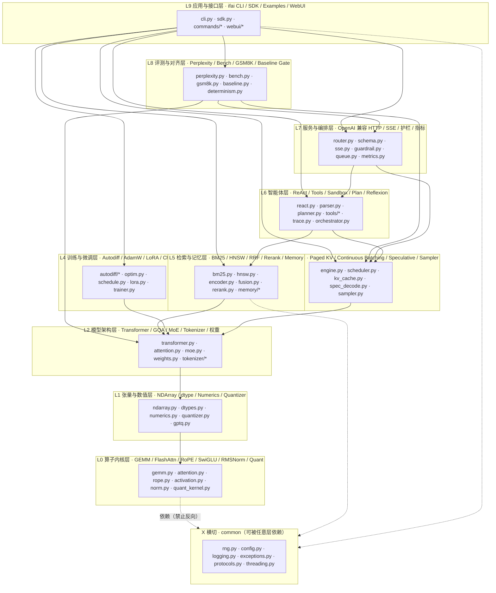
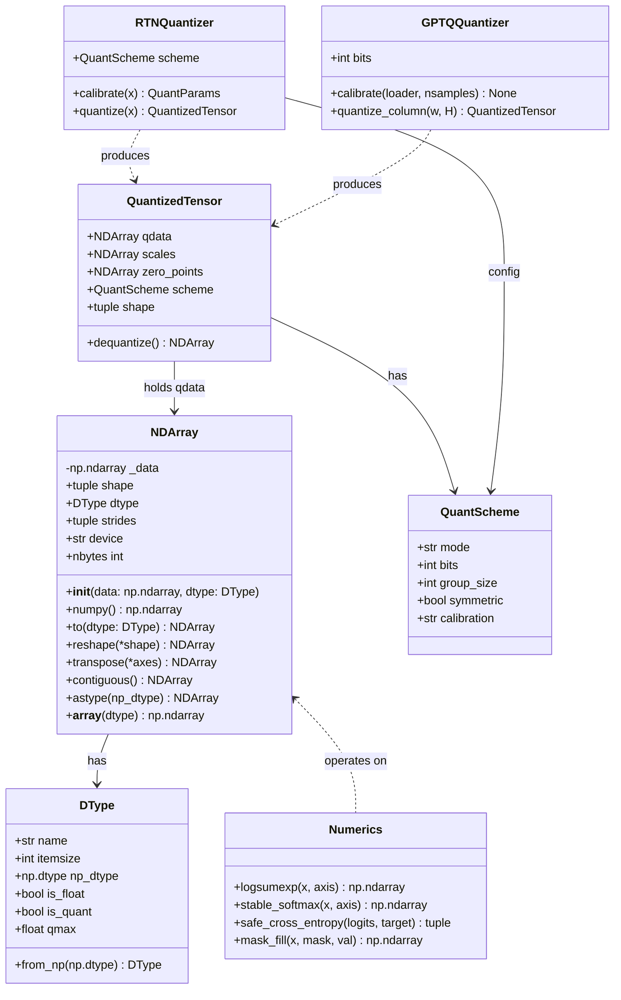
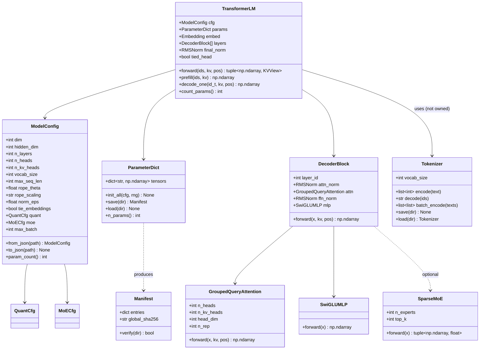
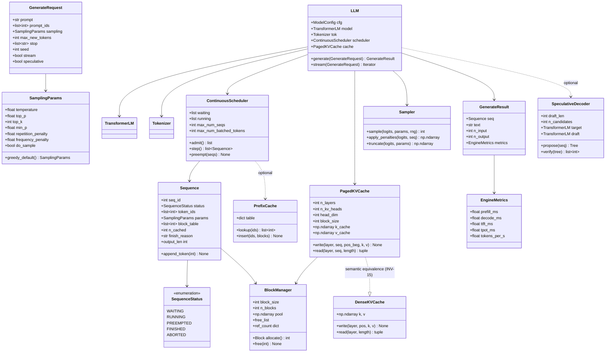
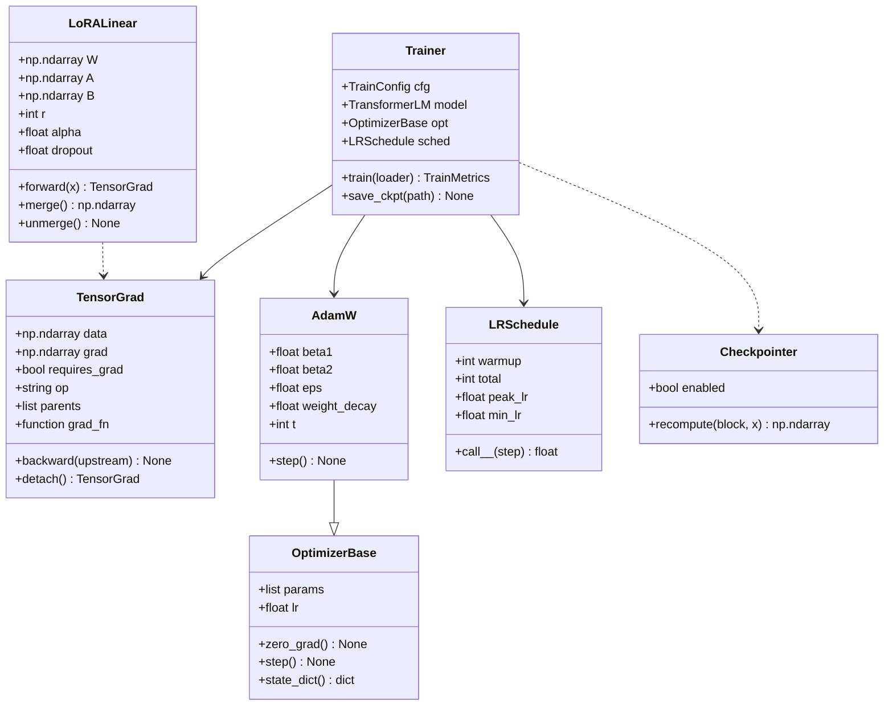
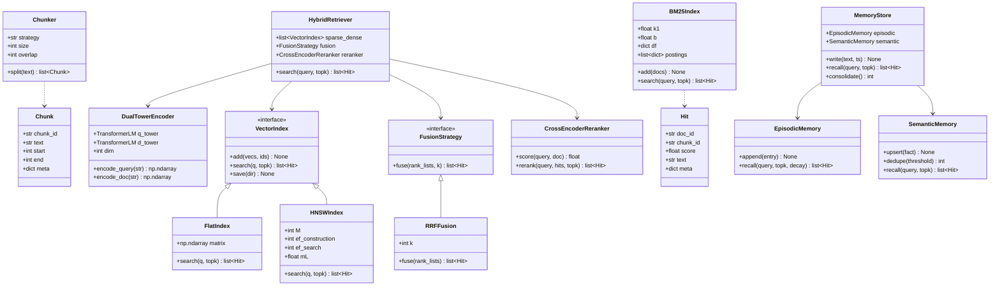
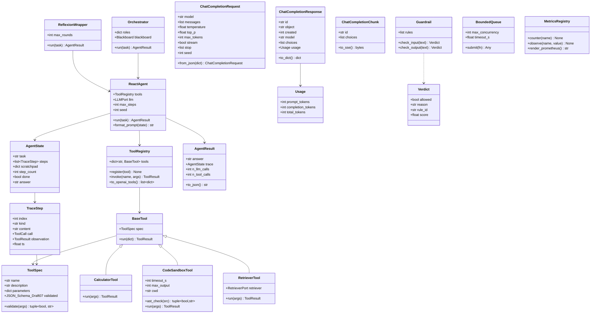
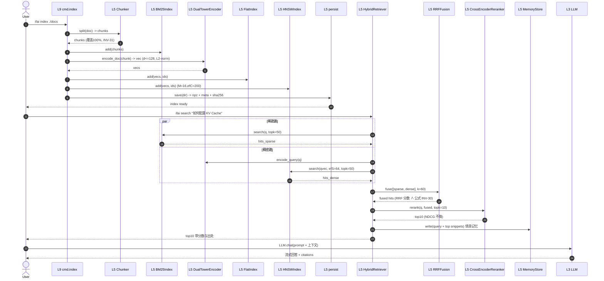
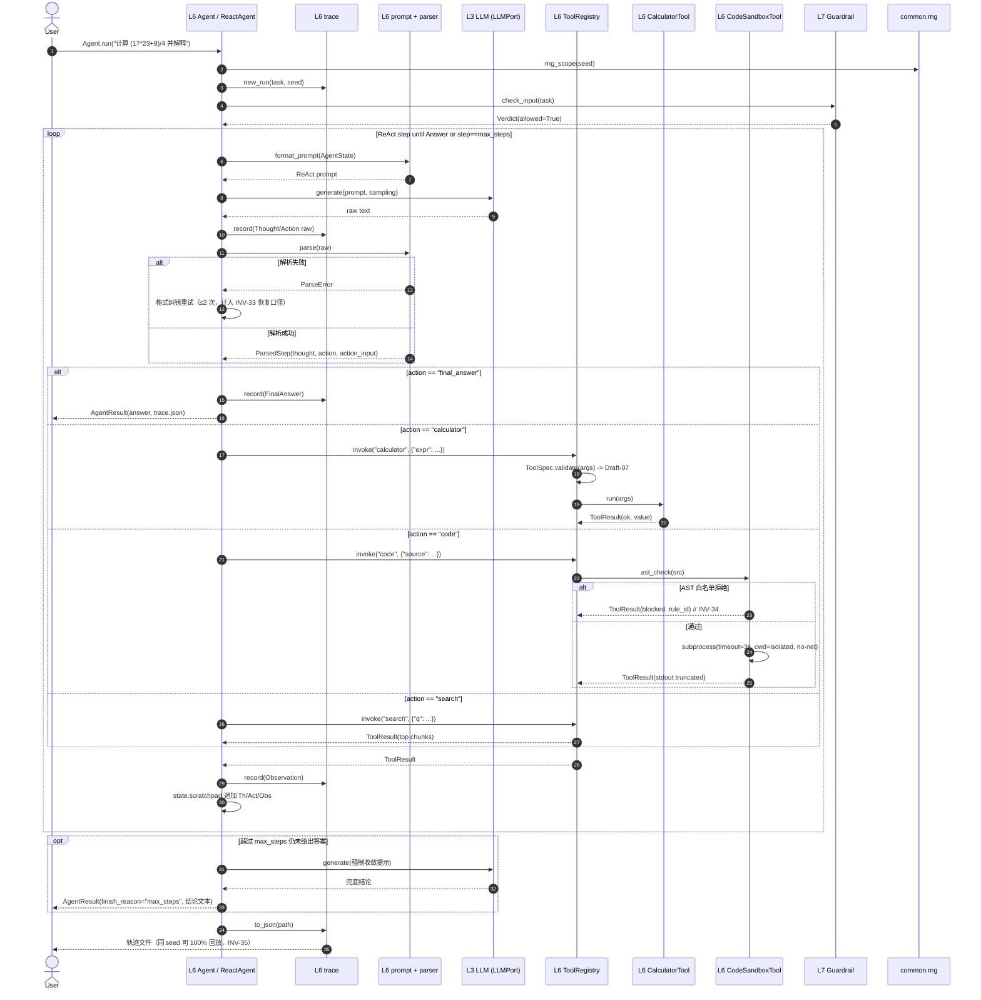
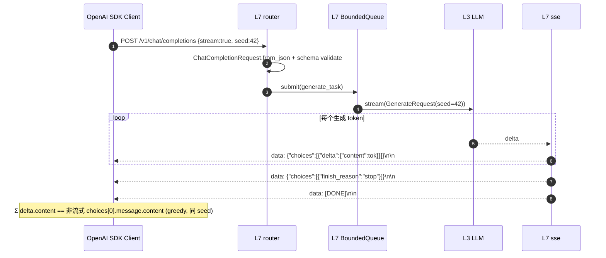

# 创新旗舰 AI（Innovation Flagship AI）— 系统架构设计（ARCHITECTURE）

| 项 | 内容 |
| --- | --- |
| 文档版本 | v1.0 |
| 作者 | 高见远（Gao）— Architect |
| 项目发起人 / 署名 | 晨星（GitHub: `CJX0712`） |
| 项目代号 | `innovation-flagship-ai` / 包名与命令名 `ifai` |
| 上游文档 | `docs/PRD.md`（v1.0，许清楚） |
| 配套文档 | `docs/TASKS.md`（Wave 任务分解）、`docs/PRIOR_ART.md`（零重写审计基线）、`CITATION.md`（≥25 条出处） |
| 运行环境 | Windows x86-64 / Python 3.13（兼容 3.11+）/ **无 GPU** / CPU-only |
| 硬依赖 | **numpy >= 1.24**（唯一）。torch 仅存在于 `.[dev]` 可选组，用于对照测试 |
| 设计原则 | 零重写（有出处）、可验证（42 条不变量）、闭环（可安装/可运行/可复现/可验证/可贡献） |

> 阅读顺序建议：**第 2 章（技术路线）→ 第 3 章（十层总览）→ 第 5 章（文件清单）→ 第 9 章（跨文件共享约定）**。第 6/7 章为施工细节参考，第 10 章为不变量映射表（工程师验收清单）。

---

## 2. 实现路线（Implementation Approach）

### 2.1 核心挑战与对策

| # | 技术难点 | 对策（方案） | 对应模块 |
| --- | --- | --- | --- |
| C1 | **纯 numpy 的推理性能**：手写三重循环比 OpenBLAS 慢 2~3 个数量级 | **永不手写三重循环做通用矩阵乘**。所谓「cache-blocking GEMM」= **分块调度 + 底层调用 BLAS 的分块 GEMM**：把大矩阵切成 cache 友好的 tile（默认 `(128,256,128)`），每个 tile 调用 `np.matmul(out=预分配缓冲)`，从而既获得 BLAS 的向量化能力，又减少 cache miss、可融合 bias/activation/residual。真正的三重循环只作为**参考实现（reference）**存在于测试与 docs | `ifai/l0_kernel/tiling.py` `gemm.py` |
| C2 | **注意力显存 O(N²)** | FlashAttention 风格 **online softmax**（running max + running sum 重标定），tile 化 Q/K/V，**永不物化 (T,T) score 矩阵**；causal mask 在 tile 级别做 block-skip 与对角块 separate handling | `ifai/l0_kernel/attention.py` |
| C3 | **确定性与 BLAS 多线程冲突**：BLAS 的并行归约顺序受线程数影响，跨机器可能不 bitwise 一致 | 双后端：默认 `GEMM_BACKEND=blas`（快）与 `GEMM_BACKEND=tiled`（我们自己完全控制的 tile 归约顺序，**bitwise 确定性**）。`deterministic=True` 或 `--seed` 指定时自动切到 `tiled`；并在 `common/threading.py` 固定 OpenBLAS/MKL 线程数（首次 import 前设置环境变量） | `ifai/common/threading.py` `l0_kernel/gemm.py` |
| C4 | **numpy 没有 int8 GEMM**（`np.matmul` 对 int8 会按 int8 累加溢出） | 采用 **int8 → int32 提升 + int32 累加**：`(A.astype(int32) @ B.astype(int32))`。安全边界：单元素累加绝对值上界 `127×127×D`，当 `D ≤ 131072` 时远小于 int32 上界 `2^31-1`，恒安全。非对称量化额外补 zeor-point 修正项 | `l0_kernel/gemm_quant.py` |
| C5 | **INT8 在 CPU 上未必更快**（无 VNNI 指令收益、类型转换有开销） | 架构上把「**精度/体积**」与「**速度**」解耦：int8/int4 路径的**卖点是显存/磁盘 4×~8× 压缩**与「PPL 退化有界」，速度不设承诺。文档明确说明：CPU-REF 上 INT8 可能为 `0.6×~1.1×`，这是**诚实披露**，不是缺陷 | `l0_kernel/quant_kernel.py` |
| C6 | **手写 autodiff 正确性** | `autodiff/tape.py` 用「纯函数 + 显式 backward 闭包」的最小 tape（非图引擎），每个算子单测都用**有限差分**对照（≥20 组随机样本），并在 `autodiff/check.py` 提供通用 `check_grad` 工具 | `l4_train/autodiff/` |
| C7 | **连续批处理 / 投机解码与单序列结果必须逐 token 一致** | 「信源唯一」原则：所有宏观优化（batch / page / spec / chunked-prefill）**只是在不同顺序上调用同一个 `(i) → logits` 函数**，logits 在 fp32 下严格可重排。禁止在 batch 维度上做任何跨序列归一化或近似。**paged KV 只改变存储布局、不改变数值语义** | `l3_engine/*` |
| C8 | **层次解耦 + 静态可审计** | 严格单向依赖 L0←L1←…←L9；跨层只允许通过 L7 编排层或 `common/protocols.py` 中定义的 `typing.Protocol`（ports & adapters）。`scripts/check_layering.py` 用 AST 静态扫描，CI 硬门禁 | `scripts/check_layering.py` |
| C9 | **零依赖 HTTP 服务**（不能引 fastapi/pydantic） | 使用标准库 `http.server.ThreadingHTTPServer` + 手写极简路由（`l7_server/router.py`）+ 自建 **JSON Schema Draft-07 子集校验器**（`l6_agent/tools/schema.py`，L6 提供，L7 复用）。SSE 通过手写 `text/event-stream` 分块写实现 | `l7_server/` |
| C10 | **离线可跑 + 仓库体积 ≤ 30MB** | 微型模型（≤ 2M 参数，fp32 约 8MB，`npz` + gzip 后可压缩到 ~2MB）随仓；微型语料（`assets/corpus/`）随仓；GSK8K 等外部数据**不随仓**，只留下载脚本 + 20 题自造 mini 子集 | `assets/` + `scripts/train_assets.py` |
| C11 | **代码沙箱跨平台** | 中等强度：AST 白名单 + 禁用 `import/open/eval/exec` + `subprocess` 子进程 + `timeout=3s` + 输出截断 + cwd 隔离。**不依赖 Unix `resource`**（Windows 不可用） | `l6_agent/tools/sandbox.py` |
| C12 | **「仅为正确性而存在」与「为性能而存在」两条路径的维护成本** | 每个算子都提供 `*_ref`（朴素参考，用于黄金测试）与 `*_fast`（优化实现）。参考实现写在**测试的 golden 模块**或模块的 `_ref` 私有函数里，**永远优先写参考实现再写优化实现**（TDD 顺序写死在任务里） | 全局 |

### 2.2 为什么硬依赖只有 numpy

- PRD Q1 已裁决：`torch` 只在 `.[dev]` 可选组，主推理/训练路径 100% numpy。
- 带来的代价与补偿：
  - **无 autograd** → 手写 tape（~400 行），换来「可教学」和 INV-22 的有限差分对照；
  - **无 Web 框架** → 标准库 `http.server` 手写路由（~300 行），换来零依赖安装 ≤60s；
  - **无 `jsonschema`** → 自写 Draft-07 子集校验器（~150 行），足够覆盖工具参数与 OpenAI 请求体；
  - **无 `tokenizers`** → 自实现 byte-level BPE（Sennrich 2016 + GPT-2 bytes 映射），训练只需扫一遍微型语料。
- **禁止**引入：任何需要编译的 C 扩展、任何下载权重的运行时逻辑、任何 `pip install` 之外的系统依赖。

### 2.3 数值精度与 dtype 策略

| 场景 | dtype | 说明 |
| --- | --- | --- |
| 主推理路径 | `float32` | 全链路 fp32，唯一"真值"基准；所有黄金测试的参考值在 fp32 下计算 |
| 训练主权重 | `float32` | master weights 为 fp32（R-L4-08 混合精度为 P2，可选） |
| 累加器 | `float32`（int8 路径为 `int32`） | 累加禁止降精度 |
| 半精度（可选） | `float16` / `bfloat16` | 仅用于 `NDArray` 往返与存储压缩；**不在主算子路径启用**，避免 Windows/CPU 上的溢出反常行为 |
| 量化推理 | `int8` / `int4(packed uint8)` | 由 `ModelConfig.quant` 开关控制，默认 `None`（关闭） |

### 2.4 numpy 性能策略（工程师必读）

1. **绝不 Hot-loop 化 scaler 运算**；任何按标量循环的地方先想能否 `np.einsum` / `reshape` + BLAS。
2. **预分配 + `out=`**：推理引擎启动即预分配 KV 池、logits 缓冲、tile 缓冲（`np.empty`，`KEEPALIVE` 引用）；热路径零 `np.stack`/`np.concatenate`。
3. **视图优先**：`reshape` / `transpose` / `expand_dims` 产出 view，不触发拷贝；只在需要连续内存进入 BLAS 时执行 `np.ascontiguousarray`（并在 debug 模式下用 `--trace-copies` 统计）。
4. **einops 风格**：自写 `l1_tensor/ops.py::rearrange(x, pattern, **sizes)` 子集实现（支持 `b h t d -> b t (h d)` 这类合并/拆分），内部只走 view + `contiguous` 兜底，便于把各处手写 reshape 收敛到一处。
5. **轴序约定**：**统一 row-major（C-contiguous）**，激活量形状为 `(B, T, D)`，注意力内部 `(B, H, T, Dh)`，权重统一 `(out, in)`（BLAS 友好）；每个函数签名必须有 `# shape: (B, T, D)` 注释。
6. **批处理优先**：尽可能把单序列操作表达为 `B=1` 的批处理，避免 `if batch is None` 分支。
7. **避免隐式 dtype 提升**：热路径显式指定 `dtype=np.float32`；`np.mean/sum` 默认 float64 会污染精度，统一 `dtype=np.float32`。
8. **BLAS 线程数固定**：在 `ifai/__init__.py` 最早链路上调用 `common.threading.pin_threads(n)`，把 `OMP/MKL/OPENBLAS_NUM_THREADS` 设为确定值（默认 4，可由 `IFAI_THREADS` 覆盖），并在 `ifai version --verbose` 与 `bench` 报告中打印。

---

## 3. 十层总览（Ten-Layer Overview）



**依赖方向铁律**：箭头必须从高层指向低层（`L9 → L0`）。任何 `l0_kernel` 中 `import ifai.l3_engine` 的行为都是 **CI 红灯**（INV-41）。

---

## 4. 各层职责表

### L0 — 算子 / 内核层（`ifai/l0_kernel/`）

| 项 | 内容 |
| --- | --- |
| **职责** | 提供无状态、可单测的数学算子：分块 GEMM、FlashAttention 风格在线 softmax 注意力、RoPE、SwiGLU、RMSNorm（含 fused residual）、INT8/INT4 量化-反量化内核、int4 位打包 |
| **输入** | `NDArray`（L1）或裸 `np.ndarray`（**只允许接受 np.ndarray 以避免反向依赖**），标量超参 |
| **输出** | 同形状约定 Tensor / 标量；支持 `out=` 预分配 |
| **依赖** | numpy；`ifai.common.exceptions` / `common.threading`（横切允许） |
| **关键不变量** | INV-01, INV-02, INV-03, INV-04, INV-05, INV-06, INV-07 |
| **复用的顶级成果** | FlashAttention（Dao et al. 2022）在线 softmax + 分块；Anatomy of HPC Matrix Multiplication（Goto & van de Geijn 2008）cache-blocking / tiling；RoFormer RoPE（Su et al. 2021/2024）；GLU Variants / SwiGLU（Shazeer 2020）；RMSNorm（Zhang & Sennrich 2019）；LLM.int8() per-channel 量化（Dettmers et al. 2022） |

### L1 — 张量 / 数值层（`ifai/l1_tensor/`）

| 项 | 内容 |
| --- | --- |
| **职责** | `NDArray` 抽象（与 numpy 零拷贝互操作）、dtype 体系（fp32/fp16/bf16/int8/int4-packed）、数值稳定工具（logsumexp / stable softmax / safe CE）、RTN 量化器、GPTQ 风格逐列量化、分布工具（熵/KL/temperature/top-k 截断） |
| **输入** | numpy 数组 / Python 标量 |
| **输出** | `NDArray` / 原语类型 |
| **依赖** | L0（用于分块 GEMM 等底层算子封装）、common |
| **关键不变量** | INV-07, INV-08, INV-09 |
| **复用的顶级成果** | 数组/stride 视图语义（NumPy 本身；Harris et al. 2020 *Array programming with NumPy*）；数值稳定 logsumexp（标准数值分析实践）；RTN/min-max 与 percentile 标定（Krishnamoorthi 2018 *Quantizing DNNs for Low-Power*；Dettmers 2022 LLM.int8）；GPTQ / OBQ（Frantar et al. 2022，Hessian 逐列最优量化）；熵/KL（Cover & Thomas 2006） |

### L2 — 模型架构层（`ifai/l2_model/`）

| 项 | 内容 |
| --- | --- |
| **职责** | `ModelConfig` 驱动组建 Transformer Decoder（pre-RMSNorm + RoPE + GQA + SwiGLU FFN + 可选 MoE）、权重绑定、参数初始化与计数、权重序列化（npz + sha256 manifest）、byte-level BPE 分词器、上下文扩展（NTK/YaRN 简化） |
| **输入** | `ModelConfig`、token id 序列 `(B, T)`、可选位置 `start_pos` 与 KV 视图 |
| **输出** | logits `(B, T, V)`、隐藏态、参数字典 |
| **依赖** | L0, L1 |
| **关键不变量** | INV-10, INV-11, INV-12, INV-13, INV-14 |
| **复用的顶级成果** | Attention Is All You Need（Vaswani et al. 2017）核心骨架；Pre-LN Transformer（GPT-2 / Radford 2019；Xiong et al. 2020 为何用 Pre-LN）；GQA（Ainslie et al. 2023）；Switch Transformer / MoE + load-balancing loss（Fedus et al. 2022）；RoFormer RoPE（Su 2021）；权重绑定（Press & Wolf 2017）；Byte-level BPE（GPT-2 Radford 2019；BPE Sennrich et al. 2016）；YaRN / NTK-aware rope scaling（Peng et al. 2023；bloc97 2023） |

### L3 — 推理引擎层（`ifai/l3_engine/`）

| 项 | 内容 |
| --- | --- |
| **职责** | PagedAttention 风格分页 KV Cache + 块表管理、迭代级连续批处理调度（admit/preempt）、投机解码（自草稿 / 树状候选 + 树验证）、采样器（temperature/top-p/top-k/min-p/惩罚）、分块 prefill、前缀缓存、面向上层的 `LLM` 门面 |
| **输入** | `GenerateRequest`（prompt token ids / 采样参数 / 停止条件 / seed） |
| **输出** | `GenerateResult`（token 序列 + 文本 + 用时 + token 计数 / 流式增量） |
| **依赖** | L0, L1, L2 |
| **关键不变量** | INV-15, INV-16, INV-17, INV-18, INV-19, INV-20 |
| **复用的顶级成果** | PagedAttention / vLLM（Kwon et al. 2023）；Continuous Batching / Orca（Yu et al. 2022）；Speculative Decoding（Leviathan et al. 2023）+ 树状候选 / Medusa（Cai et al. 2024）、EAGLE（Li et al. 2024）风格；FlashAttention 在线 softmax 复用至增量 decode；min-p 采样（Nguyen et al. 2024）；nucleus/top-p（Holtzman 2020） |

### L4 — 训练与微调层（`ifai/l4_train/`）

| 项 | 内容 |
| --- | --- |
| **职责** | 手写反向 tape autodiff（覆盖 matmul/softmax/norm/rope/loss）、AdamW、余弦+线性预热调度、全局 L2 梯度裁剪、按层梯度检查点、LoRA（含 merge/unmerge）、数据集与 batching、训练器（含 loss 平滑与可复现 dataloader） |
| **输入** | `TrainConfig`、语料、`ifai.l2_model.TransformerLM` |
| **输出** | 更新后的参数 dict / LoRA adapter 文件 / 训练日志与指标 |
| **依赖** | L0, L1, L2（**不依赖 L3**：训练不走推理引擎） |
| **关键不变量** | INV-21, INV-22, INV-23, INV-24, INV-25, INV-26 |
| **复用的顶级成果** | AdamW / Decoupled Weight Decay（Loshchilov & Hutter 2019）与 Adam（Kingma & Ba 2015）；SGDR 余弦退火（Loshchilov 2017）+ warmup（Goyal 2017）；梯度裁剪（Pascanu et al. 2013）；LoRA（Hu et al. 2022）；梯度检查点（Chen et al. 2016）；nanoGPT 风格极简训练循环（Karpathy 2022）；反向模式自动微分标准实践（Baydin et al. 2018） |

### L5 — 检索与记忆层（`ifai/l5_retrieval/`）

| 项 | 内容 |
| --- | --- |
| **职责** | 分块策略（固定/递归字符/重叠窗口）、BM25 稀疏检索、微型双塔稠密 encoder、HNSW 近似最近邻、Flat 暴力索引（作为 ANNS 真值）、RRF 融合、**QFR 时序感知融合（RRF 的严格超集）**、**MMR 多样性重排**、Cross-Encoder 风格重排、情景记忆（append-only + 时间衰减）与语义记忆（去重归并）、索引持久化与增量更新 |
| **输入** | 文档集合 / 文件路径 / 查询串 |
| **输出** | `Hit(chunk_id, score, text, meta)` 排序列表；`Index` 对象 |
| **依赖** | L0, L1, L2（双塔复用 L2 的 Transformer 编码器 + L0 内核）；common |
| **关键不变量** | INV-27, INV-28, INV-29, INV-30, INV-31, INV-32, **INV-43, INV-44, INV-45, INV-46, INV-47, INV-48, INV-49, INV-50** |
| **复用的顶级成果** | Okapi BM25（Robertson et al. 1994）；HNSW（Malkov & Yashunin 2018）；RRF（Cormack et al. 2009）；**QFR（本项目在 RRF 上的原创扩展，见 `docs/PRIOR_ART.md` 5-6）**；**MMR（Carbonell & Goldstein 1998）**；MonoBERT / Cross-Encoder 重排（Nogueira & Cho 2019）；DPR 双塔（Karpukhin et al. 2020）；MemGPT 分层记忆（Packer et al. 2023）；**Zep/Graphiti bi-temporal（事实有效期）**；**Hindsight（Vectorize.io 2026，多策略并行检索 + reflect 合成）** |

### L6 — 智能体层（`ifai/l6_agent/`）

| 项 | 内容 |
| --- | --- |
| **职责** | ReAct 循环（Thought/Action/Observation）、工具抽象（JSON Schema 声明）+ 内置工具（计算器 / 检索 / 代码沙箱）、JSON Schema Draft-07 子集校验器、Planner/Executor（无环 DAG）、Reflexion 自我反思、多智能体黑板/消息总线、轨迹记录与回放 |
| **输入** | 自然语言任务 + `AgentConfig`（工具集、最大步数、seed） |
| **输出** | `AgentResult`（答案 + 完整轨迹 + 步数/token 统计） |
| **依赖** | L0–L3（经 `common/protocols.py` 的 `LLMPort`），L5（检索工具） |
| **关键不变量** | INV-33, INV-34, INV-35 |
| **复用的顶级成果** | ReAct（Yao et al. 2022）；Reflexion（Shinn et al. 2023）；Toolformer / 工具调用（Schick et al. 2023）+ OpenAI Function Calling schema；Plan-and-Solve（Wang et al. 2023）；AutoGen（Wu et al. 2023）/ CAMEL（Li et al. 2023）多智能体编排；JSON Schema Draft-07（IETF / json-schema.org） |

### L7 — 服务与编排层（`ifai/l7_server/`）

| 项 | 内容 |
| --- | --- |
| **职责** | OpenAI 兼容 HTTP API（`/v1/chat|completions|models|embeddings`）、SSE 流式、限流排队（max_concurrency + 超时 429）、护栏（注入检测/黑白名单/长度与成本限额）、Prometheus 文本 `/metrics`、`trace_id` 贯穿、`/healthz` 与优雅启停 |
| **输入** | HTTP 请求（JSON） |
| **输出** | OpenAI schema JSON / SSE 事件流 / 错误对象 |
| **依赖** | L3（推理）、L5（embeddings）、L6（可选工具编排）、L2；**编排是被允许打破"纯粹分层"的唯一上层** |
| **关键不变量** | INV-36, INV-37, INV-38 |
| **复用的顶级成果** | OpenAI REST API 规范（OpenAI API Reference / openai-python schema）；SSE（W3C HTML Living Standard）；OWASP Top 10 for LLM Applications（2025）；NVIDIA NeMo Guardrails（Rebedea et al. 2023）规则护栏思想；Prometheus Exposition Format；OpenTelemetry trace 语义约定（trace_id） |

### L8 — 评测与对齐层（`ifai/l8_eval/`）

| 项 | 内容 |
| --- | --- |
| **职责** | 困惑度评测、吞吐/延迟基准（prefill/decode/TTFT/TPOT，CV≤15%）、答案抽取器、GSM8K 风格数学评测、事实性与安全性结构化报告、回归基线 `BASELINE.md` 读写与 ±15% 门禁、确定性自检 |
| **输入** | 模型 + 数据集 / 基准参数 |
| **输出** | JSON + Markdown 报告；写入 `BASELINE.md`；提供退出码（门禁） |
| **依赖** | L2, L3, L5, L7（端到端压测走 HTTP）；common |
| **关键不变量** | INV-39, INV-40 |
| **复用的顶级成果** | Perplexity 标准定义；GSM8K（Cobbe et al. 2021）+ CoT 提示（Wei et al. 2022）+ self-consistency 思想（Wang 2022，可选）；HELM 多维评测（Liang et al. 2022）；统计显著/变异系数回归门禁（工程实践） |

### L9 — 应用与接口层（`ifai/l9_app/`）

| 项 | 内容 |
| --- | --- |
| **职责** | `ifai` CLI 全子命令（demo/serve/bench/eval/train/quantize/index/search/selftest/version）、Python SDK 三大高阶 API（`LLM.chat` / `Retriever.search` / `Agent.run`）、示例集、可选零构建依赖 WebUI、L0→L9 链路可视化打印 |
| **输入** | 终端 argv / Python 调用 |
| **输出** | 人类可读输出 + 退出码 |
| **依赖** | L0–L8（聚合层） |
| **关键不变量** | R-L9-01..05；链路打印覆盖 L0→L9（US-01） |
| **复用的顶级成果** | Click/argparse 风格 CLI 约定；llama.cpp 风格开箱即用体验（ggerganov 2023）；OpenAI Python SDK 调用形态 |

### L10 — 微指令 ISA 层（`ifai/l10/`）

| 项 | 内容 |
| --- | --- |
| **职责** | 32 家族 × 32 成员 = **1024 条可执行微指令**（每条是真实可调用的函数，不是文档字符串）+ **390 条数学性质断言**（softmax 归一性 / L2 严格单位范数 / KL 非负 / Flash ≡ 朴素 / NS 奇异值带 / Top-K 掩码个数 / RoPE 保范数…）+ 26 条显式豁免并逐条注明理由 |
| **输入** | 确定性采样输入（固定种子，跨进程可复现） |
| **输出** | 逐条执行报告（总/通过/失败明细）+ 豁免清单 |
| **依赖** | L0（`core.ops` / `core.numeric`）—— **移植后本仓 L0 是唯一依赖源**，不存两套同义实现 |
| **关键不变量** | ISA 数量不变量（1024/32/32）；可执行性（1024/1024）；可证性（390/390）；确定性（同种子两次逐条一致） |
| **复用的顶级成果** | ISA 移植自同门旗舰 `tianji-ai`（MIT，作者同一人，已在其仓通过 1024/1024 门禁）；四变体执行模型参考同门旗舰 `flagship-ai` 的 L10-microisa；Newton-Schulz 正交化 (Keller Jordan 2024, Muon)；SSE 协议按 WHATWG HTML Living Standard |

**详见** [`design/L10_microisa.md`](design/L10_microisa.md)。

### X — 横切工程（`ifai/common/`、`scripts/`、`tests/`）

| 项 | 内容 |
| --- | --- |
| **职责** | 异常体系、结构化日志、全局可复现 RNG、配置基类（JSON round-trip）、注册器、Protocol 端口定义、BLAS 线程固定、分层静态检查、零重写审计、文档检查、基线生成 |
| **输入/输出** | 被所有层依赖的基础设施 |
| **依赖** | 仅 numpy + 标准库（**不得依赖任何 L 层**） |
| **关键不变量** | INV-40, INV-41, INV-42 |

---

## 5. 包结构与完整文件清单

### 5.0 根目录（仓库骨架）

```
innovation-flagship-ai/
├── pyproject.toml              # PEP 621 元数据、依赖分组、控制台入口 ifai
├── README.md                   # 30 秒上手 + 十层地图 + 基准表
├── CONTRIBUTING.md             # 贡献流程、分层铁律、测试要求
├── CHANGELOG.md                # 语义化版本变更
├── CITATION.md                 # ≥25 条核心算法出处（论文/实现/许可）
├── NOTICE                      # 第三方许可聚合
├── LICENSE                     # Apache-2.0（已存在）
├── MANIFEST.in                 # 打包包含 assets/
├── .gitignore
├── BASELINE.md                 # 本机实测性能基线（由脚本生成，随 Runner 更新）
├── pyproject.toml
├── docs/
│   ├── PRD.md                  # 已存在
│   ├── ARCHITECTURE.md         # 本文
│   ├── TASKS.md                # Wave 任务分解
│   ├── PRIOR_ART.md            # 零重写审计基线
│   └── API.md                  # 公开 API 参考
├── scripts/
├── tests/
├── examples/
└── ifai/
```

### 5.1 `ifai/common/`（横切 X，所有层可用）

| 文件 | 一句话职责 | 预估行数 |
| --- | --- | --- |
| `ifai/__init__.py` | 顶层门面：固定 BLAS 线程数、暴露 `__version__`、延迟导入子模块 | 45 |
| `ifai/version.py` | 版本号常量与 `version_info()`（含 numpy/平台/线程数） | 30 |
| `ifai/py.typed` | PEP 561 类型标记（空文件） | 0 |
| `ifai/common/__init__.py` | 重导出异常/配置/日志/RNG 等公共 API | 40 |
| `ifai/common/constants.py` | 全局常量：`DEFAULT_SEED`、`EPS`、`CACHE_LINE`、默认 tile 尺寸、HEAD 数上限 | 40 |
| `ifai/common/exceptions.py` | 异常树：`IfaiError` 及子树（见 §9.2） | 95 |
| `ifai/common/logging.py` | `get_logger(name)` 结构化 logger；`IFAI_LOG_PROMPTS` 开关保护用户输入明文 | 80 |
| `ifai/common/rng.py` | 全局 RNG 单例 + `set_seed()` / `rng_scope()` 上下文；统一 `random`/`numpy` 三处随机源 | 100 |
| `ifai/common/config.py` | `BaseConfig` dataclass 混入：`to_dict/from_dict/to_json/from_json`，支持严格 JSON round-trip | 90 |
| `ifai/common/registry.py` | 轻量注册器 `@register("gemm.blas")`，供量化方案/工具/巩固-newuit 扩展点使用 | 65 |
| `ifai/common/utils.py` | 计时器 `Timer`、sha256 文件摘要、原子写文件、目录准备、内存采样（`tracemalloc` 封装） | 120 |
| `ifai/common/protocols.py` | `typing.Protocol` 端口：`LLMPort` / `RetrieverPort` / `ToolPort` / `TokenizerPort`，跨层解耦用 | 80 |
| `ifai/common/threading.py` | 固定 BLAS/MKL/OMP 线程数（须在 numpy 首次繁重重算前调用），提供 `blas_config()` 自检 | 70 |

### 5.2 `ifai/l0_kernel/`（L0 算子内核层）

| 文件 | 一句话职责 | 预估行数 |
| --- | --- | --- |
| `__init__.py` | 导出 `gemm/flash_attention/rope/swiglu/rmsnorm` 等公共算子 | 35 |
| `DESIGN.md` | 本层设计：借鉴来源 + 差异 + 复杂度 + 不变量 | 120 |
| `tiling.py` | Tile 参数与循环序描述 `TileSpec`，生成 tile 迭代顺序（`ijk/ikj`…），含 `pick_tile()` 启发式 | 90 |
| `gemm.py` | `gemm(a,b,c=None,*,tiles,backend)` 缓存分块 GEMM；`gemm_ref` 朴素参考实现；`GEMM_BACKEND` 开关 | 190 |
| `gemm_quant.py` | INT8 矩阵乘：int32 累加 + zero-point 修正项；`gemm_int8_ref` 参考实现 | 155 |
| `attention.py` | FlashAttention 风格在线 softmax 注意力（tile + running max/sum、causal block-skip）；`attention_ref` 朴素实现 | 215 |
| `rope.py` | RoPE 融合算子（precompute cos/sin；NTK-aware / 线性插值 scaling）；`rope_ref` 解析旋转版本 | 130 |
| `activation.py` | SwiGLU 融合（单 pass，无中间大张量）、SiLU/GELU、fused bias-act | 95 |
| `norm.py` | RMSNorm（含 fused residual add、可调 eps）、LayerNorm 兼容实现、`rmsnorm_ref` | 105 |
| `quant_kernel.py` | per-token / per-channel / per-group 对称+非对称 INT8/INT4 量化-反量化内核与标定 | 210 |
| `packing.py` | int4↔uint8 位打包/解包（`pack_int4/unpack_int4`，要求逐位可逆） | 95 |
| `bench_micro.py` | 单算子微基准（给 L8 调用），含峰值内存采样 | 95 |

**不变量落点**：INV-01→`gemm.py`；INV-02→`attention.py`；INV-03/04→`rope.py`；INV-05→`activation.py`；INV-06→`norm.py`；INV-07→`quant_kernel.py`+`packing.py`。

### 5.3 `ifai/l1_tensor/`（L1 张量与数值层）

| 文件 | 一句话职责 | 预估行数 |
| --- | --- | --- |
| `__init__.py` | 导出 `NDArray`/dtype/数值工具/量化器 | 35 |
| `DESIGN.md` | 本层设计与借用出处 | 110 |
| `ndarray.py` | `NDArray`：`shape/dtype/strides/device='cpu'`，持有 `np.ndarray`，与 numpy 零拷贝互操作 | 210 |
| `dtypes.py` | dtype 描述对象 `DType`（fp32/fp16/bf16/int8/int4）+ 转换/往返/量化步长工具 | 145 |
| `numerics.py` | `logsumexp` / `stable_softmax` / `safe_cross_entropy` / `masked_fill`，全部 `float32` 累加 | 135 |
| `quantizer.py` | RTN 量化器：min-max / percentile 标定，对称+非对称，作用于 NDArray | 185 |
| `gptq.py` | GPTQ 风格逐列量化（校准集驱动的 Hessian/OBQ 简化），∈ P1 | 170 |
| `dist.py` | 分布工具：熵、KL(p‖q)、温度缩放、top-k 截断并重归一化 | 125 |
| `ops.py` | 通用张量 ops：`rearrange`（einops 子集）、`broadcast_to`、`arange`、`repeat_kv` | 115 |

**不变量落点**：INV-07→`quantizer.py`；INV-08/09→`numerics.py`。

### 5.4 `ifai/l2_model/`（L2 模型架构层）

| 文件 | 一句话职责 | 预估行数 |
| --- | --- | --- |
| `__init__.py` | 导出 `ModelConfig`/`TransformerLM`/`Tokenizer`/权重工具 | 35 |
| `DESIGN.md` | 本层设计、参数量解析公式、借鉴出处 | 150 |
| `config.py` | `ModelConfig` dataclass（d/ffn/heads/n_kv/layers/vocab/rope/norm/moe/quant/tie），JSON round-trip | 145 |
| `embedding.py` | 词嵌入查表（同时作为 tied lm_head 的权重持有者） | 60 |
| `attention.py` | `GroupedQueryAttention`：QKV 投影、RoPE、GQA repeat、FlashAttn 调用 | 180 |
| `mlp.py` | SwiGLU FFN（`w_gate/w_up/w_down`） | 90 |
| `moe.py` | `SparseMoE`：top-2 门控 + experts + 负载均衡辅助损失（∈ P1） | 165 |
| `norm.py` | L2 侧 RMSNorm 模块封装（包 L0 内核 + 可训练 gain） | 60 |
| `rope_scale.py` | NTK-aware / YaRN 简化的上下文长度外推位置编码缩放 | 95 |
| `block.py` | `DecoderBlock`：pre-RMSNorm → attention/FFN → residual；支持 gradient checkpoint 钩子 | 135 |
| `transformer.py` | `TransformerLM`：组装 layers + embedding + tied head，`forward()/prefill()/decode_one()` | 230 |
| `weights.py` | 参数树 `ParameterDict`：初始化（ scaled normal）、参数计数、npz 存取 + sha256 manifest | 205 |
| `tokenizer/__init__.py` | 导出 `Tokenizer` | 20 |
| `tokenizer/bytelevel.py` | GPT-2 风格 bytes↔unicode 可逆映射表与编解码 | 95 |
| `tokenizer/bpe.py` | BPE 词表训练（pair 合并统计，`%(black)` 进度可选）、编码/解码 | 225 |
| `tokenizer/vocab.py` | vocab/merges 的存取与 quick sanity（双向 round-trip） | 85 |
| `tokenizer/tokenizer.py` | `Tokenizer` 门面：`encode/decode/batch_encode/special_tokens/vocab_size` | 165 |

**不变量落点**：INV-10→`attention.py`；INV-11→`block.py`/`transformer.py`；INV-12→`transformer.py`；INV-13→`weights.py`；INV-14→`moe.py`。

### 5.5 `ifai/l3_engine/`（L3 推理引擎层）

| 文件 | 一句话职责 | 预估行数 |
| --- | --- | --- |
| `__init__.py` | 导出 `LLM`/`GenerateRequest`/`SamplingParams` | 35 |
| `DESIGN.md` | 本层设计：块表布局、调度策略、投机树、 attentn/libro 取舍 | 170 |
| `sequence.py` | `Sequence` 状态机（WAITING/RUNNING/FINISHED/PREEMPTED）、`SamplingParams`、`StopCriteria` | 125 |
| `block_manager.py` | 空闲块池 + 块表分配/释放/写时 COW（前缀共享 refcount） | 155 |
| `kv_cache.py` | `PagedKVCache`：预分配 `(n_blocks, block_size, n_kv_heads, head_dim)`，read/write via 块表 | 205 |
| `prefill.py` | 分块 prefill（chunk=512）与整段 prefill 的统一入口 | 125 |
| `scheduler.py` | `ContinuousScheduler`：admit/step/preempt，`policy: fcfs|priority`，保证 INV-16 的等价性 | 210 |
| `spec_decode.py` | 投机解码：自草稿模型 + 树状候选构造 + 树验证（rejection sampling / greedy 等价） | 230 |
| `prefix_cache.py` | 前缀缓存（块内容哈希的简化基数树 + LRU 淘汰），∈ P2 | 135 |
| `sampler.py` | 采样：temperature / top-p / top-k / min-p / frequency & presence penalty / greedy 退化 | 185 |
| `metrics.py` | 引擎侧指标：prefill/decode 耗时、TTFT/TPOT、token 计数、cache 命中率 | 105 |
| `engine.py` | `LLM` 门面：`generate()/stream()/chat()`，串起 tokenize→prefill→loop→sample→detokenize | 265 |

**不变量落点**：INV-15→`kv_cache.py`；INV-16→`scheduler.py`；INV-17→`spec_decode.py`；INV-18/19→`sampler.py`；INV-20→`prefill.py`。

### 5.6 `ifai/l4_train/`（L4 训练与微调层）

| 文件 | 一句话职责 | 预估行数 |
| --- | --- | --- |
| `__init__.py` | 导出 `Trainer`/优化器/LoRA | 35 |
| `DESIGN.md` | 本层设计：tape 设计、梯度验证策略、latex 公式 | 140 |
| `autodiff/__init__.py` | 导出 `TensorGrad`/`no_grad`/`check_grad` | 25 |
| `autodiff/tape.py` | 微型反向 autodiff：`TensorGrad` 值 + `grad_fn` 闭包 + 拓扑逆序 backward | 160 |
| `autodiff/ops.py` | 算子与其梯度：`matmul/add/mul/transpose/reshape/softmax/rmsnorm/rope/cross_entropy/concat/gather` | 265 |
| `autodiff/check.py` | `check_grad(f, x, eps)` 通用有限差分对照工具（对称差分，相对误差） | 95 |
| `optim.py` | `AdamW`（decoupled wd）、`SGD+momentum`；状态 dict 存取 | 165 |
| `schedule.py` | `cosine_with_warmup` / `linear_warmup_decay`，提供解析表达式供单测 | 105 |
| `grad_utils.py` | 全局 L2 范数裁剪（未超限时**不修改**梯度，bitwise） | 85 |
| `checkpoint.py` | 梯度检查点（按层重计算）封装 | 115 |
| `lora.py` | `LoRALinear`：A/B 低秩、缩放 α/r、`merge()/unmerge()`、adapter 存取格式 | 185 |
| `loss.py` | 交叉熵（含 ignore_index / label smoothing 可选）基于 L1 `safe_cross_entropy` | 90 |
| `dataset.py` | 文本 → token id → 窗口切片 → batch（可复现 shuffle） | 135 |
| `trainer.py` | `Trainer`：训练循环、梯度累积、loss 平滑、EMA 可选、ckpt 保存、早停 | 240 |

**不变量落点**：INV-21→`optim.py`；INV-22→`autodiff/ops.py`+`check.py`；INV-23→`grad_utils.py`；INV-24→`lora.py`；INV-25→`checkpoint.py`；INV-26→`trainer.py`。

### 5.7 `ifai/l5_retrieval/`（L5 检索与记忆层）

| 文件 | 一句话职责 | 预估行数 |
| --- | --- | --- |
| `__init__.py` | 导出 `Index`/`Retriever`/`HybridRetriever` | 35 |
| `DESIGN.md` | 本层设计：HNSW 参数、剪枝策略、召回/延迟权衡 | 135 |
| `chunk.py` | 分块器：固定 / 递归字符 / 重叠窗口；保证拼接覆盖 100%（含 offset 元数据） | 125 |
| `bm25.py` | Okapi BM25（k1=1.5,b=0.75）：倒排索引、df/idf、打分；含参考实现 `bm25_ref` | 175 |
| `encoder.py` | 微型**双塔**稠密编码器（query tower / doc tower），复用 L2 Transformer，输出 d≤128 并 L2 归一 | 185 |
| `vector_index.py` | `FlatIndex`：暴力 TopK（作为 ANNS 真值，INV-29 基准） | 115 |
| `hnsw.py` | `HNSWIndex`：多层可导航小世界图，`M=16/efC=200/efS=64`，含可复现插入（seed 控制层分配） | 270 |
| `fusion.py` | RRF 融合（k=60）与其他融合（weighted/CombSUM） | 95 |
| `rerank.py` | Cross-Encoder 风格重排器（微型交叉注意力打分器） | 145 |
| `persist.py` | 索引落盘（`npz` + json meta）与增量更新；reload 结果一致性 | 145 |
| `pipeline.py` | `HybridRetriever`：检索编排（多路 → 融合 → 重排 → topk），对外 `search()` | 185 |
| `memory/__init__.py` | 导出记忆 API | 20 |
| `memory/episodic.py` | 情景记忆：append-only 日志 + 时间衰减打分 | 135 |
| `memory/semantic.py` | 语义记忆：相似事实去重归并（向量聚类） | 155 |
| `memory/store.py` | `MemoryStore`：统一读写、容量上限、持久化到 L5 `persist` | 125 |

**不变量落点**：INV-27→`bm25.py`；INV-28→`hnsw.py`；INV-29→`vector_index.py`；INV-30→`fusion.py`；INV-31→`chunk.py`；INV-32→`persist.py`。

### 5.8 `ifai/l6_agent/`（L6 智能体层）

| 文件 | 一句话职责 | 预估行数 |
| --- | --- | --- |
| `__init__.py` | 导出 `Agent`/`ToolSpec`/`ReactAgent` | 35 |
| `DESIGN.md` | 本层设计：prompt 模板、解析器容错、沙箱威胁模型 | 150 |
| `tools/__init__.py` | 工具包导出 | 25 |
| `tools/base.py` | `ToolSpec`（name/description/parameters JSON Schema）+ `BaseTool.run()` 契约 | 145 |
| `tools/schema.py` | JSON Schema Draft-07 **子集**校验器（type/enum/required/properties/min/max/pattern），支持 unreliable I/O | 150 |
| `tools/calculator.py` | 计算器工具：AST 白名单安全求值（禁 float 幂爆炸），禁止 `eval` | 95 |
| `tools/sandbox.py` | 代码沙箱：AST 白名单 + 子进程 + 3s 超时 + 输出截断 + cwd 隔离 + 网络禁用 | 225 |
| `tools/retriever.py` | 检索工具：包装 L5 `RetrieverPort`（经 common.protocols 解耦） | 95 |
| `tools/registry.py` | `ToolRegistry`：注册/查找/`to_openai_tools()` 导出 | 85 |
| `prompt.py` | ReAct 提示模板（Thought/Action/Observation 格式说明 + few-shot + 工具清单注入） | 135 |
| `parser.py` | 输出解析器：稳定抽取 Thought/Action/Action Input/Final Answer；含格式纠错重试 | 145 |
| `react.py` | `ReactAgent`：主循环（max_steps、步幂教研室、观察注入、终止与兜底结论） | 205 |
| `planner.py` | `Planner`：任务分解 → **无环 DAG**（拓扑排序 + 环检测） | 155 |
| `executor.py` | `Executor`：DAG 拓扑执行、结果回填、失败重试策略 | 135 |
| `reflexion.py` | `Reflexion`：失败 → 反思 → 重试（≤3 轮）反思记忆写入 L5 情景记忆 | 125 |
| `orchestrator.py` | 多智能体：角色定义 + 黑板（blackboard）+ 消息总线，∈ P2 | 165 |
| `trace.py` | 轨迹记录（`TraceStep` dataclass → JSON）与同 seed 回放比对 | 145 |
| `agent.py` | `Agent` 门面：`run()`，串接 plan/react/reflexion + trace | 135 |

**不变量落点**：INV-33→`tools/base.py`+`tools/schema.py`；INV-34→`tools/sandbox.py`；INV-35→`trace.py`。

### 5.9 `ifai/l7_server/`（L7 服务与编排层）

| 文件 | 一句话职责 | 预估行数 |
| --- | --- | --- |
| `__init__.py` | 导出 `create_app`/`run_server` | 30 |
| `DESIGN.md` | 本层设计：路由、OpenAI 字段对照表、护kanal 规则分级 | 145 |
| `schema.py` | OpenAI 兼容请求/响应 dataclass：`ChatCompletionRequest/Response/Chunk`、`ModelList`、`EmbeddingRequest`，含 `to_dict()` 与 `SERVER→OpenAI` 字段映射表常量 | 265 |
| `errors.py` | OpenAI 风格错误体 `{error:{message,type,param,code}}` + HTTP 状态映射 | 100 |
| `guardrail.py` | 护栏：prompt-injection 规则集、输入输出过滤、长度/成本限额；`GuardrailVerdict` | 225 |
| `queue.py` | 有界并发队列：`max_concurrency`、排队超时 → 429、`trace_id` 传播 | 135 |
| `router.py` | 极简路由（method+path pattern → handler）+ JSON 编解码 + 异常转 HTTP 错误 | 200 |
| `sse.py` | SSE 编码：`data: {...}\n\n` 写入、`[DONE]` 收尾、keep-alive 心跳 | 115 |
| `metrics.py` | Prometheus 文本格式指标（直方图/计数）与 `/metrics` 输出 | 145 |
| `server.py` | 标准库 `ThreadingHTTPServer` 封装、优雅启停、`/healthz` | 205 |
| `app.py` | `create_app(cfg)`：注入 L3 `LLM`、L5 `Retriever`、护栏、队列，装配 handler | 125 |

**不变量落点**：INV-36→`schema.py`；INV-37→`sse.py`；INV-38→`guardrail.py`。

### 5.10 `ifai/l8_eval/`（L8 评测与对齐层）

| 文件 | 一句话职责 | 预估行数 |
| --- | --- | --- |
| `__init__.py` | 导出 `bench`/`evaluate` | 30 |
| `DESIGN.md` | 评测方案、数据统计口径、波动控制方法 | 120 |
| `perplexity.py` | 困惑度：滑动窗口似然，`exp(mean NLL)`（提供解析对照） | 95 |
| `bench.py` | 吞吐/延迟基准：prefill/decode/TTFT/TPOT，重复 3 次取均值/CV，输出 JSON+MD | 205 |
| `answer_extract.py` | 答案抽取器（GSM8K `\boxed{}/####` 格式，多候选、校验） | 95 |
| `gsm8k.py` | GSM8K 风格评测管线：few-shot CoT 提示 + 生成 + 抽取 + 计分 | 165 |
| `factuality.py` | 事实性评测：基于内置 mini 集的逐条判定（支持→理由短解释） | 115 |
| `safety.py` | 安全性评测：红队集 → 拒绝/合规判定，输出逐条结构 | 105 |
| `baseline.py` | `BASELINE.md` 读写、±15% 回归门禁（返回退出码与差异表） | 155 |
| `determinism.py` | 确定性自检：同 seed 两次运行 logits bitwise 比对 | 105 |
| `report.py` | 统一报告渲染（JSON / Markdown 表格） | 115 |
| `taskset.py` | 内置 mini 数据集加载（gsm8k/事实/红队），统一路径解析 | 95 |

**不变量落点**：INV-39→`perplexity.py`；INV-40→`determinism.py` + `common/rng.py`。

### 5.11 `ifai/l9_app/`（L9 应用与接口层）

| 文件 | 一句话职责 | 预估行数 |
| --- | --- | --- |
| `__init__.py` | 导出 SDK 的 `LLM/Retriever/Agent` | 35 |
| `DESIGN.md` | CLI 约定、退出码、链路打印规格 | 110 |
| `cli.py` | `ifai` 主入口：argparse 解析 10 个子命令 + `--seed/--verbose/--log-prompts` 全局参数 | 185 |
| `commands/__init__.py` | 子命令注册表（`COMMANDS: dict[str, Command]`），保证 `--help` 100% 覆盖可校验 | 35 |
| `commands/demo.py` | `ifai demo`：加载微型权重 → 流式生成 → 打印 L0→L9 链路摘要 | 155 |
| `commands/serve.py` | `ifai serve`：启动 L7 服务 | 85 |
| `commands/bench.py` | `ifai bench`：跑 L8 基准并写 `BASELINE.md` | 85 |
| `commands/eval.py` | `ifai eval --task {ppl,gsm8k,fact,safety}` | 95 |
| `commands/train.py` | `ifai train`：微语料训练 / `--lora-r` 微调 | 95 |
| `commands/quantize.py` | `ifai quantize --bits {8,4} --scheme {...}` + 量化前后 PPL 对比 | 95 |
| `commands/index.py` | `ifai index <path>`：构建 L5 索引并持久化 | 85 |
| `commands/search.py` | `ifai search <query>`：混合检索 + 重排结果打印 | 85 |
| `commands/selftest.py` | `ifai selftest [--layer] [--inv]`：按层/按不变量跑黄金对照，输出 PASS/FAIL 表 | 205 |
| `commands/version.py` | `ifai version [--verbose]` | 35 |
| `sdk.py` | Python SDK：`LLM.chat()` / `Retriever.search()` / `Agent.run()` 三个高阶 API | 190 |
| `link_view.py` | 链路可视化：给出本次调用实际经过的 L0→L9 模块列表（ASCII/Mermaid） | 95 |
| `webui/__init__.py` | WebUI 包标记 | 10 |
| `webui/server.py` | 零依赖 WebUI 后端（`StaticFileHandler` + 复用 L7 的 `/v1`） | 85 |
| `webui/static/index.html` | 静态页结构（对话 + 检索两个面板） | 190 |
| `webui/static/app.js` | 浏览器端：fetch + SSE 增量渲染 | 205 |
| `webui/static/style.css` | 极简样式（无外部字体/CDN，离线可用） | 145 |

### 5.12 `assets/`（随仓数据与微型权重）

| 文件 | 一句话职责 | 预估行数 / 体量 |
| --- | --- | --- |
| `assets/models/tiny/config.json` | 微型模型 `ModelConfig`（≤2M 参数） | ~25 行 |
| `assets/models/tiny/tokenizer.json` | BPE vocab + merges（由 `scripts/train_assets.py` 生成） | ~1.5MB |
| `assets/models/tiny/model.npz` | fp32 权重，gzip 压缩 | ≤ 8MB（压缩后约 3MB） |
| `assets/models/tiny/manifest.json` | 每个张量的 shape/dtype/sha256 + 全局 sha256 | ~40 行 |
| `assets/corpus/tiny_corpus.txt` | 微型训练/演示语料（自写，公开领域或自撰文本） | ≤ 500KB |
| `assets/data/mini_gsm8k.jsonl` | 20 题自造数学题子集（离线 CI 用） | 20 行 |
| `assets/data/redteam_100.jsonl` | 100 条红队提示词（护栏 INV-38 拦截率测试） | 100 行 |
| `assets/data/normal_100.jsonl` | 100 条正常提示词（误杀率测试） | 100 行 |
| `assets/data/sandbox_escape_30.jsonl` | 30 条越权/逃逸代码用例（INV-34） | 30 行 |
| `assets/data/factuality_mini.jsonl` | 50 条事实性判定题 | 50 行 |
| `assets/data/agent_tasks_20.jsonl` | 20 个可解 ReAct 任务（INV / R-L6-01 成功率基线） | 20 行 |

> **数据来源合规**：所有 `assets/data/*.jsonl` 必须为原创或明示许可来源，禁止内嵌受限数据。`mini_gsm8k.jsonl` 为自造题（遵循原 GSM8K MIT 许可但内容原创），`notices` 需在 `NOTICE` 说明。

### 5.13 `scripts/`（工程脚本，CI 调用）

| 文件 | 一句话职责 | 预估行数 |
| --- | --- | --- |
| `scripts/audit_no_reinvention.py` | 零重写审计：解析 `CITATION.md`，校验 L0–L9 每层 citation 条目齐全且指向真实文件，**0 缺失**（INV-42） | 145 |
| `scripts/check_layering.py` | AST 扫描全仓 import，校验层级矩阵，**0 反向 import**（INV-41） | 135 |
| `scripts/check_docs.py` | 文档检查：必备文件存在、内部链接有效、必含章节齐全 | 115 |
| `scripts/check_l10.py` | **L10 微指令门禁**：1024 条逐条执行 + 390 条数学性质断言 + 26 条显式豁免上报（v0.8.0） | 130 |
| `scripts/download_gsm8k.py` | 可选：下载 GSM8K 全量（遵循原许可），并对齐格式 | 90 |
| `scripts/gen_baseline.py` | 生成/更新权威基线 `BASELINE.json` + 人读 `BASELINE.md`（中位数口径 + 预热 + CV 噪声边界，v0.8.0 双轨合一） | 175 |
| `scripts/train_assets.py` | 训练并导出微型权重/tokenizer（离线，≤60s） | 125 |
| `scripts/smoke.sh` / `scripts/smoke.ps1` | 端到端冒烟脚本（`pip install -e .` → `ifai demo` → `selftest`） | 50 / 50 |

### 5.14 `tests/`（pytest 体系）

```
tests/
├── conftest.py                 # pytest fixtures：micro_model / seeded_rng / tmp_assets / blas_determinism
├── helpers.py                  # 断言工具：assert_allclose / assert_bitwise / assert_finite / fd_grad / naive_* 参考实现集中处
├── golden/
│   └── README.md               # 说明黄金对照的口径（解析/朴素/RID/有限差分）与添加新对照的流程
├── unit/
│   ├── l0/  test_gemm.py test_attention.py test_rope.py test_norm.py test_activation.py test_quant_kernel.py test_packing.py
│   ├── l1/  test_ndarray.py test_dtypes.py test_numerics.py test_quantizer.py test_gptq.py test_dist.py
│   ├── l2/  test_config.py test_transformer.py test_gqa.py test_moe.py test_weights.py test_tokenizer.py
│   ├── l3/  test_kv_cache.py test_scheduler.py test_spec_decode.py test_sampler.py test_prefill.py test_prefix_cache.py
│   ├── l4/  test_autodiff.py test_optim.py test_schedule.py test_clip.py test_lora.py test_checkpoint.py test_trainer.py
│   ├── l5/  test_bm25.py test_hnsw.py test_encoder.py test_fusion.py test_chunk.py test_persist.py test_rerank.py test_memory.py
│   ├── l6/  test_tools_schema.py test_sandbox.py test_calculator.py test_parser.py test_react.py test_planner.py test_trace.py
│   ├── l7/  test_schema.py test_sse.py test_guardrail.py test_queue.py test_router.py test_metrics.py
│   ├── l8/  test_perplexity.py test_bench.py test_gsm8k.py test_baseline.py test_determinism.py test_answer_extract.py
│   ├── l9/  test_cli_smoke.py test_sdk.py test_link_view.py
│   └── x/   test_layering.py test_citation_audit.py test_rng.py test_docs.py
└── e2e/
    ├── test_demo_pipeline.py    # `ifai demo` 端到端（≤120s 门禁）
    ├── test_openai_e2e.py       # 启动服务 → OpenAI 风格请求 → SSE 拼接 == 非流式
    └── test_rag_agent_e2e.py    # index → search → Agent ReAct 闭环
```

覆盖目标：行覆盖 **≥80%**；每层 ≥1 黄金测试；每条 INV 命中 ≥1 个独立测试。

### 5.15 `examples/` 与 CI

| 文件 | 一句话职责 | 预估行数 |
| --- | --- | --- |
| `examples/quickstart.py` | SDK 一键跑通（LLM.chat + Retriever.search + Agent.run） | 90 |
| `examples/demo_cli.py` | CLI 演示链路 | 45 |
| `examples/quantize_int8.py` | 量化 + PPL 对比 | 70 |
| `examples/rag_local.py` | 本地文档 RAG 全流程 | 85 |
| `examples/agent_tools.py` | 工具调用 ReAct 示例 | 80 |
| `examples/lora_finetune.py` | LoRA 微调 + merge 一致性 | 90 |
| `examples/serve_client.py` | 启服务 + OpenAI 风格客户端调用 | 85 |
| `examples/README.md` | 示例索引与运行说明 | 40 |
| `.github/workflows/ci.yml` | 矩阵：ubuntu-latest/windows-latest × py3.11/3.12/3.13；含 layering/citation/selftest/bench gate | 130 |

**总文件规模估算**：Python 源码约 **180 个文件 / ~13,000 行**；测试约 **55 文件 / ~6,000 行**；文档 ~10 份。**注意**：以上 LOC 为**预估**，工程师可在 ±30% 浮动，但不得因行数裁剪任何不变量或 CITATION 条目。

---

## 6. 核心数据结构与接口

### 6.1 L1 张量与数值



> **零拷贝契约**：`NDArray._data` 直接持有传入的 `np.ndarray`；`np.asarray(nda)` 经由 `__array__` 返回同一对象（`np.asarray(x).base is nda._data.base` 恒成立 → INV-01 的 L1 侧前提）。

### 6.2 L2 模型与分词



### 6.3 L3 推理引擎



### 6.4 L4 训练



### 6.5 L5 检索与记忆



### 6.6 L6 智能体 / L7 服务



---

## 7. 关键流程时序图

### 7.1 `ifai generate` 一次生成调用（含连续批处理与分页 KV）

```mermaid
sequenceDiagram
    autonumber
    actor User as 用户
    participant CLI as L9 cli.generate / SDK LLM.chat
    participant Eng as L3 LLM
    participant Tok as L2 Tokenizer
    participant Sch as L3 ContinuousScheduler
    participant BM as L3 BlockManager
    participant KV as L3 PagedKVCache
    participant Pf as L3 prefill
    participant Att as L0 attention (Flash)
    participant Gem as L0 gemm
    participant Smp as L3 Sampler
    participant RNG as common.rng

    User->>CLI: ifai generate "..." --max-new-tokens 64 --seed 42
    CLI->>RNG: set_seed(42) 统一 random/numpy/sampler
    CLI->>Eng: generate(GenerateRequest)
    Eng->>Tok: encode(prompt) -> ids
    Eng->>Sch: add(seq)
    Eng->>Sch: admit() -> running batch
    Sch->>BM: allocate(len(ids)/block_size)
    BM-->>Sch: block_table
    loop prefill chunks (size=512)
        Eng->>Pf: prefill_chunk(ids_chunk, KV, block_table)
        Pf->>Eng: 逐层 TransformerLM.forward
        Pf->>Att: flash_attention(q,k,v,causal=True)
        Att->>Gem: tiled gemm for QKV/proj
        Gem-->>Att: out
        Att-->>Pf: attn_out (O(N) 内存)
        Pf->>KV: write(layer, block_table, k, v)
    end
    Eng-->>CLI: logits_last (TTFT 打点)
    loop decode steps until stop or max_tokens
        Eng->>KV: read(layer, batch, cached_len) -> k,v views
        Eng->>Att: flash_attention(q_new, k, v, causal=False w/ causal up to pos)
        Att-->>Eng: attn_out
        Eng->>Eng: TransformerLM.forward(decode_one) -> logits
        Eng->>Smp: sample(logits, params, rng)
        Smp->>Smp: penalties -> top-k/top-p/min-p -> renorm (Σp=1)
        Smp-->>Eng: next_token
        Eng->>KV: write(new k,v at slot n_cached)
        Eng->>Sch: update(seq); evict/preempt if needed
        opt stream
            Eng-->>CLI: delta token (yield)
            CLI-->>User: SSE / stdout 增量
        end
    end
    Eng->>Tok: decode(output_ids) -> text
    Eng->>BM: free(block_table)
    Eng-->>CLI: GenerateResult(text, metrics: TTFT/TPOT/tok-per-s)
    CLI-->>User: 文本 + 链路摘要(L0→L9)
```

### 7.2 检索增强问答（RAG：`ifai index` → `ifai search` → LLM 回答）



### 7.3 ReAct 一次循环（含工具调用与沙箱）



### 7.4 SSE 流式与非流式一致（INV-37）的实现要点



---

## 8. 依赖矩阵与配置策略

### 8.1 `pyproject.toml` 依赖分组（唯一硬依赖 numpy）

```toml
[project]
name = "ifai"
requires-python = ">=3.11"
dependencies = ["numpy>=1.24"]

[project.optional-dependencies]
dev = ["pytest>=7.4", "pytest-cov>=4.1"]                    # 测试
torchref = ["torch>=2.0; sys_platform != 'win32' or python_version>='3.11'"]  # 仅对照，Win 亦可但非必需
docs = []                                                    # 文档无额外依赖

[project.scripts]
ifai = "ifai.l9_app.cli:main"
```

> `torch` **绝不**出现在 `dependencies`。对照测试必须 `pytest.importorskip("torch")` 跳过，未安装时不得失败。

### 8.2 层级依赖矩阵（✔=允许，✘=禁止）

| from ↓ / to → | X common | L0 | L1 | L2 | L3 | L4 | L5 | L6 | L7 | L8 | L9 |
| --- | --- | --- | --- | --- | --- | --- | --- | --- | --- | --- | --- |
| **X** | — | ✘ | ✘ | ✘ | ✘ | ✘ | ✘ | ✘ | ✘ | ✘ | ✘ |
| **L0** | ✔ | — | ✘ | ✘ | ✘ | ✘ | ✘ | ✘ | ✘ | ✘ | ✘ |
| **L1** | ✔ | ✔ | — | ✘ | ✘ | ✘ | ✘ | ✘ | ✘ | ✘ | ✘ |
| **L2** | ✔ | ✔ | ✔ | — | ✘ | ✘ | ✘ | ✘ | ✘ | ✘ | ✘ |
| **L3** | ✔ | ✔ | ✔ | ✔ | — | ✘ | ✘ | ✘ | ✘ | ✘ | ✘ |
| **L4** | ✔ | ✔ | ✔ | ✔ | ✘ | — | ✘ | ✘ | ✘ | ✘ | ✘ |
| **L5** | ✔ | ✔ | ✔ | ✔ | ✘ | ✘ | — | ✘ | ✘ | ✘ | ✘ |
| **L6** | ✔ | ✔ | ✔ | ✔ | ✔ | ✘ | ✔ | — | ✘ | ✘ | ✘ |
| **L7** | ✔ | ✔ | ✔ | ✔ | ✔ | ✘ | ✔ | ✔ | — | ✘ | ✘ |
| **L8** | ✔ | ✔ | ✔ | ✔ | ✔ | ✔ | ✔ | ✔ | ✔ | — | ✘ |
| **L9** | ✔ | ✔ | ✔ | ✔ | ✔ | ✔ | ✔ | ✔ | ✔ | ✔ | — |

**唯一例外通道**：L6→L3 的调用建议走 `common/protocols.py::LLMPort`（Protocol），这样 L6 单测可以注入假实现，不产生真实依赖。

### 8.3 性能策略清单（Checklist for Engineer）

- [ ] 热路径零 `np.stack` / 零列表推导 per token；只用预分配 buffer + slice 写。
- [ ] 所有进入 BLAS 的矩阵保证 C-contiguous（用 `contiguous()` 兜底，但尽量一次）。
- [ ] `float32` 全链路；任何 `np.mean/sum` 显式 `dtype=np.float32`。
- [ ] KV Cache 预分配 `(n_blocks, block_size, n_kv_heads, head_dim)`，**不随 seq 增长 realloc**。
- [ ] 注意力 tile 尺寸按 L2 cache 启发式 `TileSpec` 自动选（默认 Q tile 64、KV tile 128），可 `--tile` 覆盖。
- [ ] 分块 GEMM 的 tile 缓冲复用（进程级 cache，避免每次 malloc）。
- [ ] 避免 Python 层逐 token 循环调用 Python 函数过深：decode loop 内只允许 ≤ 3 层调用。
- [ ] `IFAI_PROFILE=1` 时启用 `Timer` 打点，输出各阶段耗时到 `EngineMetrics`。
- [ ] `deterministic=True` 时禁用任何可能改变归约顺序的路径（走 `tiled` GEMM + 固定线程数 + 固定块分配顺序）。
- [ ] 每提交一次性能改动，`ifai bench` 更新 `BASELINE.md`，CI 比对 ±15%。

---

## 9. 跨文件共享约定（Shared Knowledge — 工程师必读）

### 9.1 命名与代码风格

| 项 | 约定 |
| --- | --- |
| 文件/模块 | `snake_case.py`；层级包名 `l{N}_{topic}`（`l0_kernel`, `l1_tensor`, …） |
| 类 | `PascalCase`；数据类加 `@dataclass(frozen=True)` 除非需要可变 |
| 函数/变量 | `snake_case`；**私有**以 `_` 前缀；参考实现后缀 `_ref`（如 `gemm_ref`, `attention_ref`） |
| 常量 | `UPPER_SNAKE_CASE`，置于 `common/constants.py` 或模块顶部 |
| 张量形状注释 | 每个涉及张量的函数**必须**在参数下方写 `# shape: (B, T, D)`；**轴序统一**：激活 `(B,T,D)`，注意力内部 `(B,H,T,Dh)`，权重 `(out,in)` |
| 类型注解 | 全部公开函数必须有完整类型注解；启用 `py.typed` |
| Docstring | 所有公开 API 必须有 Google 风格 docstring（Args/Returns/Raises）+ 一行可运行 Example |
| 行长 | ≤ 100 字符；每行不超过一个语句 |

### 9.2 异常体系（`common/exceptions.py`）

```
IfaiError(Exception)                      # 所有异常的根，带 error_code 与 hint
├── ConfigError            # 配置非法 / JSON round-trip 失败
├── ShapeError             # 形状不匹配（含期望/实际）
├── DTypeError             # dtype 不支持或非法转换
├── NumericalError         # 检测到 NaN/Inf（由 check_finite 抛出）
├── QuantizationError      # 量化标定失败 / scale 为 0
├── CheckpointError        # 权重存取 / sha256 校验失败
├── ResourceExhausted      # KV Cache 耗尽 / 队列满 / 并发超限
├── ToolCallError          # 工具参数或执行出错
├── SandboxViolation       # 沙箱拦截（AST 白名单 / 超时）
├── GuardrailBlocked       # 护栏拦截（带 rule_id）
├── GenerationError        # 生成过程异常（含 ParseError）
└── UnsupportedBackend     # 需要 torch 等可选依赖但缺失
```

**规则**：底层（L0–L2）只抛形状/数值/配置类异常；**只有 L7** 负责把异常映射成 HTTP 状态码；**只有 L9** 负责把异常映射成退出码。

### 9.3 日志约定

- 统一 `logger = get_logger(__name__)`，命名空间即模块路径（如 `ifai.l3_engine.scheduler`）。
- 级别：`DEBUG` 张量形状/耗时；`INFO` 生命周期事件；`WARNING` 退化路径（如 int8 回退）；`ERROR` 可恢复失败。
- **禁止**在 `INFO` 及以上打印用户输入原文；需要时用 `IFAI_LOG_PROMPTS=1` 显式开启，并打印前做长度截断（≤200 字符 + sha256）。
- 禁止在 L0–L8 使用 `print()`，`print` 只允许出现在 `l9_app/**`。

### 9.4 随机数与可复现（INV-40 的唯一实现口径）

```python
from ifai.common.rng import set_seed, get_rng, rng_scope

set_seed(42)                  # 一次性统一 python random / numpy global / 自研采样器
g = get_rng()                 # numpy.random.Generator 单例
with rng_scope(7) as g2:      # 测试用：临时独立 RNG，不污染全局
    idx = g2.integers(0, 10)
```

**铁律**：
1. **任何模块不得直接调用** `np.random.*` / `random.*`；一律走 `get_rng()`。CI 用 `tests/x/test_rng.py` 做 AST 静态检查（发现即红灯）。
2. 采样器接受显式 `rng` 参数（默认 `get_rng()`），便于回放。
3. HNSW 层分配、MoE dropout、初始化全部走同一 RNG 流。
4. `deterministic=True` 时：固定 BLAS 线程数 → `GEMM_BACKEND=tiled` → 固定块分配顺序 → 固定 float32。

### 9.5 配置约定

- 所有配置继承 `common.config.BaseConfig`（`@dataclass`），提供 `to_dict/from_dict/to_json/from_json`。
- **`from_dict` 必须严格**：未知字段报错（防止拼写错误被静默忽略）。
- JSON round-trip 必须 bit-exact 可逆（`to_json` → `from_json` → `to_json` 字符串相等），`test_config.py` 覆盖。
- 命令行参数仅做**薄映射**到配置对象，业务对象不感知 argparse。

### 9.6 错误处理与数值守卫

- 所有公开算子入口调用 `check_finite(x, name)`（默认关闭生产路径，在 `IFAI_DEBUG=1` 或测试时开启）以尽早发现 NaN/Inf。
- 除法/`log` 前加 `EPS = 1e-12`（取自 `common.constants`），禁止魔法数。
- 禁止 bare `except:`；至少 `except Exception as e:` 且记录 `logger.debug`。

### 9.7 测试约定

- 断言工具集中在 `tests/helpers.py`：`assert_allclose(a, b, atol, rtol)`、`assert_bitwise(a, b)`、`assert_finite(x)`、`fd_grad(f, x, eps=1e-3)`、`naive_*` 参考实现集合。
- 每个 `test_*.py` 顶部用 `# INV: xx` 注释声明它守护的不变量编号；`scripts/` 侧可用 grep 校验覆盖矩阵。
- 黄金测试必须**独立于被测实现**：参考实现写在 `tests/helpers.py` 或 `*_ref` 函数，禁止”自己验证自己”。
- 慢测试标记 `@pytest.mark.slow`，CI 分两级跑（fast / full）。
- 每个需要权重的测试使用 `conftest.micro_model` fixture（随机初始化，不需网络）。

### 9.8 文档与 CITATION 约定

- 每个新算子/算法在对应 `DESIGN.md` 增加一行：**「借鉴：`论文名 (作者, 年份)`；差异：……」**。
- `CITATION.md` 每条格式：`- [L0] Dao et al., FlashAttention, 2022, arXiv:2205.14135 — 用于 `ifai/l0_kernel/attention.py`；我们的差异：CPU numpy tile 版。
- `scripts/audit_no_reinvention.py` 会校验：每层至少 N 条、条目包含年月信息、指向的文件**真实存在**（防占位漂移到 dead link）。

---

## 10. 不变量 → 测试 → 代码位置 映射矩阵（验收清单）

| INV | 层级 | 守护文件（主要） | 测试文件 | 验证方式 |
| --- | --- | --- | --- | --- |
| INV-01 | L0 | `ifai/core/ops.py` (`tiled_matmul`) | `tests/test_core.py` | C 朴素三重循环 |
| INV-02 | L0 | `ifai/core/ops.py` (`attention_flash`) | `tests/test_core.py` | C 朴素 softmax attention |
| INV-03 | L0 | `ifai/core/ops.py` (`apply_rope`) | `tests/test_core.py` | A 解析 2D 旋转 |
| INV-04 | L0 | `ifai/core/ops.py` (`apply_rope`) | `tests/test_core.py` | E 平移不变 |
| INV-05 | L0 | `ifai/core/ops.py` (`swiglu`) | `tests/test_core.py` | C 分离实现 |
| INV-06 | L0 | `ifai/core/ops.py` (`rms_norm`) | `tests/test_core.py` | E ‖·‖₂≈√d |
| INV-07 | L0/L1 | `ifai/core/quant.py` | `tests/test_core.py` | A 误差界 |
| INV-08 | L1 | `ifai/core/numeric.py` (`logsumexp`) | `tests/test_core.py` | A logsumexp |
| INV-09 | L1 | `ifai/core/numeric.py` (`stable_softmax`) | `tests/test_core.py` | E 平移不变 |
| INV-10 | L2 | `ifai/models/transformer.py` | `tests/test_models.py` | E GQA≡MHA |
| INV-11 | L2 | `ifai/models/transformer.py` (causal mask) | `tests/unit/l2/test_transformer.py` | E 因果遮蔽 |
| INV-12 | L2 | `ifai/models/transformer.py` (tied) | `tests/test_models.py` | E `is` 判定 |
| INV-13 | L2 | `ifai/models/transformer.py` (`count_params`) | `tests/unit/l2/test_param_moe.py` | A 解析计数 |
| INV-14 | L2 | `ifai/models/transformer.py` (`_moe`) | `tests/unit/l2/test_param_moe.py` | E 守恒 |
| INV-15 | L3 | `ifai/engine/kvcache.py` | `tests/test_engine.py` | C 稠密对照 |
| INV-16 | L3 | `ifai/engine/scheduler.py` | `tests/test_engine.py` | C 串行对照 |
| INV-17 | L3 | `ifai/engine/speculative.py` | `tests/test_engine.py` | C greedy 逐 token |
| INV-18 | L3 | `ifai/engine/sampler.py` | `tests/test_engine.py` | E Σp=1 |
| INV-19 | L3 | `ifai/engine/sampler.py` | `tests/test_engine.py` | E 退化 greedy |
| INV-20 | L3 | `ifai/engine/prefill.py` | `tests/unit/l3/test_prefill.py` | C 整段 prefill |
| INV-21 | L4 | `ifai/train/optim.py` | `tests/test_train.py` | A 解析公式 |
| INV-22 | L4 | `ifai/train/autodiff.py` | `tests/test_train.py` | B 有限差分 |
| INV-23 | L4 | `ifai/core/numeric.py` (`clip_by_norm`) / `ifai/train/optim.py` | `tests/test_train.py` | E 范数界 |
| INV-24 | L4 | `ifai/train/lora.py` | `tests/test_train.py` | E merge 等价 |
| INV-25 | L4 | `ifai/train/checkpoint.py` | `tests/unit/l4/test_checkpoint.py` | C 无检查点对照 |
| INV-26 | L4 | `ifai/train/trainer.py` | `tests/unit/l4/test_trainer.py` | E 单调性 |
| INV-27 | L5 | `ifai/retrieval/bm25.py` | `tests/test_retrieval.py` | D 参考实现 |
| INV-28 | L5 | `ifai/retrieval/hnsw.py` | `tests/test_retrieval.py` | C 暴力 recall |
| INV-29 | L5 | `ifai/retrieval/dense.py` | `tests/test_retrieval.py` | C 暴力 TopK |
| INV-30 | L5 | `ifai/retrieval/rrf.py` | `tests/test_retrieval.py` | A RRF 公式 |
| INV-31 | L5 | `ifai/retrieval/chunk.py` | `tests/unit/l5/test_chunk.py` | E 拼接还原 |
| INV-32 | L5 | `ifai/retrieval/persist.py` | `tests/unit/l5/test_persist.py` | E reload 一致 |
| INV-33 | L6 | `ifai/agent/tools.py` | `tests/test_agent.py` | E Draft-07 |
| INV-34 | L6 | `ifai/agent/sandbox.py` | `tests/test_agent.py` | E 拦截率 |
| INV-35 | L6 | `ifai/agent/trace.py` | `tests/unit/l6/test_trace.py` | E 回放一致 |
| INV-36 | L7 | `ifai/serve/api.py` | `tests/test_serve.py` | D 字段集 diff |
| INV-37 | L7 | `ifai/serve/api.py` | `tests/test_serve.py` | C 字符串相等 |
| INV-38 | L7 | `ifai/serve/guardrail.py` | `tests/unit/l7/test_guardrail.py` | E 拦截/误杀 |
| INV-39 | L8 | `ifai/eval/perplexity.py` | `tests/test_eval.py` | A exp(mean NLL) |
| INV-40 | X | `ifai/rng.py` + 训练/采样链路 | `tests/unit/x/test_determinism.py` | E bitwise |
| INV-41 | X | `scripts/check_layering.py` | `tests/unit/x/test_layering.py` | E 0 反向 |
| INV-42 | X | `scripts/audit_no_reinvention.py` | `tests/unit/x/test_citation_audit.py` | E 10/10 层 |

> 映射原则：**每条不变量至少一个独立测试函数**，且每条 INV 编号至少被 1 个测试文件
> 引用（由 `tests/unit/x/test_inv_traceability.py` 硬门禁强制，42/42）。
> `ifai selftest --inv INV-17` 即可定位并单独运行验证该不变量的测试文件。
> 注：本表为**实际扁平布局** (`ifai/core|models|engine|train|retrieval|agent|serve|eval`)，
> 与本文其余小节的历史规划路径 (`l0_kernel/` 等) 不同时，以本表与实际代码为准。

---

## 11. 待明确事项与风险（Anything UNCLEAR / Risks）

### 11.1 待明确（默认假设已写入，工程师按此执行）

| # | 事项 | 默认假设 / 处置 |
| --- | --- | --- |
| A1 | **BLAS 多线程是否破坏 bitwise 确定性** | 假设**会**（归约顺序随线程数变化）。对策：`deterministic` 模式强制 `GEMM_BACKEND=tiled` + 固定 `OMP_NUM_THREADS=4`。INV-40 的测试必须在两种模式下分别断言：默认模式断言 "同机同设置 bitwise"，deterministic 模式断言"跨线程数 bitwise" |
| A2 | **微型模型是否需要"真能说话"** | 假设**不需要**。微型模型（≤2M）只需产出**语法连贯、可读**的文本即可验收（US-01）。`ifai demo` 的验收口是"≤120s 产出可读文本"，**不做语义质量门槛** |
| A3 | **`ifai demo` 使用随仓权重还是现训** | **默认随仓权重**（保证离线 + ≤120s）；`--retrain` 参数走 `ifai train` 从零训练（≤60s）后继续 demo，用于"完全可复现"演示 |
| A4 | **Cross-Encoder 重排器的权重来源** | 假设为**随机初始化 + 结构正确**，只对 NDCG@10 做"不下降"（相对融合前由 teacher label 给出的 gold 排序）的**相对**判定而非绝对值；这也是"微型模型"诚实的做法，需在 DESIGN.md 说明 |
| A5 | **双塔 encoder 的训练信号** | 微型任务采用**对比学习 + 自监督 heuristic**（同一文档的相邻 chunk 为正例），不依赖外部标注数据 |
| A6 | **`int4` 是否必须 PPL 退化 ≤15%** | R-L0-04 为 P1。若 Int4 在微型模型上退化 >15%，允许**降级为演示性功能**并在 `BASELINE.md` 显式标注实测值，但 **P1 验收转为"pack/unpack 逐位一致 + 误差 ≤1 步长"必须全绿** |
| A7 | **代码沙箱在 Windows 的隔离强度** | 按 PRD Q2：AST 白名单 + subprocess + 3s timeout。已知风险：`subprocess` 无法阻止所有文件系统**读**操作。README 必须**明示其为教学/本地场景的中等强度沙箱，非安全边界** |
| A8 | **OpenAI schema 的字段级对齐方式** | 以 OpenAI Python SDK 的 pydantic model 字段名为准做一个常量快照表（`l7_server/schema.py::OPENAI_FIELDS`），若 OpenAI 更新以快照为准，避免联网依赖 |
| A9 | **SSE keep-alive** | 默认每 15s 发 `:ping\n\n` 注释行；由测试通过缩短间隔（如 0.1s）验证心跳不污染验收假设 |

### 11.2 风险登记（Risk Register）

| # | 风险 | 影响 | 概率 | 缓解措施 |
| --- | --- | --- | --- | --- |
| R1 | 50 tok/s / 200 tok/s 的 NFR 在纯 numpy 上不达标 | 高 | 中 | 优先保证：①定 tile 尺寸；②小模型 d=128/heads=4/layers=4；③decode 单 token 走专用路径不做 batch overhead。若仍不达标：把绝对门槛移入 `BASELINE.md` 做**相对回归保护**，README 明示实测值（PRD NFR 已允许 CI 用 ±15% 基线） |
| R2 | int8/int4 路径比 fp32 更慢，被评审者质疑"优化倒退" | 中 | 高 | 文档与 `bench` 报告显式区分 **size↓** vs **speed**，明确宣称前者；提供 `IFAI_QUANT=0` 一键关闭 |
| R3 | 手写 autodiff 覆盖不足导致训练不收敛 | 高 | 中 | 每算子先有限差分再上线；`check_grad` 集成到测试；Trainer 提供 `--grad-check` 模式每次 step 抽样验证 |
| R4 | 连续批处理/投机解码的等价性容易在重构中腐化 | 高 | 中 | INV-16/17 作为 P0 门禁；每次 PR 必跑；在 `scheduler`/`spec_decode` 代码注释里写清"不得引入跨序列耦合" |
| R5 | 仓库体积超出 30MB | 中 | 低 | 权重 gzip 压缩 + fp32→（可选）fp16 存储选项；语料 ≤500KB；`MANIFEST.in` 排除 `tests/`、`docs/` |
| R6 | CI 在 Windows + Python 3.13 上的 numpy wheel 或多线程差异 | 中 | 中 | CI 矩阵以 **windows + 3.13 为必过**；其余为 best-effort（`continue-on-error: true` 但报告 badge） |
| R7 | 《零重写》审计流于形式 | 高 | 中 | `audit_no_reinvention.py` 必须**基于 AST 扫描源码中的核心函数 docstring 是否有 `Priors:` 段**，而不只是检查 CITATION.md 条数 |
| R8 | 十层工作量巨大导致后期层"占位空实现" | 高 | 中 | Wave 机制：每个 Wave 出口必须 `ifai selftest --layer` 全绿 + 文档齐备；占位实现（仅 `raise NotImplementedError`）**不允许合入主干**，但允许在 `TASKS.md` 中标记为 P2 延后 |
| R9 | GPTQ 在小模型上收益不明显 | 低 | 中 | 判定标准降级为"过程正确 + 相比 RTN 不退化"时仍算 P1 通过要在 DESIGN 说明 |
| R10 |  lacks torch 对照导致不可信质疑 | 低 | 低 | `[dev]` 组提供 `tests/torch_ref/*.py`，用 `importorskip`；README 给出对照表 |

---

## 12. 附录 A：全局调用链示意（US-01 的链路打印数据源）

`ifai demo` 打印的 L0→L9 摘要由 `l9_app/link_view.py` 生成，其静态映射表如下（实现时维护）：

| 层 | demo 链路中实际被调用的模块 | 打印文案要点 |
| --- | --- | --- |
| L0 | `gemm`, `attention`, `rope`, `norm`, `activation` | tiling GEMM + FlashAttention + RoPE + RMSNorm + SwiGLU |
| L1 | `ndarray`, `numerics` | NDArray 零拷贝 + stable softmax |
| L2 | `transformer`, `attention`(GQA), `tokenizer` | Transformer + GQA + Tied embeddings + BPE |
| L3 | `engine`, `scheduler`, `kv_cache`, `sampler` | Paged KV + Continuous batching + top-p sampling |
| L4 | `weights`(init)+`lora`(若启用) | LoRA adapter（若开启） |
| L5 | （demo 可选）`memory` | 情景记忆写入本轮问答 |
| L6 | （demo 可选）无 | — |
| L7 | `schema`(若在 demo 中调用本地 API) | OpenAI 兼容 schema |
| L8 | `perplexity`(快速自评) | PPL 自评一行 |
| L9 | `cli` + `sdk` | CLI → SDK → 以上九层 |

---

*文档结束 — 任何与本文冲突的实现，必须先回来修改本文并同步 `TASKS.md` 与 `PRIOR_ART.md`。*
