# 任务分解（TASKS）— innovation-flagship-ai

| 项 | 内容 |
| --- | --- |
| 文档版本 | v1.0 |
| 作者 | 高见远（Gao）— Architect |
| 发起人 / 署名 | 晨星（GitHub: `CJX0712`） |
| 上游 | `docs/PRD.md`（v1.0）、`docs/ARCHITECTURE.md`（v1.0）、`docs/PRIOR_ART.md`（v1.0） |
| 目标读者 | 工程师（实现者）、主理人（排期与验收） |

---

## 0. 施工总纲（Read This First）

### 0.1 Wave 机制

本项目文件量大（~180 源码 + ~55 测试 + 10 文档），采用 **Wave（波次）** 施工：

1. **每个 Wave = 一次可合并的施工批次**，出口必须**可验收**。
2. **同一 Wave 内文件互不冲突**：下表中每个任务的「涉及文件」与其他任务**在同一个 Wave 内不重叠**（跨 Wave 可能出现「先建后改」，已标注）。因此 Wave 内可并行/批量施工，无需担心写冲突。
3. **Wave 之间强依赖**：只有前一 Wave 出口标准达成，才进入下一 Wave。

```
W1 ──► W2 ──► W3 ──► W4 ──► W5 ──► W6 ──► W7
仓库   L2模型  L3引擎  L5检索  L6智能体 L7服务  L9接口
+L0   +L4训练          +L8评测  +示例   +文档
+L1                           +CI     +审计
```

> 说明：为压缩关键路径，**L4 训练与 L2 模型同属 W2**（两者共享 autodiff 与 L2 参数树，串行施工成本更低）；**L8 评测基线工具与 L5 同属 W4**（评测需要检索管线），实际 bench/gate 在 W6 完成。

### 0.2 每个任务的**统一施工顺序**（不可颠倒）

```
① 写参考实现 *_ref（朴素/解析）
② 写实现（*_fast / 主函数）
③ 写黄金对照测试（对照①，不看②的数据结构）
④ 跑 pytest + selftest
⑤ 更新层内 DESIGN.md（借鉴来源 + 差异）+ CITATION.md 条目
```

> **禁止**：跳过 ① 直接写优化实现（会导致不变量无法对照，违反可验证原则）。

### 0.3 优先级与规模口径

- **P0** = MVP 硬门槛，Wave 出口必须全绿；**P1** = 旗舰完整性，允许 Wave 出口后补；**P2** = 可延期。
- **规模** = `S(<150行)` / `M(150-400行)` / `L(400-800行)` / `XL(>800行含依赖任务)`。
- 所有行数均为**预估**，实际可在 ±30% 浮动，但不得裁剪任何 INV 或 CITATION 条目。

### 0.4 全局硬约束（每个任务都要满足）

- [ ] 依赖：仅 numpy + 标准库；**任何** `import torch` 必须位于 `pytest.importorskip` 的对照测试文件内。
- [ ] 无编译扩展、无网络请求（除 `scripts/download_gsm8k.py` 显式下载）。
- [ ] 随机数只走 `common.rng.get_rng()`，禁止 `np.random.*` / `random.*` 直接调用（CI 静态检查）。
- [ ] 单向分层：不得出现反向 import（`W7-T05` 的 `check_layering.py` 上线后每 Wave 必跑）。
- [ ] 公开 API 必须有 Google 风格 docstring + 类型注解 + Example 段。
- [ ] 库代码禁止 `print()`。
- [ ] 每个新算法新增一行到所属层 `DESIGN.md` 与 `CITATION.md`。

---

## W1 — 仓库骨架 + L0 算子内核 + L1 张量数值

**Wave 目标**：`import ifai` 可用；`ifai selftest --layer L0,L1` 全绿；INV-01…09 全部通过。
**Wave 出口**：PRD 里程碑 **M1** 达成。

| ID | 层 | 任务描述 | 依赖 | 涉及文件（本 Wave 内互不冲突） | 验收（不变量 / 需求） | 规模 |
| --- | --- | --- | --- | --- | --- | --- |
| **W1-T01** | 仓库 | 仓库骨架与打包：PEP 621 元数据、`pip install -e .`、控制台入口 `ifai`、`.gitignore`、`MANIFEST.in`、`ifai/__init__.py` + `version.py` + `version` 子命令骨架、`License` 头部署名对齐 | — | `pyproject.toml`, `MANIFEST.in`, `.gitignore`, `ifai/__init__.py`, `ifai/version.py`, `ifai/py.typed`, `ifai/l9_app/__init__.py` | R-L9-05（干净 venv 安装 ≤60s 且 `import ifai` 成功）；R-X-05 署名 | S |
| **W1-T02** | X | 横切基础设施：异常体系、结构化日志、可复现 RNG、配置基类 `BaseConfig`（JSON round-trip）、常量、工具函数、BLAS 线程固定 | W1-T01 | `ifai/common/__init__.py`, `exceptions.py`, `logging.py`, `rng.py`, `config.py`, `constants.py`, `utils.py`, `registry.py`, `protocols.py`, `threading.py` | INV-40（RNG 一致性）；R-X-08；`test_rng.py` 通过 | M |
| **W1-T03** | L1 | `NDArray` 抽象与 dtype 体系：零拷贝 numpy 互操作、fp32/fp16/bf16/int8/int4 描述对象与转换 | W1-T02 | `ifai/l1_tensor/__init__.py`, `ndarray.py`, `dtypes.py`, `DESIGN.md` | R-L1-01（零拷贝 + 往返误差=0）；R-L1-02（fp32↔fp16 ≤1e-3、int4 逐位一致） | M |
| **W1-T04** | L1 | 数值稳定工具与通用 ops：`logsumexp/stable_softmax/safe_cross_entropy`、einops 风格 `rearrange`、`repeat_kv` | W1-T03 | `ifai/l1_tensor/numerics.py`, `ops.py` | INV-08, INV-09；logits∈[-1e4,1e4] 无 inf/nan | M |
| **W1-T05** | L0 | 分块 GEMM：tile 参数与循环序、cache-blocking 调度 + BLAS 分块调用 + `deterministic` 后端；`gemm_ref` 三重循环参考实现 | W1-T03 | `ifai/l0_kernel/__init__.py`, `tiling.py`, `gemm.py`, `bench_micro.py`, `DESIGN.md` | INV-01；R-L0-01（误差 ≤1e-5，256³ 加速 ≥2× vs 朴素） | M |
| **W1-T06** | L0 | FlashAttention 风格在线 softmax 注意力（tile + running max/sum + causal block-skip）；朴素 `attention_ref` 对照 | W1-T05 | `ifai/l0_kernel/attention.py` | INV-02；R-L0-02（≤1e-5；@N=4096 峰值 ≤20%） | M |
| **W1-T07** | L0 | RoPE 融合算子（含 NTK-aware / 线性插值 scaling）与 `rope_ref` 解析旋转对照 | W1-T05 | `ifai/l0_kernel/rope.py` | INV-03, INV-04；R-L0-05（≤1e-6；2× 外推无 NaN） | M |
| **W1-T08** | L0 | RMSNorm（fused residual add、eps 可调）、LayerNorm 兼容、`rmsnorm_ref` | W1-T05 | `ifai/l0_kernel/norm.py` | INV-06；R-L0-07（≤1e-6；1e3 量级有界） | S |
| **W1-T09** | L0 | SwiGLU 融合算子（单 pass）、SiLU/GELU、fused bias-act；分离实现对照 | W1-T05 | `ifai/l0_kernel/activation.py` | INV-05；R-L0-06（≤1e-6；峰值 ≤60%） | S |
| **W1-T10** | L0 | 量化内核：per-token / per-channel / per-group 对称+非对称 INT8/INT4 量化-反量化；int4 位打包/解包 | W1-T03 | `ifai/l0_kernel/quant_kernel.py`, `packing.py` | INV-07；R-L0-03（误差 ≤scale/2+1e-6）；R-L0-04 的 pack/unpack 逐位一致部分 | L |
| **W1-T11** | L0 | INT8 矩阵乘：int32 累加 + zero-point 修正，`gemm_int8_ref` 参考实现 | W1-T05, W1-T10 | `ifai/l0_kernel/gemm_quant.py` | R-L0-03 的模型侧 PPL 退化 ≤5%（**待 W2 有模型后补测**）；本 Wave 只验收算子与参考实现一致 | M |
| **W1-T12** | L1 | 量化器层：RTN（min-max / percentile 标定，对称+非对称）+ GPTQ 风格逐列（∈ P1）+ 分布工具（熵/KL/温度/top-k 截断） | W1-T03, W1-T10 | `ifai/l1_tensor/quantizer.py`, `gptq.py`, `dist.py` | INV-07 的 L1 侧；R-L1-04, R-L1-05, R-L1-06 | M |
| **W1-T13** | L1/X | L0+L1 测试与 `selftest --layer` 骨架：`tests/helpers.py` 黄金断言工具、`conftest.py` fixtures、`tests/unit/l0/*` 与 `tests/unit/l1/*` 全部用例、`l9_app/commands/selftest.py` 最小可用版 | W1-T05..T12 | `tests/conftest.py`, `tests/helpers.py`, `tests/golden/README.md`, `tests/unit/l0/*.py`(7 文件), `tests/unit/l1/*.py`(6 文件), `tests/unit/x/test_rng.py`, `ifai/l9_app/commands/selftest.py` | **Wave 出口**：`ifai selftest --layer L0,L1` 全绿；INV-01..09 全部通过；行覆盖 L0/L1 ≥80% | L |

**W1 文件冲突检查**：全部涉及文件路径两两不重复 ✔
**W1 出口命令**：
```bash
pip install -e .
python -m pytest tests/unit/l0 tests/unit/l1 -q
ifai selftest --layer L0,L1
```

---

## W2 — L2 模型架构 + L4 训练与微调

**Wave 目标**：微型模型（≤2M）可前向、可训练；`ifai train` ≤60s 且 loss 单调下降；INV-10…14 与 INV-21…26 通过。
**Wave 出口**：PRD 里程碑 **M2 的模型侧** 达成。

| ID | 层 | 任务描述 | 依赖 | 涉及文件 | 验收 | 规模 |
| --- | --- | --- | --- | --- | --- | --- |
| **W2-T01** | L2 | `ModelConfig` + 参数树：`ModelConfig` dataclass（含 quant/moe 子配置）、`ParameterDict` 初始化/参数计数/npz 存取 + sha256 manifest | W1-T02 | `ifai/l2_model/__init__.py`, `config.py`, `weights.py`, `DESIGN.md` | R-L2-05（round-trip bitwise）、R-L2-06（误差=0）；**INV-13** 参数量解析守恒 | M |
| **W2-T02** | L2 | GQA 注意力模块：QKV 投影 + RoPE + GQA repeat + 调用 L0 FlashAttn；`n_kv==n_q` 时 ≡ MHA | W1-T06, W1-T07, W2-T01 | `ifai/l2_model/attention.py`, `norm.py` | **INV-10**；R-L2-02（KV 缩小 1/g） | M |
| **W2-T03** | L2 | SwiGLU FFN + DecoderBlock（pre-RMSNorm + residual + checkpoint 钩子）+ Embedding | W1-T08, W1-T09, W2-T02 | `ifai/l2_model/embedding.py`, `mlp.py`, `block.py` | **INV-11**（因果遮蔽：扰动未来 token 输出 bitwise 不变） | M |
| **W2-T04** | L2 | `TransformerLM` 组装：层堆叠、tied head、`forward/prefill/decode_one`；上下文扩展 `rope_scale`（∈ P2 的接口先留） | W2-T03 | `ifai/l2_model/transformer.py`, `rope_scale.py` | **INV-12**（`is` 判定）；R-L2-01（前向无 NaN、shape 断言） | M |
| **W2-T05** | L2 | BPE 分词器：GPT-2 byte-level 映射 + BPE 训练/编解码 + vocab 存取 + `Tokenizer` 门面 | W1-T02 | `ifai/l2_model/tokenizer/__init__.py`, `bytelevel.py`, `bpe.py`, `vocab.py`, `tokenizer.py` | encode→decode round-trip 无损；vocab_size 与 ModelConfig 一致 | M |
| **W2-T06** | L2 | MoE 稀疏专家（top-2 路由 + 负载均衡辅助损失，∈ P1） | W2-T04 | `ifai/l2_model/moe.py` | **INV-14**（路由 Σ=1；token 分配守恒；CV ≤0.3） | M |
| **W2-T07** | L4 | 手写 autodiff tape：`TensorGrad` + 反向闭包 + 拓扑逆序 backward + `check_grad` 有限差分工具 | W2-T04 | `ifai/l4_train/__init__.py`, `autodiff/__init__.py`, `autodiff/tape.py`, `autodiff/check.py`, `DESIGN.md` | tape 机制自测通过（链式、分叉、共享参数） | M |
| **W2-T08** | L4 | autodiff 算子梯度：matmul/add/mul/transpose/reshape/concat/gather/softmax/rmsnorm/rope/cross_entropy | W2-T07 | `ifai/l4_train/autodiff/ops.py` | **INV-22**（≥20 组随机样本 vs 有限差分，相对误差 ≤1e-3）★ 本项目最高优先级正确性不变量 | L |
| **W2-T09** | L4 | 优化器与调度：AdamW（decoupled wd）、余弦+线性预热调度、全局 L2 梯度裁剪（未超限 bitwise 不改） | W2-T07 | `ifai/l4_train/optim.py`, `schedule.py`, `grad_utils.py` | **INV-21**、**INV-23**；R-L4-01/02/03 | M |
| **W2-T10** | L4 | LoRA：`LoRALinear`（A/B、α/r、merge/unmerge、adapter 存取） | W2-T08, W2-T09 | `ifai/l4_train/lora.py` | **INV-24**（merge≡未 merge ≤1e-6；B=0≡冻结；参数 ≤5%） | M |
| **W2-T11** | L4 | 梯度检查点（按层重计算，∈ P1） | W2-T08 | `ifai/l4_train/checkpoint.py` | **INV-25**（loss/grad ≡ 无检查点 ≤1e-5；峰值内存 -30%） | S |
| **W2-T12** | L4 | 训练循环：数据集/批（可复现 shuffle）、交叉熵损失、`Trainer`（梯度累积、loss 平滑、ckpt、早停） | W2-T08, W2-T09, W2-T10, W2-T11 | `ifai/l4_train/loss.py`, `dataset.py`, `trainer.py` | **INV-26**（尾 20% ≤ 前 20%×0.8）；R-L4-07（CPU ≤60s） | L |
| **W2-T13** | L2/L4 | 本 Wave 全部测试：`tests/unit/l2/*` 与 `tests/unit/l4/*`（共 13 文件）；`ifai train` 命令 + 微型权重产出脚本 | W2-T01..T12 | `tests/unit/l2/*.py`(6), `tests/unit/l4/*.py`(7), `ifai/l9_app/commands/train.py`, `scripts/train_assets.py` | **Wave 出口**：INV-10..14 与 INV-21..26 全绿；`ifai train` ≤60s 且产出 `assets/models/tiny/*` | L |

**W2 文件冲突检查**：W2-T06 `moe.py` 会被 W2-T04 的 `transformer.py` **引用**（非修改），不冲突 ✔
**W2 出口命令**：
```bash
python scripts/train_assets.py     # 产出 micro 权重 + tokenizer
ifai train --corpus assets/corpus/tiny_corpus.txt --steps 200
ifai selftest --layer L2,L4
```

---

## W3 — L3 推理引擎（最高业务价值层）

**Wave 目标**：微型模型可流式生成；分页 KV、连续批处理、投机解码、采样器全绿；INV-15…20 通过；`ifai demo` 可用。
**Wave 出口**：PRD 里程碑 **M2 引擎侧** 达成，US-01/US-02 达成。

| ID | 层 | 任务描述 | 依赖 | 涉及文件 | 验收 | 规模 |
| --- | --- | --- | --- | --- | --- | --- |
| **W3-T01** | L3 | 序列与块抽象：`Sequence` 状态机（WAITING/RUNNING/PREEMPTED/FINISHED）、`SamplingParams`、`StopCriteria` | W2-T01 | `ifai/l3_engine/__init__.py`, `sequence.py`, `DESIGN.md` | 状态迁移合法（非法迁移抛错） | M |
| **W3-T02** | L3 | 分页 KV：`BlockManager`（空闲池 + refcount/COW）+ `PagedKVCache` 预分配读写 + `DenseKVCache` 参考实现 | W3-T01 | `ifai/l3_engine/block_manager.py`, `kv_cache.py` | **INV-15**（≤1e-5）；R-L3-01（@8192 ≤50%） | L |
| **W3-T03** | L3 | 采样器：temperature / top-p / top-k / **min-p** / 重复与频率惩罚；必须提供 greedy 退化路径 | W1-T04, W3-T01 | `ifai/l3_engine/sampler.py` | **INV-18**（Σp=1±1e-6）、**INV-19**（T→0 / top_k=1 ≡ greedy 100%） | M |
| **W3-T04** | L3 | 连续批处理调度器：admit/step/preempt、FCFS 策略、token 预算；**保证 batch≡串行** | W3-T01, W3-T02 | `ifai/l3_engine/scheduler.py` | **INV-16** ★（greedy 逐 token 100% 一致）；R-L3-02（并发 8 聚合吞吐 ≥2× 串行） | L |
| **W3-T05** | L3 | 分块 prefill（chunk=512）与整段 prefill 统一入口 | W3-T02, W2-T04 | `ifai/l3_engine/prefill.py` | **INV-20**（≤1e-5） | M |
| **W3-T06** | L3 | 投机解码：自草稿模型 + 树状候选构造 + 树验证（greedy 严格等价 / rejection sampling） | W3-T03, W3-T05, W2-T04 | `ifai/l3_engine/spec_decode.py` | **INV-17** ★★（greedy 逐 token 100% 一致，这是投机解码正确性核心）；接受率 ≥0.4；加速 ≥1.3× | L |
| **W3-T07** | L3 | 前缀缓存（块哈希简化基数树 + LRU，∈ P2） | W3-T02 | `ifai/l3_engine/prefix_cache.py` | R-L3-06（命中/未命中输出 ≤1e-5；场景命中率 ≥50%） | M |
| **W3-T08** | L3 | `LLM` 门面与指标：`generate/stream/chat`、tokenize→prefill→loop→sample→detokenize、`EngineMetrics`（TTFT/TPOT/tok-s） | W3-T03, W3-T04, W3-T05, W2-T05 | `ifai/l3_engine/engine.py`, `metrics.py` | US-01 的流式能力；`metrics` 与本地计时偏差 ≤10% | L |
| **W3-T09** | L3 | 本 Wave 测试：`tests/unit/l3/*`（6 文件）；`ifai demo`（含链路打印）与 `l9_app/link_view.py` | W3-T02..T08 | `tests/unit/l3/*.py`(6), `ifai/l9_app/commands/demo.py`, `ifai/l9_app/link_view.py` | **Wave 出口**：INV-15..20 全绿；`ifai demo` ≤120s 输出可读文本 + L0→L9 链路图 | L |

**W3 文件冲突检查**：全部路径两两不重复 ✔
**W3 出口命令**：
```bash
ifai demo
ifai selftest --layer L3
python -m pytest tests/unit/l3 -q
```

---

## W4 — L5 检索与记忆 + L8 评测内核基线

**Wave 目标**：本地文档索引 + 混合检索 + 重排 + 记忆可用；BM25/HNSW/RRF 达标；困惑度与评测内核就绪。
**Wave 出口**：INV-27…32、INV-39 通过；US-05 达成。

| ID | 层 | 任务描述 | 依赖 | 涉及文件 | 验收 | 规模 |
| --- | --- | --- | --- | --- | --- | --- |
| **W4-T01** | L5 | 分块策略：固定 / 递归字符 / 重叠窗口 + offset 元数据 | W1-T02 | `ifai/l5_retrieval/__init__.py`, `chunk.py`, `DESIGN.md` | **INV-31**（拼接 == 原文，100% 覆盖） | S |
| **W4-T02** | L5 | BM25：倒排索引、df/idf、Okapi 打分（k1=1.5,b=0.75）+ `bm25_ref` 参考实现 | W4-T01 | `ifai/l5_retrieval/bm25.py` | **INV-27**（Top-10 重合 ≥95%，≥1000 文档/≥50 查询） | M |
| **W4-T03** | L5 | 稠密双塔 encoder（复用 L2 Transformer，d≤128，L2 归一）+ Flat 暴力索引 | W2-T04, W1-T02 | `ifai/l5_retrieval/encoder.py`, `vector_index.py` | **INV-29**（TopK ≡ 暴力 100%） | M |
| **W4-T04** | L5 | HNSW 近似最近邻（M=16/efC=200/efS=64，可复现插入） | W4-T03 | `ifai/l5_retrieval/hnsw.py` | **INV-28**（recall@10 ≥0.95；QPS ≥5× @N=10k,d=64） | L |
| **W4-T05** | L5 | 融合与重排：RRF（k=60）+ Cross-Encoder 风格重排器 | W4-T02, W4-T03 | `ifai/l5_retrieval/fusion.py`, `rerank.py` | **INV-30**（≤1e-12）；R-L5-05（NDCG@10 不下降） | M |
| **W4-T06** | L5 | 记忆：情景记忆（append-only + 时间衰减）、语义记忆（去重归并）、`MemoryStore` | W4-T03 | `ifai/l5_retrieval/memory/__init__.py`, `episodic.py`, `semantic.py`, `store.py` | R-L5-06（50 条事实召回 ≥90%） | M |
| **W4-T07** | L5 | 索引持久化与增量更新 + `HybridRetriever` 编排 + `index/search` 子命令 | W4-T02, W4-T03, W4-T05 | `ifai/l5_retrieval/persist.py`, `pipeline.py`, `ifai/l9_app/commands/index.py`, `commands/search.py` | **INV-32**（reload 一致）；US-05 端到端 | M |
| **W4-T08** | L8 | 评测内核：困惑度（exp(mean NLL)，解析对照）+ 答案抽取器 + report 渲染 | W3-T08, W1-T02 | `ifai/l8_eval/__init__.py`, `perplexity.py`, `answer_extract.py`, `report.py`, `DESIGN.md` | **INV-39**（≤1e-6）；报告 JSON/Markdown 可渲染 | M |
| **W4-T09** | L8 | 数据集加载器 + 事实性/安全性评测 + 确定性自检 | W4-T08, W3-T08 | `ifai/l8_eval/taskset.py`, `factuality.py`, `safety.py`, `determinism.py` | **INV-40**（同 seed bitwise）；R-L8-04/06 | M |
| **W4-T10** | L5/L8 | 本 Wave 测试与内置数据：`tests/unit/l5/*`（8 文件）、`tests/unit/l8/*`（6 文件）、`assets/data/*` 全部 jsonl | W4-T01..T09 | `tests/unit/l5/*.py`(8), `tests/unit/l8/*.py`(6), `assets/data/*.jsonl`(6), `assets/corpus/tiny_corpus.txt` | **Wave 出口**：INV-27..32、INV-39、INV-40 全绿；`ifai index ./docs && ifai search "..."` 可用 | L |

**W4 文件冲突检查**：W4-T08 依赖 W3-T08（跨 Wave，只读引用）✔；本 Wave 内路径两两不重复 ✔
**W4 出口命令**：
```bash
ifai index ./docs && ifai search "如何配置 KV Cache"
ifai selftest --layer L5,L8
```

---

## W5 — L6 智能体 + 示例集

**Wave 目标**：ReAct + 工具 + 沙箱 + 计划/反思 + 轨迹回放；INV-33…35 通过；US-06 达成。
**Wave 出口**：Agent 闭环可用。

| ID | 层 | 任务描述 | 依赖 | 涉及文件 | 验收 | 规模 |
| --- | --- | --- | --- | --- | --- | --- |
| **W5-T01** | L6 | 工具抽象：`ToolSpec`（JSON Schema 声明） + `BaseTool` 契约 + `ToolRegistry`（含 `to_openai_tools`） | W1-T02 | `ifai/l6_agent/__init__.py`, `tools/__init__.py`, `tools/base.py`, `tools/registry.py`, `DESIGN.md` | **INV-33**（所有内置工具通过 Draft-07 校验） | M |
| **W5-T02** | L6 | JSON Schema Draft-07 **子集**校验器（type/enum/required/properties/min/max/pattern） | W1-T02 | `ifai/l6_agent/tools/schema.py` | INV-33 的校验器侧；非法 args 100% 拒绝 | M |
| **W5-T03** | L6 | 计算器工具：AST 白名单安全求值（禁 eval、禁指数爆炸） | W5-T01, W5-T02 | `ifai/l6_agent/tools/calculator.py` | 20 组算术用例结果精确；恶意表达式被拒 | S |
| **W5-T04** | L6 | 代码沙箱：AST 白名单（禁 import/open/eval/exec） + subprocess + 3s 超时 + 输出截断 + cwd 隔离 + 禁用网络 | W5-T01, W5-T02 | `ifai/l6_agent/tools/sandbox.py` | **INV-34** ★（30 条越权用例 100% 拦截；超时 100% 终止） | L |
| **W5-T05** | L6 | 检索工具（经 `RetrieverPort` 协议包装 L5） | W4-T07, W5-T01 | `ifai/l6_agent/tools/retriever.py` | 工具可返回 top chunks 并注入 prompt | S |
| **W5-T06** | L6 | ReAct 主体：提示模板 + 输出解析器（含格式纠错重试）+ `ReactAgent` 循环（max_steps、终止与兜底结论） | W5-T01, W5-T05, W3-T08 | `ifai/l6_agent/prompt.py`, `parser.py`, `react.py` | R-L6-01（20 个内置任务成功率 ≥70%；超步优雅终止）；R-L6-02（解析错误 ≤2 次重试恢复） | L |
| **W5-T07** | L6 | Planner/Executor（无环 DAG + 环检测 + 拓扑执行）+ Reflexion（≤3 轮） | W5-T06 | `ifai/l6_agent/planner.py`, `executor.py`, `reflexion.py` | R-L6-04（DAG 无环且可执行）；R-L6-05（二次成功率 +20pp） | M |
| **W5-T08** | L6 | 轨迹记录与回放（`TraceStep` → JSON，同 seed 回放一致）+ `Agent` 门面 | W5-T06 | `ifai/l6_agent/trace.py`, `agent.py` | **INV-35**（100% 一致） | M |
| **W5-T09** | L6 | 多智能体编排（角色 + 黑板 + 消息总线，∈ P2） | W5-T08 | `ifai/l6_agent/orchestrator.py` | R-L6-06（2 智能体协作完成内置任务；消息无丢包） | M |
| **W5-T10** | L6/L9 | 本 Wave 测试与示例：`tests/unit/l6/*`（7 文件）+ `assets/data/agent_tasks_20.jsonl` + 示例 `examples/agent_tools.py`、`examples/rag_local.py` | W5-T01..T09 | `tests/unit/l6/*.py`(7), `assets/data/agent_tasks_20.jsonl`, `examples/agent_tools.py`, `examples/rag_local.py`, `examples/README.md` | **Wave 出口**：INV-33..35 全绿；US-06（计算 (17*23+9)/4 并解释）成功 | L |

**W5 文件冲突检查**：W5-T05 依赖 W4-T07（跨 Wave，只读）✔；本 Wave 内路径两两不重复 ✔
**W5 出口命令**：
```bash
python examples/agent_tools.py
ifai selftest --layer L6
```

---

## W6 — L7 服务与编排 + L8 基准与 CI 门禁

**Wave 目标**：OpenAI 兼容 HTTP + SSE + 护栏 + 指标；benchmark 与回归门禁上线；CI 全矩阵绿灯。
**Wave 出口**：INV-36…38 通过；US-07/US-08 达成。

| ID | 层 | 任务描述 | 依赖 | 涉及文件 | 验收 | 规模 |
| --- | --- | --- | --- | --- | --- | --- |
| **W6-T01** | L7 | OpenAI 兼容 schema：`ChatCompletionRequest/Response/Chunk`、`ModelList`、`Embedding*`、`Usage` + OFFICIAL 字段快照常量 + `to_dict` | W1-T02 | `ifai/l7_server/__init__.py`, `schema.py`, `DESIGN.md` | **INV-36**（字段集 diff 为空）；`to_openai_tools` 复用 W5-T01 产物 | L |
| **W6-T02** | L7 | 错误体 + 极简路由 + JSON 编解码 + 异常转 HTTP 状态 | W6-T01 | `ifai/l7_server/errors.py`, `router.py` | 错误码语义与 OpenAI 一致；未知路径 404 | M |
| **W6-T03** | L7 | SSE 编码与流式 handler（含 keep-alive 心跳、`[DONE]` 收尾） | W6-T02, W3-T08 | `ifai/l7_server/sse.py` | **INV-37** ★（Σchunks == 非流式 content） | M |
| **W6-T04** | L7 | 护栏：prompt-injection 规则集、输入/输出过滤、长度与成本限额、`GuardrailVerdict` | W6-T01 | `ifai/l7_server/guardrail.py` | **INV-38**（红队拦截 ≥90%；正常误杀 ≤5%） | L |
| **W6-T05** | L7 | 并发与可观测：有界队列（max_concurrency、超时 429、`trace_id`）+ Prometheus 文本 `/metrics` | W6-T02 | `ifai/l7_server/queue.py`, `metrics.py` | R-L7-03（1000 并发丢失 0）；R-L7-05（指标偏差 ≤10%） | M |
| **W6-T06** | L7 | 服务器装配：`ThreadingHTTPServer` 封装 + `/healthz` + 优雅启停 + `create_app` + `serve` 子命令 | W6-T02..T05, W3-T08, W4-T07 | `ifai/l7_server/server.py`, `app.py`, `ifai/l9_app/commands/serve.py` | R-L7-06；`serve/healthz` e2e 冒烟 | M |
| **W6-T07** | L8 | 吞吐/延迟基准（prefill/decode/TTFT/TPOT，重复 3 次取 CV） + `BASELINE.md` 读写与 ±15% 门禁 | W3-T08, W4-T08 | `ifai/l8_eval/bench.py`, `baseline.py`, `BASELINE.md`, `scripts/gen_baseline.py`, `ifai/l9_app/commands/bench.py` | R-L8-02（CV ≤15%）；R-L8-05（性能回归 >15% 或黄金测试失败 → CI 红灯） | L |
| **W6-T08** | L8 | GSM8K 风格数学评测管线（few-shot CoT + 抽取 + 计分）+ `eval` 子命令 + 下载脚本 | W4-T08, W4-T09, W3-T08 | `ifai/l8_eval/gsm8k.py`, `ifai/l9_app/commands/eval.py`, `scripts/download_gsm8k.py` | R-L8-03（抽取器单测 100%；管线跑通） | M |
| **W6-T09** | L7/L8 | 本 Wave 测试：`tests/unit/l7/*`（6 文件）、`tests/unit/l8/*` 剩余、`tests/e2e/test_openai_e2e.py`、`quantize` 子命令 | W6-T01..T08, W1-T12 | `tests/unit/l7/*.py`(6), `tests/e2e/test_openai_e2e.py`, `ifai/l9_app/commands/quantize.py` | **Wave 出口**：INV-36..38 全绿；US-07 达成；INT8 PPL 退化 ≤5% | L |

**W6 文件冲突检查**：本 Wave 内路径两两不重复 ✔
**W6 出口命令**：
```bash
ifai serve --port 8000 &   # 或 Windows: start /b
python examples/serve_client.py
ifai bench && ifai quantize --bits 8 --scheme per-channel && ifai eval --task ppl
```

---

## W7 — L9 接口与文档 + 横切工程 + 零重写审计

**Wave 目标**：CLI/SDK 全齐；文档齐备；三项静态审计脚本全绿；e2e 全通；发布 **v0.1.0**。
**Wave 出口**：PRD 里程碑 **M5** 达成，全部 G1/G2/G3 可验收。

| ID | 层 | 任务描述 | 依赖 | 涉及文件 | 验收 | 规模 |
| --- | --- | --- | --- | --- | --- | --- |
| **W7-T01** | L9 | CLI 主入口与 `selftest` 完备化：argparse 十子命令、`--seed/--verbose/--log-prompts` 全局参数、命令注册表保证 `--help` 100% 覆盖；`selftest` 支持 `--layer` / `--inv` | W1-T13, W6-T09 | `ifai/l9_app/cli.py`, `commands/__init__.py`, `commands/selftest.py`(扩展), `commands/version.py`, `DESIGN.md` | R-L9-01（--help 覆盖 100%；每子命令 e2e 冒烟）；**42 条 INV 全部可单独执行** | L |
| **W7-T02** | L9 | Python SDK 三大高阶 API：`LLM.chat` / `Retriever.search` / `Agent.run` + `examples/quickstart.py` | W3-T08, W4-T07, W5-T08 | `ifai/l9_app/sdk.py`, `examples/quickstart.py` | R-L9-02（一键运行成功；公开 API 100% 有 docstring） | M |
| **W7-T03** | L9 | 示例集补齐（demo_cli / quantize_int8 / lora_finetune）+ 可选零构建依赖 WebUI（∈ P2） | W7-T01, W7-T02, W6-T06 | `examples/demo_cli.py`, `examples/quantize_int8.py`, `examples/lora_finetune.py`, `ifai/l9_app/webui/__init__.py`, `webui/server.py`, `webui/static/index.html`, `webui/static/app.js`, `webui/static/style.css` | R-L9-03（≥6 示例，每个 ≤120s）；R-L9-04（WebUI 打开即用） | L |
| **W7-T04** | X | 静态审计脚本 ①：分层依赖检查（AST 扫描 import，0 反向） | W1-T01 | `scripts/check_layering.py`, `tests/unit/x/test_layering.py` | **INV-41**（0 反向 import） | M |
| **W7-T05** | X | 静态审计脚本 ②：零重写审计（校验每层 citation 条目、依赖 CODE Mapping 真实存在、 docstring 的 `Priors:` 段） | W1-T01, 全程 CITATION | `scripts/audit_no_reinvention.py`, `tests/unit/x/test_citation_audit.py`, `CITATION.md` | **INV-42**（10/10 层覆盖；≥25 条出处） | M |
| **W7-T06** | X | 静态审计脚本 ③：文档检查（必备文件存在、内部链接有效、必含章节）+ 冒烟脚本 | W7-T01 | `scripts/check_docs.py`, `tests/unit/x/test_docs.py`, `scripts/smoke.sh`, `scripts/smoke.ps1` | R-X-03（链接与必备章节 0 缺失） | M |
| **W7-T07** | X | 配置文件清单更新 + 覆盖补齐：补齐全部层 `DESIGN.md`、`.github/workflows/ci.yml` 矩阵、 `NOTICE`（第三方许可聚合）、`CHANGELOG.md`、`CONTRIBUTING.md`、`API.md`、`BASELINE.md` 生成 | W7-T04..T06 | `.github/workflows/ci.yml`, `README.md`, `CONTRIBUTING.md`, `CHANGELOG.md`, `NOTICE`, `docs/API.md`, `scripts/gen_baseline.py`(扩展) | R-X-02（覆盖 ≥80%）、R-X-04、R-X-05（四处署名一致）、R-X-06（3.13+windows 必过） | XL |
| **W7-T08** | 全栈 | e2e 收官与发布检查：`tests/e2e/test_demo_pipeline.py`、`tests/e2e/test_rag_agent_e2e.py`、`tests/unit/l9/*`、`pytest.ini`/coverage 配置、v0.1.0 tag 与 release check | W7-T01..T07 | `tests/e2e/test_demo_pipeline.py`, `tests/e2e/test_rag_agent_e2e.py`, `tests/unit/l9/*.py`(3), `pyproject.toml`(补 [tool.pytest]/coverage), `docs/ARCHITECTURE.md`(回填实测), `docs/PRIOR_ART.md`(回填实文件) | **Wave 出口 / 项目出口**：G1（≤120s 离线 demo）、G2（selftest L0–L9 全绿，≥30 条 INV 断言于 CI）、G3（CITATION ≥25 条，审计 0 缺失） | L |

**W7 文件冲突检查**：本 Wave 内路径两两不重复 ✔（注意 W7-T04..T06 与 W7-T02/T03 并行友好）
**W7 出口命令**：
```bash
python -m pytest --cov=ifai --cov-report=term-missing -q
python scripts/check_layering.py && python scripts/audit_no_reinvention.py && python scripts/check_docs.py
ifai selftest && bash scripts/smoke.sh
```

---

## Wave 依赖图（Task Dependency Graph）

```mermaid
graph TB
    subgraph W1["W1 仓库+L0+L1（出口：INV-01..09 全绿）"]
        T101[W1-T01 骨架/打包]
        T102[W1-T02 横切 common]
        T103[W1-T03 NDArray/dtype]
        T104[W1-T04 numerics/ops]
        T105[W1-T05 分块GEMM]
        T106[W1-T06 FlashAttn]
        T107[W1-T07 RoPE]
        T108[W1-T08 RMSNorm]
        T109[W1-T09 SwiGLU]
        T110[W1-T10 量化内核]
        T111[W1-T11 INT8 GEMM]
        T112[W1-T12 RTN/GPTQ/dist]
        T113[W1-T13 L0+L1测试+selftest]
    end
    subgraph W2["W2 L2模型+L4训练（出口：INV-10..14, 21..26）"]
        T201[W2-T01 ModelConfig/权重]
        T202[W2-T02 GQA]
        T203[W2-T03 FFN/Block]
        T204[W2-T04 TransformerLM]
        T205[W2-T05 BPE分词器]
        T206[W2-T06 MoE]
        T207[W2-T07 autodiff tape]
        T208[W2-T08 autodiff 算子]
        T209[W2-T09 AdamW/调度/裁剪]
        T210[W2-T10 LoRA]
        T211[W2-T11 梯度检查点]
        T212[W2-T12 Trainer]
        T213[W2-T13 L2+L4测试+train]
    end
    subgraph W3["W3 L3推理引擎（出口：INV-15..20, demo可用）"]
        T301[W3-T01 Sequence]
        T302[W3-T02 PagedKV]
        T303[W3-T03 Sampler]
        T304[W3-T04 连续批处理]
        T305[W3-T05 分块prefill]
        T306[W3-T06 投机解码]
        T307[W3-T07 前缀缓存]
        T308[W3-T08 LLM门面]
        T309[W3-T09 L3测试+demo]
    end
    subgraph W4["W4 L5检索+L8评测内核（出口：INV-27..32,39,40）"]
        T401[W4-T01 Chunker]
        T402[W4-T02 BM25]
        T403[W4-T03 双塔+Flat]
        T404[W4-T04 HNSW]
        T405[W4-T05 RRF+Rerank]
        T406[W4-T06 Memory]
        T407[W4-T07 持久化+编排+CLI]
        T408[W4-T08 PPL+抽取+report]
        T409[W4-T09 评测数据集+确定性]
        T410[W4-T10 L5+L8测试+数据]
    end
    subgraph W5["W5 L6智能体（出口：INV-33..35）"]
        T501[W5-T01 ToolSpec]
        T502[W5-T02 Schema校验器]
        T503[W5-T03 计算器]
        T504[W5-T04 代码沙箱]
        T505[W5-T05 检索工具]
        T506[W5-T06 ReAct]
        T507[W5-T07 Plan+Reflexion]
        T508[W5-T08 Trace+Agent]
        T509[W5-T09 多智能体]
        T510[W5-T10 L6测试+示例]
    end
    subgraph W6["W6 L7服务+L8基准（出口：INV-36..38, CI门禁）"]
        T601[W6-T01 OpenAI schema]
        T602[W6-T02 路由/错误]
        T603[W6-T03 SSE]
        T604[W6-T04 护栏]
        T605[W6-T05 队列/指标]
        T606[W6-T06 服务器装配]
        T607[W6-T07 bench+baseline]
        T608[W6-T08 GSM8K管线]
        T609[W6-T09 L7测试+quantize]
    end
    subgraph W7["W7 L9接口+横切+审计（出口：发布 v0.1.0）"]
        T701[W7-T01 CLI+selftest完备]
        T702[W7-T02 SDK]
        T703[W7-T03 示例+WebUI]
        T704[W7-T04 分层检查]
        T705[W7-T05 零重写审计]
        T706[W7-T06 文档检查]
        T707[W7-T07 CI/NOTICE/文档集]
        T708[W7-T08 e2e收官+发布]
    end

    T101 --> T102 --> T103 --> T104
    T103 --> T105
    T105 --> T106
    T105 --> T107
    T105 --> T108
    T105 --> T109
    T103 --> T110 --> T111
    T103 --> T112
    T104 --> T112
    T105 --> T113
    T106 --> T113
    T107 --> T113
    T108 --> T113
    T109 --> T113
    T110 --> T113
    T111 --> T113
    T112 --> T113

    T102 --> T201
    T106 --> T202
    T107 --> T202
    T201 --> T202 --> T203 --> T204
    T201 --> T205
    T204 --> T206
    T204 --> T207 --> T208
    T207 --> T209
    T208 --> T210
    T208 --> T211
    T209 --> T212
    T210 --> T212
    T211 --> T212
    T201 --> T213
    T204 --> T213
    T206 --> T213
    T208 --> T213
    T212 --> T213

    T201 --> T301
    T204 --> T302
    T301 --> T302 --> T304
    T104 --> T303
    T303 --> T306
    T305 --> T306
    T302 --> T307
    T303 --> T308
    T304 --> T308
    T305 --> T308
    T205 --> T308
    T302 --> T309
    T304 --> T309
    T306 --> T309
    T307 --> T309
    T308 --> T309

    T204 --> T403
    T401 --> T402
    T403 --> T404
    T402 --> T405
    T403 --> T405
    T403 --> T406
    T402 --> T407
    T403 --> T407
    T308 --> T408
    T408 --> T409
    T402 --> T410
    T404 --> T410
    T405 --> T410
    T406 --> T410
    T407 --> T410
    T409 --> T410

    T407 --> T505
    T501 --> T502 --> T503
    T501 --> T504
    T502 --> T506
    T505 --> T506
    T506 --> T507
    T506 --> T508
    T508 --> T509
    T503 --> T510
    T504 --> T510
    T506 --> T510
    T507 --> T510
    T508 --> T510
    T509 --> T510

    T308 --> T601
    T601 --> T602 --> T603
    T601 --> T604
    T602 --> T605
    T602 --> T606
    T603 --> T606
    T604 --> T606
    T605 --> T606
    T308 --> T607
    T408 --> T607
    T409 --> T608
    T308 --> T608
    T601 --> T609
    T603 --> T609
    T604 --> T609
    T607 --> T609
    T608 --> T609
    T112 --> T609

    T113 --> T701
    T609 --> T701
    T308 --> T702
    T407 --> T702
    T508 --> T702
    T701 --> T703
    T702 --> T703
    T101 --> T704
    T101 --> T705
    T701 --> T706
    T704 --> T707
    T705 --> T707
    T706 --> T707
    T701 --> T708
    T702 --> T708
    T703 --> T708
    T707 --> T708
```



---

## 附：不变量 → Wave 交付时间表

| Wave | 交付的不变量 | 累计覆盖 |
| --- | --- | --- |
| W1 | INV-01…09 | 9 / 42 |
| W2 | INV-10…14, INV-21…26 | 20 / 42 |
| W3 | INV-15…20 | 26 / 42 |
| W4 | INV-27…32, INV-39, INV-40 | 35 / 42 |
| W5 | INV-33…35 | 38 / 42 |
| W6 | INV-36…38 | 41 / 42 |
| W7 | INV-41（其余 41 条通过 `selftest --inv` 一键全跑） | **42 / 42** |

> INV-40 在 W4 先由 RNG 模块与 `determinism.py` 交付；**但其最终强度验证需要在 W7 用 `--seed` 跑端到端**（demo 与 bench 两次运行 bitwise 对比）。

---

## 附：Wave 内并行提示

| Wave | 可并行的任务组（互不冲突） |
| --- | --- |
| W1 | `{T06,T07}` 与 `{T08,T09}` 与 `{T10,T11}`（在 T05 完成后即可并行） |
| W2 | `{T05,T06}`（分词器 & MoE）与 `{T11}`（检查点）与 `{T09}`（优化器） |
| W3 | `{T03}`（采样器）与 `{T07}`（前缀缓存）可与 T04/T06 并行 |
| W4 | `{T02}`（BM25）与 `{T03,T04}`（向量检索）可并行（同属擦除 测试应在 T10 统一） |
| W5 | `{T03,T04}`（计算器与沙箱）可并行 |
| W6 | `{T04}`（护栏）与 `{T03}`（SSE）可并行 |
| W7 | `{T02,T03}`（SDK/示例/WebUI）与 `{T04,T05,T06}`（三项静态审计）可完全并行 |

---

*本表为施工图纸。任何任务拆分/合并/推迟必须同步修订 `docs/ARCHITECTURE.md` 与 `docs/PRIOR_ART.md`。*
